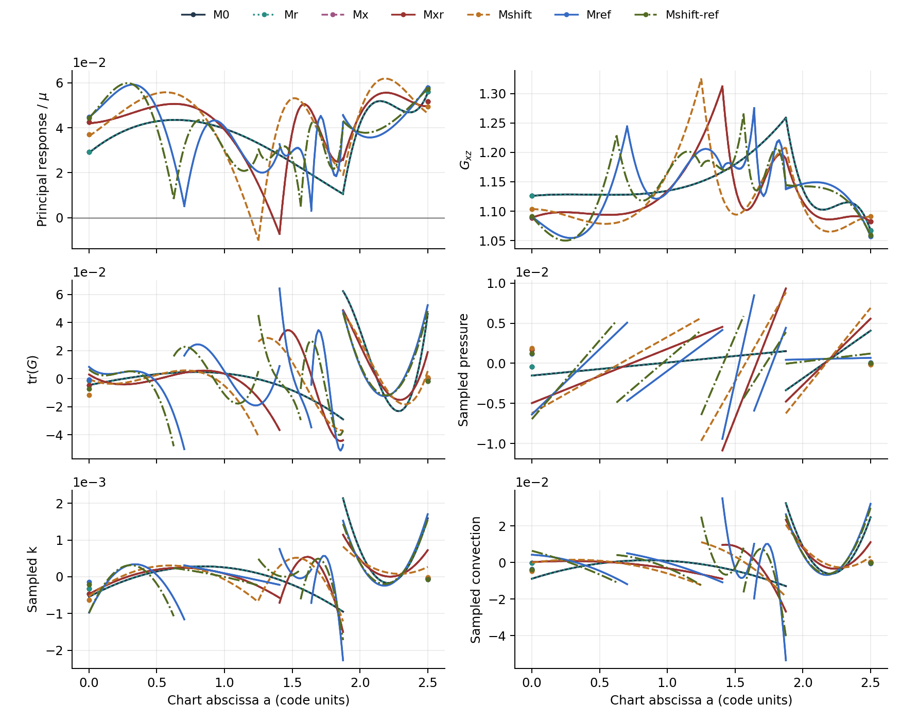

# WJ-C1R4 support-region spatial admissibility

## Decision

**D. SPATIAL_ADMISSIBILITY_UNRESOLVED.** The original steady equations at $g=.0024$ have admissible roots on the 864-cell mesh, the radial-only refinement and both progressively refined layouts. The axial-only, combined and independently shifted 970-cell roots have adverse response. The adverse region moves with the inserted axial face. The two progressively refined fields still vary substantially at the same physical points, so height continuation remains on hold. The release-receipt repair concerns admission and observation. All decision roots use the original discrete operators.

Every original solve used the same 0.096 mm physical hill, exact reference $h=0.11541061001735275$, Q3 velocity and scalars, Q2 pressure, fixed inlet and `ZeroTransverseV1` outlet, with literal $\eta=0$. Positive records from earlier campaigns retain their documented scope. The highest previously admitted height is $g=.0032$ on 864 cells. The earlier disturbed release reached $t=.06$ at $g=.003$. This campaign advanced one native release-control timestep to $t=.02$ at $g=.0024$. The full 40 mm qualification remains open.

## Controls and criteria

The immutable archived endpoints have coefficient SHA-256 prefixes `dea7da2cd965` and `7b721ce2d4f0`. Native replay reproduced both digests, including the resumed adverse root. The reference table's SHA-256 is `3eeb32e6c1f53d6045d9d03707344c65f0f1ec3964dc69116a87e04e104325e1`. The [evidence manifest](wj-h27-c1-support-spatial-admissibility-evidence.json) records full source, build, session, mesh, packet and independent receipt identities.

| Mesh | Added axial cuts relative to M0 | Added radial cut relative to M0 | Preparation |
|---|---|---|---|
| M0 | — | — | Immutable developed positive anchor |
| Mx | 1.40625 | — | Directly from M0 |
| Mr | — | .1146829575130125 | Directly from M0 |
| Mxr | 1.40625 | .1146829575130125 | Immutable converged adverse control |
| Mshift | 1.25 | .114537427012146 | Directly from M0 |
| Mref | .703125, 1.40625, 1.640625 | .1146829575130125 | M0 and Mxr separately |
| Mshift-ref | .625, 1.25, 1.5625 | .114537427012146 | From Mshift |

The shifted cuts were chosen before observing the shifted solution. The progressive trials bisect the two axial intervals neighboring each 970-cell inserted cut. The alternate Mxr-to-Mshift preparation failed the native strict-nesting guard before solving. The progressive Mref mesh supports both archived starts using existing constrained transfers and identical signed inventory.

The recorded resolution criterion requires the maximum response change on the common physical strip $a\in[0.875,2.5]$, $|r-h|\le.0015$ to fall below one quarter of the smallest retained positive margin, with smaller integration and differentiation uncertainty. A supported adverse result requires a stable common adverse region as the physical derivative fields resolve. The fixed grid and the owner limits are compared directly. Cell-relative offsets give a second check close to faces. The extended radial window records extent and leaves the comparison strip unchanged.

Original limits are $10^{-10}$ on freshly evaluated native $F_0$, $10^{-9}$ for independent momentum and continuity, $10^{-8}$ for independent $k$ and outer epsilon, and $10^{-10}$ on the projected dependent trace. Each domain check retains strict whole-cell scalar positivity, covariance over $k$ above $10^{-10}$, complete table coverage and a positive chart. Positive admission also requires principal over $\mu$ above $10^{-8}$ after angular differentiation uncertainty.

| Root | Cells | Native 16×24 max | Independent momentum / continuity / k / epsilon | Projected trace defect | Local margin after uncertainty |
|---|---:|---:|---|---:|---:|
| M0 | 864 | 9.022e-12 | 4.005e-13 / 6.812e-16 / 1.038e-11 / 1.153e-13 | 4.962e-16 | +0.003852 |
| Mx | 960 | 5.362e-11 | 6.811e-13 / 8.849e-16 / 5.388e-11 / 8.677e-14 | 4.019e-16 | -0.007197 |
| Mr | 873 | 8.999e-12 | 7.68e-14 / 6.679e-16 / 1.038e-11 / 7.834e-14 | 4.446e-16 | +0.003852 |
| Mxr | 970 | 5.364e-11 | 7.36e-13 / 8.409e-16 / 5.387e-11 / 8.544e-14 | 4.152e-16 | -0.007206 |
| Mshift | 970 | 5.905e-11 | 1.18e-12 / 8.79e-16 / 5.928e-11 / 8.581e-14 | 5.533e-16 | -0.01019 |
| Mref | 1164 | 6.2e-11 | 7.287e-13 / 8.526e-15 / 6.247e-11 / 4.282e-11 | 3.682e-16 | +0.003038 |
| Mref-alt | 1164 | 3.773e-11 | 4.496e-13 / 1.198e-15 / 3.806e-11 / 1.407e-12 | 4.075e-16 | +0.003038 |
| Mshift-ref | 1164 | 4.136e-11 | 4.11e-13 / 1.157e-15 / 4.168e-11 / 1.338e-12 | 3.747e-16 | +0.003294 |

Across the decision cases, the minimum whole-cell lower bounds for $k$ and epsilon are 0.004961 and 1.744e-05. Covariance/$k$ is at least 0.2615. The union of whole-interface $K/K_\mathrm{in}$ intervals is [0.96870230, 1.02897658]. The minimum Jacobian is 0.99954995 and the minimum outlet normal velocity is 1.196e-06. Maximum trace pointwise approximation error is 6.271e-07. The independent mass and mean-power identity defects are bounded by 2.995e-15 and 2.119e-15. Across matching owners, the largest trace and measure differences are 1.665e-16 and 2.22e-16, with a maximum weak free interface row of 1.295e-14. Raw jumps and force integrals are retained separately.

## One-sided support fields

The independent evaluator uses actual chart metrics and stores each owner at its common physical coordinates. The exact matching support is sampled from both sides when a serialized face lies within chart roundoff of $h$. The archived face differs by $2.75\times10^{-15}$ code units. The final check uses a 64-machine-epsilon coincidence test at unit chart scale and includes all four axial/radial owners at $(1.875,h)$ on the frozen meshes. The physical support radius and integration panels keep their original values.

At $a=1.40625,\ r=h$, the upper radial, positive-axial limit changed from approximately $+.02791$ on M0 to $-.007197$ on Mx. The radial-only response change was $-6.22\times10^{-7}$ and the axial–radial interaction was $-8.50\times10^{-6}$. The axial change in $G_{xz}$ was $+.14525$. The changes compared at the old point $a=1.875$ have the opposite sign. All four Mxr owners there remain positive. This is why a single favorable location cannot decide the support response.

For the force, let $A_H=|\partial_a X_H|=\sqrt{1+z_b'(a)^2}[1+(d_0+H)\kappa_b]$. At matching the curvature is $\kappa_H=\kappa_b/[1+(d_0+H)\kappa_b]$. Below support the tangential multiplier is the sum

$$
\lambda_\Pi=\frac{\partial_a\Pi_H}{A_H},\qquad
\lambda_k=-\frac{2\partial_aK}{3A_H},\qquad
\lambda_c=2u_{t,H}\left(\frac{\mathbf t\cdot\partial_a \mathbf U_H}{A_H}-\kappa_H u_{n,H}\right).
$$

The applied force is $\mathbf t\,\mathbf 1_{r<h}(\lambda_\Pi+\lambda_k+\lambda_c)$. This is the matching-arclength derivative of $\Pi_H-2K/3+u_{t,H}^2$. The projected mixed pressure column retains $G_h-C_\Pi$. The companion data store matching traces and their one-sided derivatives, physical velocities and gradients, strong divergence, local WJ root and invariants, raw and normalized responses, minimizing directions, raw stress and diffusive jumps, and wall forces.



At $(1.40625,h)$ the common Cartesian location is $(1.40655010,.20387628)$ in code units. The table uses the positive-axial and upper radial limits. The force columns represent limits from below the support irrespective of radial owner.

| Root | $G_{xz}$ | Strong divergence | $\lambda_\Pi$ | $\lambda_k$ | $\lambda_c$ |
|---|---:|---:|---:|---:|---:|
| M0 | 1.167 | -0.00491 | 0.0007572 | -8.33e-05 | -0.002903 |
| Mx | 1.312 | 0.02736 | -0.01088 | -0.0007078 | 0.009639 |
| Mr | 1.167 | -0.00491 | 0.0007572 | -8.33e-05 | -0.002903 |
| Mxr | 1.312 | 0.02737 | -0.01088 | -0.0007078 | 0.009639 |
| Mshift | 1.124 | 0.02402 | -0.005042 | 0.000286 | 0.006893 |
| Mref | 1.172 | 0.06414 | -0.009428 | 0.0007577 | 0.03518 |
| Mshift-ref | 1.17 | -0.001988 | -0.0002823 | 2.027e-05 | -0.005832 |

The final scan uses 6380 common chart locations through the downstream half, plus both face owners and cell-relative offsets. At $r=h$ the adverse sampled ranges for Mxr and Mshift are respectively $a\in[1.36513,1.41447]$ and $a\in[1.20,1.27]$. Their sampled Cartesian spans are approximately 1.97 and 2.80 mm. Strictly interior adverse points occur from $r-h=-.002$ through $+.006$ on Mxr and from $-.0025$ through $+.010$ on Mshift. These are sampled extents. Common adverse approaches on the declared strip are zero across the independent placements. The 1164-cell grids both recover positive response across that strip.

The two progressive placements differ by 0.03869 in principal/$\mu$ at common locations. The quarter-margin limit is 0.0007594, a factor of 50.9 below the observed variation. Their largest $G_{xz}$ and strong divergence differences are 0.1367 and 0.06626. This is spatial field variation, compared separately with native and independent residuals and the directional differentiation uncertainty.

### Constitutive attribution

The local substitutions use the three-dimensional deviatoric strain, original full WJ root and molecular viscosity. Near the representative support witness $\chi=1$ and the wall auxiliary viscosity has zero weight in the stress. At the Mxr negative point the Mxr gradient inserted into the M0 local state already gives a negative response. Rebuilding the scalar state with Mxr matching $K$ and the same reference-column dissipation law retains a positive response with the M0 gradient. Projecting out the planar divergence only in the local constitutive calculation retains a negative response. These independent substitutions distinguish the change in the full gradient from the scalars and the pointwise divergence.

The observed M0-to-Mxr gradient displacement at $(1.40625,h)$ is about .148 in Frobenius norm. Along the observed full-gradient direction at fixed M0 scalars, the model crosses zero after roughly 84% of this change. Allowing compatible scalar interpolation and reevaluating prescribed epsilon moves the crossing to about 78%. These distances are along the measured path. Raw derivative-spacing uncertainty is orders of magnitude below the mesh-induced differences.

The fixed-chart signed transfer with boundary and dependent-trace lifts reproduces M0 on Mx to 1.035e-12 in $G_{xz}$ across the common strip. Applying the constrained continuity projection changes that gradient by up to 0.009947 and preserves all sampled positive signs. The subsequent original solve changes it by up to 0.1437 and creates the adverse samples. The radial-only transferred and solved fields stay positive. K and the pressure trace are retained through the constraint projection, and the native dependent lift is rebuilt with the same reference-column law.

The Mref starts from M0 and Mxr use identical signed inventory. Maximum canonical differences for $[u,w,\Pi,k,\varepsilon]$ are [6.867e-10, 1.873e-10, 9.379e-11, 1.902e-10, 9.739e-12]. The common-point response difference is at most 2.048e-10 on the prescribed strip. Both preparations reach the same represented result to these measured tolerances.

## Integration and release parity

The original nonlinear split rule is 10×16 on the new solves. Every decision root was reevaluated on 16×24 with a native direct/assembled action check and integrated independently at order 28. The geometry clips the computational panels at the physical $h$, using the same matching owner and face measure on each side. Pressure and sampled $k$ have a separate native 16-point Gauss rule in both directions. The independent signed matrix actions at orders 16 and 28 agree to well below the original residual limits. The Q3/Q2 native expansion rule uses 12×12 Gauss–Lobatto–Legendre points throughout the decision mesh family.

The 18-point expansion control stopped during construction at the native matching velocity trace/gradient consistency assertion. Repeats at 14 and 10 points on M0, Mx and Mref passed without changing its threshold. These repeats hold degrees and the 16×24 split rule fixed. The maximum changes in original residual and native principal margin were 2.27e-11 and 1.83e-12. The native import rebuilds essential and dependent lifts, so these replay packets have new coefficient hashes. The failed 18-point check remains a recorded scope limit of that control.

`InitialFields::ValidateOriginalSteadyRelease` checks the support-region response, the exact reported support minimum and the named fixed owners. The Python admission check uses the same point and owner criteria. Matching source, packet, coefficient, table and scan identities are required. The six negative controls were rehashed and bound to the correct positive coefficient field. They exercised the missing support region, omitted support minimum, omitted reported witness, adverse support witness, omitted fixed owner and adverse fixed owner. All were rejected before construction of fresh physical history. The original positive proof released and completed one physical timestep.

## Reproduction and cost

Use the authoritative Linux run directory below and use a new output directory for each repeat. The scripts preserve exact inputs, convergence and error logs, the independent integrations, force and response profiles, recovery records and timing. The manifest includes their SHA-256 identities and the independently measured per-case costs.

```bash
ws=/media/jay/cb7dc460-f22f-4533-8329-245d10620f47/nektar-v2026-workspace
source "$ws/env.sh"
run="$NEKTAR_RUNS/wj-c1-support-spatial.W5us9Je8"
archive="$NEKTAR_RUNS/wj-c1-original-height.dIppuznG"
old="$archive/anchor-g0024"
suite=solvers/IncNavierStokesSolver/Tests/RANS/h27
helper="$run/owner-source/$suite"
table="$run/owner-source/docs/plans/wj-h27-linux/task2r-r1/tables-exact-inner-v1.json"
exe="$run/gate-build/IncNavierStokesSolver"
runner="$NEKTAR_RUNS/wj-c1-steady-recovery.LOp8mfob/run-capped.sh"
new=$(mktemp -d "$NEKTAR_RUNS/wj-c1r4-repeat.XXXXXXXX")
mkdir "$new/tmp"
export TMPDIR="$new/tmp" PYTHONPYCACHEPREFIX="$new/tmp/pycache"
export OMP_NUM_THREADS=1 OPENBLAS_NUM_THREADS=1 MKL_NUM_THREADS=1 NUMEXPR_NUM_THREADS=1
export BLIS_NUM_THREADS=1 VECLIB_MAXIMUM_THREADS=1
for mode in Mx Mr; do
  if [ "$mode" = Mx ]; then
    cut=(--streamwise 1.40625)
  else
    cut=(--radial .1146829575130125)
  fi
  python3 "$helper/c1_refined_witness.py" nested "$old/run.xml" "$new/$mode-mesh" "${cut[@]}"
  q="$new/$mode"
  python3 "$helper/c1_steady_case.py" "$new/$mode-mesh/run.xml" "$q" \
    --seed "$old/state.diagnostic-steady.json" --remap --eta 0 --quadrature 10 16 \
    --seconds 850 --inverse ColoredSparseV1 --maximum-inverse-age 4 --reuse-linear-iterations 12
  bash "$runner" "$q" "$archive/build/IncNavierStokesSolver" 890
  python3 "$helper/c1_steady_case.py" "$q/run.xml" "$q-rich" \
    --seed "$q/state.diagnostic-steady.json" --eta 0 --quadrature 16 24 \
    --seconds 120 --evaluate-only --check-actions
  bash "$runner" "$q-rich" "$exe" 165
  python3 "$helper/c1_oracle.py" --diagnostic --native "$q-rich/state.diagnostic-steady.json" \
    --table "$table" --order 28 --seconds 270 --out "$q-rich/equations.json"
  python3 "$helper/c1_margins.py" --diagnostic --native "$q-rich/state.diagnostic-steady.json" \
    --table "$table" --order 28 --one-sided-faces --seconds 270 --out "$q-rich/margins.json"
done
```

`shifted.sh`, `progressive.sh` and `paired-refinement.sh` pin the placement arms. `initial.sh` verifies both archived coefficient digests before importing. `audit.sh` evaluates the richer equation and margin receipts. `owners.sh` repeats the latest build, both frozen controls, the native receipt suite and the full owner-preserving comparison. For a fresh build, configure the indicated helper source with Release and `Nektar++_DIR=$NEKTAR_INSTALL/lib64/nektar++/cmake`, then build target `IncNavierStokesSolver` with eight jobs. The exact commands are in the archived scripts and executable hashes appear in the manifest.

The elapsed Linux campaign was 2,583 s inside the initial 7,200 s envelope. The overlapping native process sum was 2,676.57 s, the independent equation and response process sum was 3,416.42 s, and the profile and plotting process sum was 295.44 s. Peak solver RSS was 1,375,612 KiB. These totals include rejected setups and repeated controls and have diagnostic campaign scope. Both builds used eight workers. Each solver and audit used one rank and one library thread. Production timing remains a separate gate.

The original roots used numerical revision `485d6393ffd91f4bfeb1e4b44edd148b8e64e33d` and executable SHA-256 `94b96c153f104f6e0dd428f25b8cc876635767bcb039410213c1d5b6e2c06251`. The main richer replays used `9e5036c9df4f0620d4fbb65b883aa2dd003bf1f7`. The final owner-complete receipt build used `b8f1bba6c50a1e85a89c8c70dfcc29b0e44d4cf6`, native source fingerprint `104bcf1f3169a590d99e18d477aea4db7f2547d469fcde1340a3764c7e11da01`, and executable SHA-256 `60be1637c75f7d2a701f2082dd38b770bec0d37d52cc2296d76b804f14ebc66b`. The later evidence commits leave these tested binaries unchanged.

The next discriminating experiment is one matched axial refinement comparison of the two 1164-cell sequences at $g=.0024$. Keep the radial grids and original forcing fixed, halve the largest axial cells in the downstream support region and repeat the same fixed-strip field stability test. Upward continuation remains on hold.

## Gates

| Gate | Status | Scope |
|---|---|---|
| `FROZEN_SUPPORT_CONTROLS_REPRODUCED` | PASS | Both immutable coefficient hashes and current-source independent receipts. |
| `NATIVE_RELEASE_SUPPORT_GATE_ALIGNED` | PASS | Exact h, four fixed owners, positive release and six rehashed scientific rejection controls. |
| `COMMON_PHYSICAL_SUPPORT_COMPARISON_COMPLETE` | PASS | Fixed physical grid, both radial and axial sides, interval and cell-relative samples. |
| `AXIAL_RADIAL_EFFECTS_SEPARATED` | PASS | Solved Mx and Mr from M0 with a measured interaction. |
| `INDEPENDENT_PLACEMENT_AND_REFINEMENT_COMPLETE` | PASS | Mshift, Mref and the matched progressive Mshift-ref all audited. |
| `LOCAL_CONSTITUTIVE_ATTRIBUTION_COMPLETE` | PASS | Independent full-WJ gradient and compatible scalar substitutions. |
| `SAME_REPRESENTATION_PREPARATION_COMPARISON_COMPLETE` | PASS | Mref reproduced from two signed starts with matched audited fields. |
| `POSITIVE_ORIGINAL_ANCHOR_RESOLUTION_SUPPORTED` | OPEN | Two positive progressive placements exceed the fixed-strip variation limit. |
| `ADVERSE_ORIGINAL_BRANCH_RESOLUTION_SUPPORTED` | OPEN | The adverse region tracks axial placement and the progressive layouts recover positive margins. |
| `HEIGHT_CONTINUATION_RELEASED` | BLOCKED | Fixed-height spatial decision D. |
| `FULL_HEIGHT_ORIGINAL_PHYSICAL_PILOT_PASSED` | BLOCKED | Actual 40 mm original qualification remains pending. |
| `C1_CLOSED` | OPEN | Requires the full-height disturbed physical qualification. |
| `C2_READY` | OPEN | Depends on C1. |
| `LONG_FLAT_PRODUCTION_COST_CLOSED` | OPEN | Production gate remains 1.25 times total cost at most 86,400 wall seconds. |
| `REMOTE_PUSH_VERIFIED` | PASS | `git ls-remote origin refs/heads/codex/wj-earsm-awf` matched evidence head `92caa94c8b178459e4f04e7654d8b84eef32db50`. |
