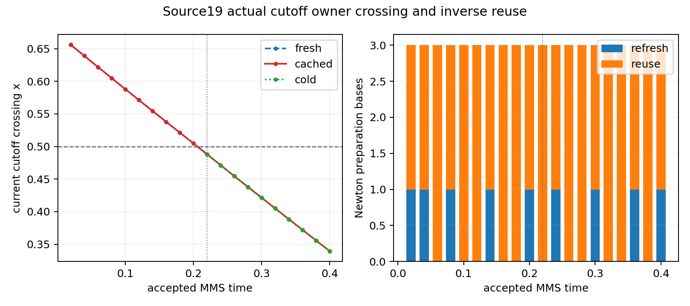

# H27 source19 moving-cutoff owner-transition checkpoint

The approved v2 solver passes the focused moving-cutoff, inverse-cache and
cold-history tests below. **TASK3_READY=NO; the full closure goal remains
open.** This extends the [source19 MMS checkpoint](wj-h27-source19-mms-checkpoint-v2.md),
whose eight-cell crossing cases advanced only to .04. The new trajectory
actually crosses a native x owner edge while inverse reuse is active.

## Pinned execution and independent checks

The source parent is remotely verified
`82d11ddeb21118293737fd67d5be265000a256b2`. No C++ change or rebuild is
needed: all 1853 current .cpp/.h/.hpp, .cmake and CMakeLists.txt files match the executed source19
capsule. Numerical source identity is
`56c35390fdf092180913f60c3ae348ca10cdcdf4e6b889c3afd589eddb511acf`;
solver ELF SHA256 is
`37307b1662d694124326568fd1137050a56955928c48f6406989a171596fc52b`;
reference-table SHA256 is
`b1bac2202d5991865a19c193528182954211f11f954fb5ca9b3f23998262250d`.
The prior loader, libraries, physical units, boundaries and v2 equations
remain bound by their existing manifests. V4 remains inactive.

The [prospective admission](wj-h27-cutoff-owner-transition-admission-v1.md)
fixes the Historical continuous MMS, eight Q3/Q2 cells, first radial face
.02944229043455091, x edge .5, body amplitude 1, native 8x12 quadrature,
dt=.02, linear/nonlinear tolerances 3e-13/3e-12, CoupledJFNKV1 and
CurrentDataDriftV1(.02,8). Fresh/cached controls advance 20 steps to .4.
A separate ten-step prefix supplies an actual binary checkpoint for ten
additional steps in a cold process. Both retained recovery files are then
imported in separate zero-step processes.

All numerical operations and timings are authoritative Linux results under
`/home/jay/build/wj-h27-coupling-r1-20261117/science/cutoff-owner-transition-v19`.
Helpers are frozen under `tools-cutoff-owner-transition-v19`. The new
[independent checker](../../solvers/IncNavierStokesSolver/Tests/RANS/h27/cutoff_owner_transition_check.py)
uses the existing signed-basis/direct-c(K) oracle, independent of native
inverse levels and native cutoff root code. Original owners remain distinct.

## Actual crossing, current equations and cache equivalence

The numerical cutoff intersection moves from x=.6560816620997554 at step 1
to .3393686967943314 at step 20. Its observed owner transition is:

| Accepted step | Time | Current intersection x | Original radial owners | Refresh / reuse |
|---|---:|---:|---|---:|
| 10 | .20 | .504795249975577 | 1 and 3, right column | 1 / 2 |
| 11 | .22 | .4880293076910518 | 0 and 2, left column | 0 / 3 |

The three step-11 Newton preparations reuse an inverse; its maximum used
age is 6. Across all 20 cached steps there are 9 refreshes and 51 reuses,
versus 60 refreshes for the fresh control. Every accepted step uses three
Newton and five Krylov iterations. Current residuals, Jv evaluations and
acceptance guards remain fresh. The drift metric remains a heuristic,
not an independently bounded operator norm.

All 20 cached/fresh frames and ten cold frames pass positive-weight and
original-cell area closure within 1e-12 relative, separate radial-owner root
checks, clock/identity/history checks and native positive guards. The
sampled K change is .005143957540781112 Kin; cutoff change is
.0003249059116068829 H, exceeding the fixed excursion requirements.

All seven coefficient/history roles agree within the unchanged 1e-8
reference-scaled MAX limit. The observed maxima are 1.281276550940104e-13
(fresh/cached, all 20 frames) and 1.2518632422911197e-13
(cold/cached, steps 11 through 20). At the transition and endpoint, the
independent checks also pass both original-owner samplings, dependent
K/Gamma/c/Ew, essential lifts and all-row explicit-history mass duals.
Pressure is not realigned. The existing complete endpoint cache comparator
passes independently.

Three separate 20x24/24x32 current MMS equation audits pass. Fine-rule
residuals retain the original physical normalization and thresholds:

| Run | Momentum | Continuity | k | Outer epsilon |
|---|---:|---:|---:|---:|
| Fresh | 3.2563119316691863e-12 | 1.8380242316481844e-17 | 1.274291556529686e-13 | 1.0422539903897286e-13 |
| Cached | 3.2563958933385e-12 | 2.4045798002034555e-17 | 1.3642453373408475e-13 | 1.2245778009847005e-13 |
| Cold | 3.2563689142664054e-12 | 1.1881915575842167e-17 | 1.404733292606178e-13 | 1.4041099289344561e-13 |

Gauge residuals are below 1.43e-18. History/trace, body-action and independent
integration gates pass. These tests supplement the earlier temporal/spatial
and tiny direct-reference results; they do not repeat those studies or
select a physical dt.

## Cold history and actual recovery rotation

Every prefix frame's four complete history hashes matches the uninterrupted
cached run through step 10. The checkpoint's prelaunch SHA, payload checksum,
layout and four histories are independently bound to that accepted frame.
The first cold step, 11, uses alpha=75 and a cold inverse event with age 0;
warm factors are not imported. It advances to .4 and meets the comparisons
above despite the owner transition in its first accepted step.

Scheduled writes occur at 3/6/9/12/15/18. Four actual rotations remove
3/6/9/12, leaving 15 and 18. The removed binaries are absent; their bytes
are not claimed as audited. Both retained files bind all four histories to
their scientific frames and reload byte-exactly, with zero steps, zero
advancement and zero inverse work. Default zero-step guard values are not
used as admissibility evidence. This is a manufactured restart foundation;
selected-production retention/statistics/storage remain unqualified.

## Costs, archive and remaining gates

| Native process | Whole operation seconds | Advancement seconds |
|---|---:|---:|
| Fresh, 20 steps | 8.723433404986281 | 6.836166187946219 |
| Cached, 20 steps with six recoveries | 8.801372010959312 | 6.597256055974867 |
| Prefix, ten steps | 5.1555867019924335 | 3.241578993969597 |
| Cold, ten additional steps | 5.244740331021603 | 3.251520861114841 |
| Retained-15 zero-step import | 1.7356726250145584 | 0 |
| Retained-18 zero-step import | 1.7565514980233274 | 0 |

Whole operations include their subsets; construction, initialization, step,
scientific output, recovery and export timers in the [CSV](wj-h27-linux/native-cutoff-owner-transition-v2k/native-timings.csv)
are not added again. Eight-cell MMS timings are not physical production
forecasts or a claim of a material speed improvement.



The [assessment](wj-h27-linux/native-cutoff-owner-transition-v2k/assessment.json)
is `PASS_CUTOFF_OWNER_CACHE_HISTORY_ONLY`. The archive is 306108 bytes,
SHA256 `0596205d0ed139b453a874cc9e5bf5fc8f7fce4011db473288fd802087ab1636`.
All 88 inventoried files were hash-verified after download and preserved.
Raw signed fields, scientific frames and binaries remain on Linux at the
exact identities in the inventory; compact reports bind those raw files.
Inputs, frozen checker, commands, logs and complete operation receipts are
retained. The post-publication receipt/account are separately captured
because publication cannot include its own completed receipt.

All 13 admitted operations pass and total 89.91056257206947 seconds,
including 5.392840253014583 seconds for publication. No failure or allowance
reset is omitted. The exact [post-publication account](wj-h27-linux/native-cutoff-owner-transition-v2k/accounting-post-publication-open.json)
is **OPEN 16975.562547255773 / 43200 seconds**, with no RESERVED operation.
The 3600-second evidence protection remains, leaving 22624.437452744227
seconds for further non-protected work. Phase maxima are 12 actual host
workers and 182808576 bytes tree RSS. Each science process uses one rank
and all six library thread limits 1. At publication, source/build/runtime
uses 3001775477 bytes, science 2725900259 bytes, and free space is
69434105856 bytes, within the declared caps. The unrelated Linux and Mac
working trees and older accounts/capsules are preserved.

A bounded reassessment uses a new output path and operation label:

```bash
R=/home/jay/build/wj-h27-coupling-r1-20261117
export OMP_NUM_THREADS=1 OPENBLAS_NUM_THREADS=1 MKL_NUM_THREADS=1
export BLIS_NUM_THREADS=1 NUMEXPR_NUM_THREADS=1 VECLIB_MAXIMUM_THREADS=1
python3 -B "$R/tools/run.py" --root "$R" \
  --label owner-transition-review --phase analysis --seconds 120 -- \
  python3 -B "$R/tools-cutoff-owner-transition-v19/h27/cutoff_owner_transition_check.py" \
  --manifest "$R/science/cutoff-owner-transition-v19/manifest.json" \
  --table "$R/science/reference-tables-v1.json" \
  --out "$R/science/cutoff-owner-transition-v19/review.json" --seconds 115
```

The physical reference still fails inner-k RMS/MAX
.13279468209091205/.44168324293315253 versus .05/.10. Physical h/p/q/dt,
four required-duration pilots, monitoring escalation, persisted statistics,
selected-production storage and complete costs remain open. The unselected
dt=.005 short-work proxy still exceeds the one-day target. The
[Task3 launch hold](wj-h27-task3-launch-hold-v2.json) keeps all global gates
unmet, launch commands null, T=505.02466521278404 and the terminal window
[447.8483832973273,505.02466521278404] unchanged. No full Task3 run was
launched. The [v4 proposal](wj-h27-historical-inner-transport-proposal-v4.md)
requires separate authorization and is not implemented by the tensor approval.
