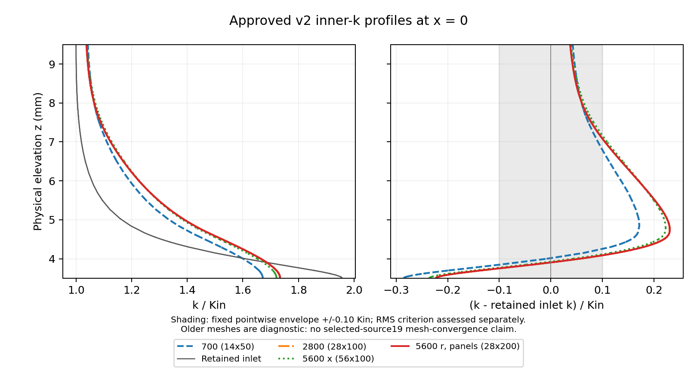

# H27 native trace and moving-cutoff integration checkpoint

This checkpoint repairs numerical evaluation of the approved v2 model.
It does not close H27-C/D. **TASK3_READY=NO; the closure goal is open.**
The proposed v4 scalar/reference changes remain inactive and require a
separate model decision. All failures and unexecuted conditional branches
remain distinguishable in the evidence.

## Model, identities and executed scope

The active model is `FiniteNuIsotropicWallFullWJCollarV2`: the approved
isotropic lower-wall normal block, AWF shear and C2 full-WJ collar. It keeps
the finite molecular viscosity, full three-dimensional deviatoric strain,
raw `-R:G` production, conservative k/outer-epsilon transport, dependent
`Ew=A(K)/max(r,c(K))`, the actual outer production/destruction and the
unchanged inlet, geometry, roughness, traction and scalar boundaries.
The inner diffusivity remains `nu+Cd*k*k/(sigmaK*Ew)`; no v4 diffusivity,
cutoff, counterfactual flux, equilibrium forcing or state clipping is used.

| Identity | Value |
|---|---|
| Mac parent | `edf8d4ce7770e47641b99b2be4a87197e60b9426` |
| Preserved reviewed ancestor | `ec0b2f1ba0de65ffabfd41001cc0e0a423ddd9db` |
| Source18 numerical identity | `1c9b1fe7027814da2b575babb055cf988833e69cf11d63cf6eda34e71a2000f4` |
| Source19 numerical identity | `56c35390fdf092180913f60c3ae348ca10cdcdf4e6b889c3afd589eddb511acf` |
| Source19 solver ELF SHA256 | `37307b1662d694124326568fd1137050a56955928c48f6406989a171596fc52b` |
| Source19 local-row probe ELF SHA256 | `33ed3d222388cec950a788f43b5f790bd51740ea93fa31e6720abee613df0c8c` |
| Frozen table SHA256 | `b1bac2202d5991865a19c193528182954211f11f954fb5ca9b3f23998262250d` |
| Compiler/flags | Linux GCC11.4, C++17, Release O3, no-fast-math, fp-contract=off |
| Build allocation | Four compiler jobs; actual host maximum15 workers |
| Science allocation | One serial rank; all six library thread limits1 |
| Refined diagnostic mesh | 28x200=5600 native rectangles, Q3 velocity/k/outer-epsilon and Q2 pressure |
| Source19 integration | Native8x12 with `CubicCutoffFacePanelsV1` |
| Refined steady tolerances | Nonlinear1e-10, linear1e-12, Krylov dimension80 |

Linux root is `/home/jay/build/wj-h27-coupling-r1-20261117` (`R` below).
`source-v18`, `source-v19`, their builds and runtimes are separate immutable
capsules. The source19 manifest binds157 exact Mac overlay files and its
complete Linux source inventory. The normal production main, Standard
Driver and registered coupled EquationSystem are compiled; the small probe
is identified separately. Loader, linked dependencies, inputs, signatures,
source manifests and all commands are bound by the evidence inventory.

## Native H trace repair

The first source15 radial refinement failed construction after14.572948s,
before any solve or physical advancement. An exact-source diagnostic found
the requested physical H mapped to eta=-.9999999999999641 on one original
owner. Its gradient discrepancy was3.258504577274837e-13, exceeding the
unchanged2e-13 check. Native lower-face evaluation gave4.996003610813208e-14.

`HorizontalTrace` uses the owned native eta=-1/+1 and endpoint-relative x
coordinate. Coupled H rules, the constructor comparison and the dependent
Gamma preconditioner derivative use this rule. Arbitrary point evaluation
and all physical states remain unchanged. Source18 checks on radial5600,
2800 and700 give maximum gradient discrepancies8.393286066166199e-14,
8.437694987151196e-14 and1.0824674490095287e-14. The old arbitrary-H rule
is retained as a failing radial negative control.

Both advancing continuous MMS families, independent current equations and
the physical12-step regression passed before source18 radial reuse. The
seven state/history sets are independently hash-checked in the assessment;
all seven are byte-exact in each source15/source18 case, including signed
zeros. This is a geometry-evaluation
foundation, not a reference or long-pilot qualification.

## Cutoff-crossing failure and repair

The source18 radial8x12 solve converged in454.015566s with4 Newton steps and
77 linear iterations. Independent20/32 k residuals1.8293736150710952e-7
and1.7572719104656823e-7 failed1e-8. Increasing only the independent
integration order did not repair the native equation.

Native16x12 converged in420.124789s. Independent32/48 k residuals
8.466472223361823e-9 and7.147672466181481e-9 passed1e-8 and the same-grid
field budgets passed. The conditional native32 branch was consequently
not triggered and was not executed. Those passing PDE residuals did not
erase a failed local integration test.

A frozen independent witness on adjacent original owners896/924 locates
the moving cutoff crossing at r=.02936741102104816,
x=-9.43122807524855. It integrates the full actual conservative k volume
row and the separate Ew load. Scales are fixed Ki*original-cell-area;
there is no time-mass or RHS normalization.

| Integration | Worst k-row error | Fixed1e-10 gate |
|---|---:|---|
| Unsplit Gauss8 | 1.000803072052391e-6 | Fail |
| Unsplit Gauss16 | 4.1105836553351866e-8 | Fail |
| Unsplit Gauss32 | 5.606408677593579e-9 | Fail |
| Unsplit Gauss48 | 3.9125444066353645e-9 | Fail |
| Independent split8 | 1.3401560969624988e-14 | Pass |
| New native split8 | 2.338380909610934e-14 | Pass |

The independent split64/128 references agree within1.75e-15. Native Ew-load
error is at most3.6537201712670845e-16. Native owner areas close at1e-12
relative tolerance, and all576 weights per witness owner are positive.
This is a finite two-owner operator witness, not an exhaustive error bound.

Source19 certifies that the frozen log-cutoff derivative is negative over
its complete K interval (bounds[-42.545745694837876,-31.70095688834545]).
It inverts that unchanged table at native radial faces, then isolates
current Q3 H-trace crossings on the cubic's monotone subintervals. Positive
x panels retain stationary and crossing events; the existing positive
radial panels follow. Every cell intersecting the certified cutoff range
is considered, including crossings missed by the old x Gauss nodes.
No signed owner is merged, averaged or constrained.

Panel data are reconstructed for every current residual and difference
action. MMS forcing uses its own exact quadratic K surface. The independent
physical oracle uses a separate cubic fit and direct c(K(x))-face SciPy
roots, sharing neither the native inverse levels nor root implementation.
Nine cubic/multiple/tangent/constant/degenerate controls and two invalid
inputs passed; maximum known-root error1.4432899320127035e-15. Twenty-one
inverse cases pass independent value/derivative checks, and an out-of-range
inverse is rejected instead of clamped.

## Coupled regressions and refined current equations

Source19 continuous Polynomial and Historical MMS audits pass. The physical
12-step700-cell run also passes its independent current BDF2/EX2, history,
boundary, quadrature and accounting checks. All seven compared coefficient
sets have zero numerical difference from source18 at the fixed1e-8 scales;
owner samples, dependent quantities, essential lifts and mass-dual history
comparisons pass. Current physical momentum/divergence/k/epsilon residuals
are1.0864190567137352e-14,6.628508553230888e-16,
1.3207476756023315e-13 and1.1784605946801764e-14.

The source19 refined steady solve takes103.729355s whole operation,
54.398172s inside its steady solver, with1 Newton/1 linear iteration and
native true norm1.915058684864861e-11. Its source18 Gauss16 seed is a
closely matched fresh initial guess, not an accepted trajectory or a
qualified reference. This timing is not a fresh-construction speedup.
Construction13.116243s, initialization17.832507s and export.181433s are
separate subsets of the complete operation. Physical time advanced is0.

| Source19 independent integration | Momentum | Continuity | k | Outer epsilon |
|---|---:|---:|---:|---:|
| 32x32 | 1.6223929502523693e-12 | 1.621771435220138e-15 | 5.816106648667614e-10 | 5.227820662208984e-13 |
| 48x48 | 1.6224603624396638e-12 | 1.6220073221246972e-15 | 5.816107594496065e-10 | 5.239730415713806e-13 |

Both current-equation, boundary and weak-accounting gates pass. The
source18 Gauss16 versus source19 panel8 same-grid field comparison passes
the unchanged numerical budgets. This qualifies a quadrature foundation;
it does not qualify mesh convergence or physical development. Independent
audit times are159.500971s/219.893475s and comparison81.329188s.

A new process cold-imports the5600-cell source19 binary, reconstructs
current/previous cutoff data and exports without advancement. All four
complete binary histories match bit for bit, including signed zeros; the
whole operation takes46.246771s with zero advanced steps and zero inverse
factorizations. This tests derived-data reconstruction, not advancing
restart accuracy or long-duration robustness. The independent reader
binds the prelaunch input SHA, checksum, source/configuration signature,
complete coefficient inventory, time and output SHA.

Native refined minima are k=.008760037703215604,
outer epsilon=1.7439456139595767e-5, covariance/k=.2793478737215498 and
principal/mu=.00423058758510759. The current full planar acceptance checks
remain active. Zero-step reload default diagnostics are not counted as a
new converged PDE or advancing admissibility observation.

The source19 physical12 run also writes recoveries at3/6/9/12 and actually
deletes3/6, retaining9/12. A further cold process imports the actual9
recovery and advances to12 in26.013503s whole operation. Independent current
momentum/continuity/k/epsilon residuals remain1.0864190567137352e-14,
6.628508553230888e-16,1.3207476756023315e-13 and1.1784605946801764e-14.
All compared history coefficients have zero numerical difference from
uninterrupted12; full owner/dependent/history comparisons pass1e-8.
The uninterrupted step10 first inverse event is an age refresh; the cold
process records a fresh cold preparation with age0. This is not an
unscheduled warm-reuse test. Retained12 cold-reloads in7.071080s with exact
four-history bytes and zero advancement/factors. Both retained binaries
independently bind their accepted scientific frames and logs. The two
already deleted binaries are not claimed to have an independent byte audit.

The real source18 physical checkpoint is rejected by source19 before
advancement at the scientific-signature check (expected nonzero exit,
3.538956s, charged). The first cold-current oracle recomputes passing current
equations, then fails at its profile report because the helper package
omitted the roughness CSV (41.510395s, charged and preserved). A new helper
namespace restores the exact frozen CSV, verifies every original helper byte,
and reruns only that report:52.226457s, pass. The independent recovery
assessment takes8.892373s. Native runs and scientific thresholds are unchanged.

## Physical reference and remaining gates

The 48-point independent physical-development result remains NOT_MET.
Every frozen region, station and original-owner interface is retained in the
raw reports and compact norm tables. Selected domain values follow:

| Field/region | RMS | Sampled MAX | Limits [RMS,MAX] | Status |
|---|---:|---:|---|---|
| domain/inner/U | 0.0053385170442 | 0.0115693727111 | [0.01, 0.02] | MET |
| domain/inner/W | 0.000157705339354 | 0.000911979195919 | [0.01, 0.02] | MET |
| domain/inner/k | 0.132794682091 | 0.441683242933 | [0.05, 0.1] | NOT_MET |
| domain/outer/k | 0.00367644926358 | 0.047358393095 | [0.05, 0.1] | MET |
| domain/outer/epsilon | 0.00921863537682 | 0.0718732248446 | [0.1, 0.2] | MET |
| ground/shear | 0.0382438369618 | 0.0578939518905 | [0.05, 0.1] | MET |

The inner-k failure remains after the trace and moving-surface integration
repairs. The x=0 diagnostic below plots original-owner profile samples;
older meshes do not establish selected-source19 mesh convergence.



The 700-cell physical fixture covers only12 steps/t=.06 at dt=.005. Whole
native operation81.383702s includes construction1.104596s,
initialization2.416611s, advancing75.248551s and final export.040619s.
Each accepted step uses4 Newton bases; Krylov counts are
9,7,8,7,7,7,7,7,7,7,7,7. Three short warm three-step block means are
6.32767639736024,5.831102799992853 and6.317736720336446s.
These are short startup observations, not representative long pilot classes.

At this unselected dt, N=101005. Applying the largest observed warm mean
only as a work-class proxy gives639126.954515371s accepted advancement and
798908.6931442139s with1.25 margin, already above86400s. Four identical
work-class proxies sum2556507.818061484s before fixed costs. These are not
qualified per-trajectory or campaign forecasts: baseline/developed,
startup and the two perturbations need distinct representative measurements;
selected h/p/q/dt, periodic monitoring/statistics, cold reconstruction and
terminal export remain unqualified. Unknown costs are not zero.
Reference preparation is H27 work; costs repeated at Task3 launch must still
be charged. Nested/subset timers and steps already included in advancement
must not be added a second time.


The previous source18 anisotropic comparisons are preserved. The2800 to
radial5600 inner-k numerical RMS/MAX are6.616926836188644e-6/
5.645798247480919e-5; U8.184005817308292e-7/4.1786178003322405e-6.
The complementary x5600 versus radial5600 k differences are
.008028243937234924/.13088145387527705 versus.001/.001; U
.000532389957791422/.004578345175975385 versus1e-4/1e-4.
Neither56x100 nor28x200 is jointly finer. Those comparisons used the
source18 Gauss8 candidate with its failed current-k equation and do not
qualify selected-source19 h/p/q accuracy or a continuum barrier.

| Closure field | Current status |
|---|---|
| H27_MODEL_AND_REFERENCE | NOT_MET |
| H27_COUPLED_NUMERICS | NOT_MET; new integration/trace foundations pass |
| H27_PHYSICAL_PILOTS_AND_ACCURACY | NOT_MET |
| H27_RESTART_MONITORING_STORAGE | NOT_MET on one selected production recipe |
| H27_COMPLETE_COST | TARGET_NOT_MET |
| TASK3_READY | NO |

The principal evolving pilots must still reach26.13350407707765, alongside
baseline, startup and both finite-perturbation checks, selected h/p/q/dt
and monitoring qualification. Earlier cold-history, retry, recovery and
persisted-statistics results remain separately source-bound; they are not
silently transferred to this new executable. A full positive Task3
forecast and production command cannot be supplied while these gates fail.

The next model decision is the documented, inactive
[v4 proposal](wj-h27-historical-inner-transport-proposal-v4.md). Tensor
approval authorizes v2 and does not authorize that scalar/reference change.
Further model work requires that decision; these numerical repairs do not
substitute for it. Historical T=505.02466521278404 and terminal window
[447.8483832973273,505.02466521278404] remain fixed. No full Task3 run was
launched. The closure goal has not been marked complete.

## Evidence and executable assessment commands

The full panel/trace archive is4,309,352bytes, SHA256
`52e0bd975941c21b8a7e3817c46489eac83fb73227a38c3ef03cb40c040939aa`;
all482 inventoried files were verified after download. The Git selection
keeps290 evidence files and excludes193 duplicate frozen source/helper
files, retained in the full archive and the Mac support directory. Its
[selection manifest](wj-h27-linux/native-cutoff-panels-v2i/local-selection-manifest.json)
records each inclusion/exclusion identity. Raw signed numerical payloads
remain Linux; compact reports retain their exact raw identities.

The retained-history addon archive is247,911bytes, SHA256
`53bf85e6fa0f732fdfe9a35c98b3a2d3d33dc299569427f2bee42ed5469479af`;
all60 inventoried files were verified and preserved. Its
[independent report](wj-h27-linux/native-cutoff-recovery-v2i2/science/cutoff-recovery-v19/independent.json)
binds the cold inputs, full comparison, current equations, rotation and
expected rejection. The [main assessment](wj-h27-linux/native-cutoff-panels-v2i/assessment.json)
contains complete iteration, timing, physical norm and conditional cost tables.

All operations are resolved. The exact post-publication account is
**OPEN15890.857028864673s /43200s**, including the closed703.678641s
predecessor, bootstrap/control charge, failed attempts, expected rejection,
both builds and all numerical/analysis/publication operations. The
[post-publication account](wj-h27-linux/native-cutoff-panels-v2i/accounting-post-publication-open.json)
has no RESERVED operation. The account remains open with the unfinished
closure goal; it is not reported as a closed positive H27 account.
The3600s evidence protection remains binding; no allowance has been reset.

At panel assessment, source/build/runtime storage is3,001,775,477bytes,
science2,667,216,047bytes and free69,542,166,528bytes. Trace/panel phase
maximum actual host workers15 and process-tree RSS6,036,103,168bytes stay
within72 and science8GiB/build16GiB caps. Every operation receipt records
its actual threads, allocation, RSS and worker maxima. All1721 current Mac
C++/header/CMake files match the executed source19 capsule. The Linux
primary remains at`f4b70baec10016dd098005bc5a5507b87e4a57bf` with only its
pre-existing developer-guide entry; unrelated Mac work is preserved.

The updated [Task3 launch-hold manifest](wj-h27-task3-launch-hold-v2.json)
binds the current source/binary/inputs, contracts, physical horizon/window,
candidate reference, four planned work classes, observables, known restart
proofs, explicit unqualified selections/costs and the reasons no production
launch command is yet valid. It supersedes the initial infeasibility hold
for current status; historical artifacts remain unchanged.

The following Linux commands replay read-only assessments into new
create-only output paths. Existing solver/case prefixes are immutable;
rerunning a native XML requires a fresh output prefix and an accounted
operation. These are diagnostic commands, not a qualified Task3 launch.

```bash
R=/home/jay/build/wj-h27-coupling-r1-20261117
T=$R/source-v19/solvers/IncNavierStokesSolver/Tests/RANS/h27
export OMP_NUM_THREADS=1 OPENBLAS_NUM_THREADS=1 MKL_NUM_THREADS=1
export BLIS_NUM_THREADS=1 NUMEXPR_NUM_THREADS=1 VECLIB_MAXIMUM_THREADS=1
python3 -B "$R/tools/run.py" --root "$R" \
  --label cutoff-panel-operator-review --phase analysis --seconds 30 -- \
  python3 -B "$T/cutoff_panel_check.py" \
  --manifest "$R/science/cutoff-panels-v19/operator-manifest.json" \
  --table "$R/science/reference-tables-v1.json" \
  --out "$R/science/cutoff-panels-v19/operator-review.json"
python3 -B "$R/tools/run.py" --root "$R" \
  --label cutoff-panel-reference-review --phase analysis --seconds 400 -- \
  python3 -B "$T/physical_oracle.py" \
  --native "$R/science/cutoff-panels-v19/reference-r2.result.json" \
  --table "$R/science/reference-tables-v1.json" --order 32 --seconds 380 \
  --out "$R/science/cutoff-panels-v19/reference-review.json"
```
