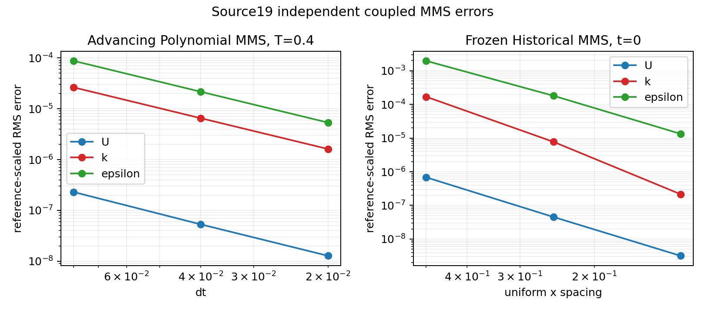

# H27 source19 coupled MMS checkpoint

This checkpoint requalifies numerical foundations on the pinned source19
solver. The approved v2 physical model is unchanged. **TASK3_READY=NO and
the full closure goal remains open.** The physical reference, selected
physical accuracy recipe, required-duration pilots, monitoring/storage and
complete production cost remain separate unresolved gates.

## Executed recipe

Parent is remotely verified`b97214df4bc93624660748cae3858d6936defde6`.
There is no new C++ build. All1721 current C++/header/CMake files match
the executed immutable source19 capsule. Numerical source identity is
`56c35390fdf092180913f60c3ae348ca10cdcdf4e6b889c3afd589eddb511acf`;
solver ELF SHA256
`37307b1662d694124326568fd1137050a56955928c48f6406989a171596fc52b`;
table SHA256
`b1bac2202d5991865a19c193528182954211f11f954fb5ca9b3f23998262250d`.
The existing exact loader/library identities remain bound by the source19
runtime manifest. Mac owns code/Git; all numerical operations and timings
below are authoritative Linux results.

The older source11 temporal sessions used the default PicardV1 path.
This study explicitly uses CoupledJFNKV1 and CurrentDataDriftV1(.02,8),
the policy of the current physical solver. Every residual, difference
action, nonlinear accepted-state guard and final principal check remains
fresh. Only inverse preconditioners may be reused. The steady study uses
its true zero-time/current-advection Newton solve; its stored JFNK/cache
identity does not turn steady iterations into physical advancement.

Generated files are under
`/home/jay/build/wj-h27-coupling-r1-20261117/science/mms-requalification-v19`;
helpers are frozen separately under`tools-mms-requalification-v19`.
All scientific tolerances, scales and expected-rate gates were frozen in
[the prospective admission](wj-h27-source19-mms-requalification-v1.md).
No v4 transport/cutoff/reference amendment is implemented.

## Coupled temporal order and subordinate controls

PolynomialScalarsV1 advances from fresh t=0 data toT=.4 with dt=.08/.04/.02
(5/10/20 real steps) on32 Q3/Q2 cells, native8x12. Finest-dt controls use
128 cells, native12x18, or tighter linear/nonlinear tolerances respectively.
Continuous forcing is analytic and verification-only. No old checkpoint or
old accepted trajectory is imported. Pressure is never aligned after the solve.

The independent20x24/24x32 study passes all endpoint, current-equation,
history/trace, RMS integration, physical owner-budget, h/q/tolerance and
weak-accounting gates. Each non-temporal U/k/epsilon control difference is
below the fixed10% fraction of the finest temporal error. The three-level
RMS order requirement remains>=1.8.

| dt pair | U order | k order | Outer epsilon order |
|---|---:|---:|---:|
| .08 -> .04 | 2.1135473919239125 | 2.014940657929903 | 2.018625733607315 |
| .04 -> .02 | 2.053164479093568 | 2.010923288984784 | 2.012666179885314 |

Pressure, gradients, sampled MAX and their locations are retained as separate
diagnostics. Orders use analytic physical RMS integrals with the original
reference scales; no time-mass normalization or fitted target is used.
The independent temporal analysis takes228.553187s. This qualifies temporal
behavior of the bounded smooth MMS, not a selected physical timestep.

## Steady spatial order and controls

Historical MMS contains a quartic radial k factor and rational outer epsilon,
giving genuine scalar approximation error. Five independent normal-main
steady solves use8/32/128 cells at t=0, alpha=0, native12x18; the128-cell
controls use16x24 and tighter algebraic tolerances. Analytic time derivatives
are removed from continuous forcing. No synthetic time history is substituted
for spatial verification.

All current residuals, essential/dependent traces, stored advection, scalar
constant-test and mechanical velocity-test weak accounts pass. Physical
two-owner jumps remain separate diagnostics. The independent20x24/24x32
fine-pair results and gates are:

| Field | Observed RMS order | Frozen minimum |
|---|---:|---:|
| U | 3.8303141412648634 | 3.5 |
| k | 5.166153389250153 | 3.5 |
| Outer epsilon | 3.7554182133518874 | 3.5 |
| grad U | 3.682804243564664 | 2.5 |
| grad k | 4.349082308720745 | 2.5 |
| grad outer epsilon | 2.7700537503547635 | 2.5 |

Pressure/gradient orders3.6420814743187044/2.9326106214843595 are diagnostic;
the analytic pressure is representable in Q2, so these are not a generic
Q2 approximation-order claim. Higher observed k rates likewise describe
this fixture. Quadrature and tolerance differences stay subordinate at the
unchanged10% thresholds and fixed1e-12 band. Independent analysis280.599472s.

## Actual moving-cutoff continuous MMS

Uniform earlier MMS meshes do not put a radial face across their cutoff
excursion. A separate eight-cell mesh fixes its first inner face at
r=.02944229043455091, computed before new fields from
c(K_exact(.5,.2)). H, boundaries, fields and physical equations are unchanged.
Polynomial and Historical cases each advance two steps of.02 to.04,
with body amplitude1, native8x12 and12x18 controls, and the current
coupled/cache policy. Exact and numerical cutoff surfaces are integrated
separately by the native solver.

The independent Python oracle now fits each original-owner cubic trace and
the analytic quadratic trace separately, isolates stationary intervals and
solves direct c(K(x))-face roots with SciPy. It does not use native inverse
levels or native root code. Positive x panels precede radial integration;
horizontal owner-flux quadrature resolves the same surfaces. Static operators
keep their original rules. Old frozen helpers and all failure outcomes remain.

All four current-step/history/trace, independent integration and nonzero
prescribed-body action gates pass. Fine independent-rule residuals are:

| Case | Momentum | Continuity | k | Outer epsilon |
|---|---:|---:|---:|---:|
| Polynomial8 | 2.485066248345635e-15 | 1.4875218772902634e-17 | 1.0327886359367788e-13 | 8.779198602715885e-14 |
| Polynomial12 | 3.785490637029905e-16 | 2.354332135053346e-17 | 9.911705147941009e-14 | 2.7040031849087787e-13 |
| Historical8 | 2.3364914365035793e-12 | 2.2226876613418923e-17 | 1.0819940018717721e-13 | 1.3531771322973137e-13 |
| Historical12 | 1.9466458893513877e-15 | 1.886367565524872e-17 | 1.0163918154232136e-13 | 1.2116322090051392e-13 |

Both native8 base cases pass the independently refreshed dense nonlinear
reference. The largest reference-scaled RMS discrepancy is pressure
2.324532552275469e-10, below1e-8; worst U/k/epsilon discrepancies are
7.378707742770561e-13,4.3960846982060775e-13 and2.616439381719005e-13.
The quadrature controls' largest coefficient differences are
4.209111937112695e-12 (Polynomial) and1.6299440974726015e-9 (Historical),
below the frozen1e-8 check.

Each case exercises two adjacent original owners with positive independent
weights and cell-area agreement within1e-12 relative. At the completed.04
endpoint, current/exact root separations are.00010670507675081264 and
.0014902607848901184 respectively, exceeding the prospective1e-10 support
check. The analytic fixed-face crossing moves from x=.6731819526212026
at t=0 to.33356110291387203 at t=.4, passing the declared.2 geometry
excursion check. That analytic witness is not a claim that these two-step
crossing cases advanced to.4 or crossed a native x owner edge in time.

The first Polynomial8 independent current equations pass (momentum
2.49e-15, continuity1.49e-17, k1.03e-13, epsilon8.78e-14), including
history/trace, integration and separate nonzero body actions. Its first
block-direct reference times out at40s after three improving iterations;
the53.386786s failed operation remains charged and preserved. A report-only
retry with direct160s/whole200s passes the unchanged residual and1e-8 field
agreement gates in74.699806s. The native case and helper code are unchanged.
Quadrature controls do not claim optional dense-reference evidence.

## Cost, resources and remaining closure

The [assessment](wj-h27-linux/native-mms-requalification-v2j/assessment.json)
contains complete errors, rates, independent controls, native iteration and
timing tables. The [CSV](wj-h27-linux/native-mms-requalification-v2j/native-timings.csv)
lists whole process, construction, initialization, advancement and export
timings separately. Those native sub-timers are subsets of whole process
cost and are not added twice. The independent analyses and timed-out attempt
are H27 verification/preparation work, not a production advancement forecast.



The full compact archive is952,272bytes, SHA256
`a133ef785bb1cc6b55b1b66414f33c773ded74bf8ecf09f8893f97e398594c6d`.
All191 inventoried files were hash-verified after download and preserved.
Large signed native state/history/field payloads remain at their exact Linux
identities; compact native reports bind the raw artifacts. Frozen helper
code, inputs, complete operation commands/receipts, both failed and successful
direct attempts and the old controller's terminal outcome are retained.

All25 phase operations are resolved and charged:994.7949558190303s,
including the failed53.386786s direct attempt and7.065665s publication.
The exact [post-publication account](wj-h27-linux/native-mms-requalification-v2j/accounting-post-publication-open.json)
is **OPEN16885.651984683704s /43200s**, with no RESERVED operation.
The3600s evidence protection remains; no allowance is reset. The open account
and unfinished goal are not reported as positive H27 closure.

At publication, source/build/runtime storage is3,001,775,477bytes,
science2,719,934,281bytes and free69,445,439,488bytes. Phase maxima are
12 actual host workers and1,400,651,776bytes process-tree RSS, within the
72-worker and8GiB science limits. All runs use one rank and all six library
thread limits1. Linux primary remains`f4b70baec10016dd098005bc5a5507b87e4a57bf`
with its existing developer-guide entry only. Older capsules/accounts and
unrelated Mac work are preserved.

For a bounded read-only reassessment on Linux, use a fresh output and label:

```bash
R=/home/jay/build/wj-h27-coupling-r1-20261117
T=$R/tools-mms-requalification-v19/h27
export OMP_NUM_THREADS=1 OPENBLAS_NUM_THREADS=1 MKL_NUM_THREADS=1
export BLIS_NUM_THREADS=1 NUMEXPR_NUM_THREADS=1 VECLIB_MAXIMUM_THREADS=1
python3 -B "$R/tools/run.py" --root "$R" \
  --label source19-crossing-review --phase analysis --seconds 60 -- \
  python3 -B "$T/mms_cutoff_crossing_check.py" \
  --manifest "$R/science/mms-requalification-v19/crossing/manifest.json" \
  --table "$R/science/reference-tables-v1.json" \
  --out "$R/science/mms-requalification-v19/crossing/review.json" --seconds 55
```

These MMS results do not change the source19 physical-reference inner-k
RMS/MAX.13279468209091205/.44168324293315253 versus.05/.10, the unresolved
physical h/p/q/dt comparisons, or the required principal pilot duration
26.13350407707765. The unselected dt=.005 short-work proxy still gives
798908.6931442139s including1.25 margin before complete fixed costs, versus
86400s. It is not a selected production forecast. Four distinct trajectory
classes and total campaign cost still require qualification.

The current [Task3 launch hold](wj-h27-task3-launch-hold-v2.json) remains in
force. T=505.02466521278404 and terminal window
[447.8483832973273,505.02466521278404] remain unchanged. No full Task3 run
was launched. The [v4 proposal](wj-h27-historical-inner-transport-proposal-v4.md)
is inactive; the tensor approval does not authorize its scalar/reference
changes. The goal has not been narrowed or marked complete.
