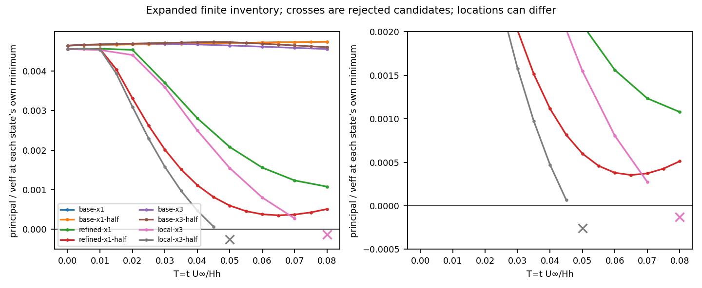
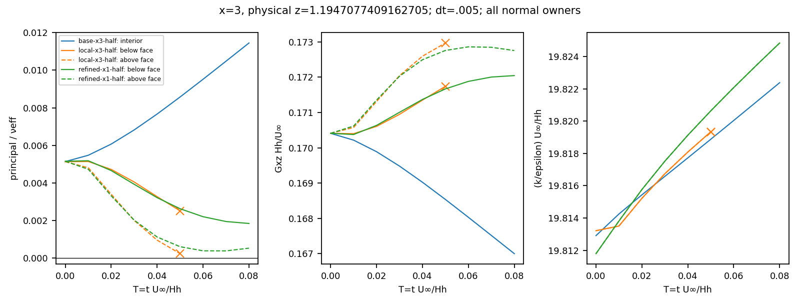

# WJ-H4: matched local admissibility remains resolution-sensitive

The four fresh core controls reach T=.08 with positive expanded sampled
principal margins and no numerical correction. The fixed two-split/Nx3
controls reject at attempted T=.08 (dt=.01) and T=.05 (dt=.005). Their
covariances and root branches remain regular. H4 therefore closes the bounded
diagnostic design with explicit unreached optional times, **not** admissibility of a developed precursor or permission
for T=.4. H2's T=8 denial and WJ-7's resource denial remain unchanged.

The reviewed/fetched baseline was
`ccf20a8949d3ef2a0c4a5f6e09142448fe9cbe82`. The Mac WJ worktree and branch
were preserved; commits were pushed normally. No native C++ input changed.

| Role | Tested source |
|---|---|
| Frozen H4 contract | `15490e72c01382fb1cc84b350e100539ac37efb5` |
| Core generator, controls and incremental owned-point audit | `a9d90236a61b5ebb064564ab05505609444da656` |
| Optional controls / completed passive-extension recovery | `bd72c246f48e7331e80371fd10173858a6523c68` |
| Final passive packet binding, comparison and publication | `4d6dca21c254bc3a92eb01a6f9d5e6000731d4c3` |
| Explicit rejected-candidate/face figures | `921fa5eb53a17d816fe47d32fe67256f24f1ec95` |
| Reused governing C++ producer | `c344dc2209f030e426e2ee5501d5e5b72a6d2c46` |
| Reused native passive observer | `e62b5f4d265f068dd5af3f090bfb0e385c3ae53e` |

Linux numerical execution used the verified NTFS volume UUID
`5AB8A669B8A642FD`, mounted at `/media/jay/新加卷1`. USB SSH was unavailable;
the documented `ssh jay@100.105.247.110` fallback was used. The isolated root is
`/media/jay/新加卷1/nektar-v2026-runs/wj-h4-20261112`. No remount, substitute
old-path data, shared installation update or unrelated campaign change occurred.
Historical paths were translated read-only, preserving report/checkpoint bytes.

All340 native compilation dependencies were rehashed on Linux and Mac. All134
files in the current sealed H2 runtime inventory were checked on Linux. The
actual H4 early-process map contains47 files, all matching that inventory;
it is explicitly not an exhaustive late-MPI map. Governing ELF SHA-256 is
`9ae37a1aba62755b10ad99c9484c498cef9d927a75fb950f00344f4ffc5d06fe`,
observer SHA-256 is
`6f35b837f0dd13eb155e0fe34f0dc670c609ee6cbe739609a5de288dd49ed06d`,
and source-built SpatialDomains is
`0c23e0de180a233bd88f70b265ae9865aeac456e6482f8ff0fa1b4be84d69dab`.
Reuse retains GNU11.4/C++17 Release, `-O3 -DNDEBUG -ffp-contract=off
-fno-fast-math`, RANS_BUILD_SOLVER=ON. No native rebuild was needed.

Original Mac, worktree and Linux specification identities agree:

```
main     1959e96ea0b61f9deb9ff9ad1f5b26488a932a8451c2de6d3b6f7b7c9dbd9124
appendix 0ab52e0d813b8fb344973f75ca6d8da97ff389ef9f93476500ca9d1df1fbc47c
```

The literal `quad`/`\quad` typography erratum and `(d+a*h)/a^2` coefficient
were retained without changing specification bytes.

The physical problem remains the H3 finite-depth rough-flat strip[0,8], ceiling20,
d0=.0875, H_w=.5, h_s=.03721697831176141, nu=.051*.005/3.97, and continuous
K_H=.012618181994557477. VerticalBalanceV1 and zero complete outlet traction
remain fixed; reference data remain at the inlet/virtual-crest approximation
x=0. There is no new inlet fit, upstream fetch or outlet model. The complete WJ
tensor/cubic-N, Original stress, DevStrainRawWorkV1, raw P=-R:G, direct epsilon and separate
Cd diffusion remain, with c1=1.8,c2=5/9,Ce1=1.44,Ce2=1.82,sigma_k=1,
sigma_epsilon=1.3,Cd=572/6561,qe=81/(2sqrt(143)),kappa=.381917863546733. Positive wall molecular nu,
uncapped P_A-E_c, current endpoint-K cutoff and A(K)/H remain. Inner epsilon
is absent. Outer high-Re molecular diffusion remains zero; wall diffusion retains
physical nu. Shared U/k, regional Q1 pressures, physical traction coupling and
outer Q3 epsilon are unchanged. Open traction fixes the pressure level; the
gauge is absent. No cap, clipping, reset, stabilization or extra solve was added.

The [contract](wj-h4-contract.md) fixes q12/NormalOrder16, IMEX1 single sweep,
eta=0, ExactStepV1, PimpleVerify=Off, StopOnBound and the3000-state guard.
Every fresh H4 configuration had its own CP0; same-mesh timestep pairs have exactly
equal initial primary coefficients, including the regional pressure values.
The two H3 zero-traction .01 trajectories were hash/signature/history/reference
verified and reused, not rerun. Their genuine callbacks remain their producers.

| Normal/Nx | dt | States | New attempts | Accepted endpoint | Expanded minimum including CP0 |
|---|---:|---:|---:|---:|---:|
| base23/1, reused H3 | .01 |1062|0|.08|.00464505891909|
| base23/1 | .005 |1062|16|.08|.00464505891909|
| refined43/1 | .01 |1966|8|.08|.00107862681207|
| refined43/1 | .005 |1966|16|.08|.000353530952242 at T=.065|
| base23/3, reused H3 | .01 |2630|0|.08|.00455785333905|
| base23/3 | .005 |2630|16|.08|.00460461031823|
| local25/3 | .01 |2878|8|.07|.000274594282632|
| local25/3 | .005 |2878|10|.045|.0000666591870728|

The optional vector was frozen before H4 evolution from the retained B/A
normal-resolution question: physical additions .8818157002137355 and
1.1947077409162703. No split was chosen after a fresh failure. The source
converts these physical heights to chart coordinates, keeps all original
knots, rejects invalid/duplicate/third splits, and preserves old defaults.
Actual [mesh vectors and sizes](wj-h4-linux/publication-v1/meshes.json) confirm
every case. This local25/Nx3 pair is not globally refined43/Nx3 convergence.

The initial2330-point union became2418 physical points after native witnesses
were added. Every relevant retained/fresh state was retrospectively evaluated
on the final union with every legitimate owner. The111 packets comprise108
accepted states/startups and3 rejected candidates, including retained A.
There was no missed negative in a native-accepted state, so the conditional
strict one-step execution path and its four-attempt check were NOT_RUN.
Retrospective scans are not native precommit gates. A rejected packet's
`prefix_qualified` describes its preceding accepted prefix; its native role
and expanded FAIL never become an accepted state.

The reconstruction uses CompositeTunnelV1's physical/chart transformation,
physical gradients, explicit x/normal sides and separate H regions. It rejects
extrapolation and retains fixed1e-6 physical neighborhoods. At H, U/k and stress
have two traces; epsilon/principal are outer-only. Inner covariance uses local
k and the endpoint-K AWF coefficients separately. Exact native weak-node
crosschecks gave maximum G discrepancy2.123e-13. The fixture includes normal
and horizontal two-owner faces, a four-owner intersection with an adverse
owner, face-versus-interior meshes, inward offsets and roundoff-consistent
integer-time matching. Common-time pairing never requires equal bounds/IDs.
When both meshes have a face it matches the same physical side; it preserves
one-to-many face/interior relations.

All seven core contrasts contain all nine actual common times .00,.01,...,.08
(63 records), with both recorded timestamps retained. H3 A's .06 above-face
comparison at x=3,z=1.1947077409162705 reproduces -.000346167290389 versus
+.000345261981536 for dt=.02/.01. Its below-face values are instead
.00201865160887/.00195968401383. A's q8/sign-only seed differs from H4's
q12/balanced seed; A-versus-B is not a one-factor contrast.

Some decisive *same-point* results illustrate the remaining sensitivity:

| Contrast/time/physical point | First margin | Second margin | Gxz first → second | k/epsilon first → second |
|---|---:|---:|---:|---:|
| refined43/1 dt .01→.005, T=.08, (3,1.19470774), above face |.00108512603404|.000522262651392|signed change +.000302422835|signed change +.000155369850|
| base23→refined43, Nx1/.005, T=.08, same above-face point |.0123739878172|.000522262651392|signed change +.006240018483|signed change +.000626867875|
| base23→local25, Nx3/.01, T=.08, (8/3,1.19470774), right/above owner |.0109306168616|-.000130224043689|.167209448677→.173068650667|19.8229032867→19.8236258019|
| base23→local25, Nx3/.005, T=.05, (1.054266709,1.19470774), above face |.00906345953497|-.000254950862019|.168278901547→.173225701813|19.8200832814→19.8205762800|

At the coarse failure's same physical intersection, the adjacent horizontal
owner's above-face margin is **+.0000617761537015**, while geometry43 is
negative. Deduplicating coordinates/choosing one owner would hide this result.
Below-face margins remain positive. At x=3 the local .005 rejected candidate
also remains positive (+.000230238352235 above face); its negative lies at a
different x. The native minima, fixed-position contrasts and their locations
are therefore kept separately. At the outlet/H corner the .005 horizontal
contrast changes the outer margin .174202923517→.109624852355 and Gxz by
+.0407699507715. That variation is not subtracted from a minimum near z=.908.

Native hard exits retain the complete candidate/history and exit code1:

| Candidate | Native minimizing point | Native principal/nu_eff | Root N | Covariance eigenvalues |
|---|---|---:|---:|---|
| local25/3 .01, T=.08 |(8/3,1.1947077409162705), geometry43|-.000130224043689|4.08966837281|.00288875413,.00690754920,.01087650269|
| local25/3 .005, T=.05 |(1.0542677094633615,1.1947077409162705), geometry42|-.000254950819627|4.08411374461|.00289133991,.00691271037,.01087861894|

The expanded inward fine witness is slightly more negative,
-.000254950862019 at x=1.0542667094633615. Full G, root residual/F_N,
production, covariance, nu_eff/nu_d and minimizing directions are retained in
[adverse witnesses](wj-h4-linux/publication-v1/adverse-witnesses.json) and the
heavy owned scans. Each state's limiting action was replayed with the compiled
shared WJ kernel. No q threshold, trace removal or positivity of covariance was
substituted for the full-gradient action. Local25/.005 times .06,.07,.08 are
NOT_RUN; no interpolation or altered target fills them.
At the coarse native witness, (Gxx,Gxz,Gzx,Gzz)=
(-4.64861257e-5,.173068650667,2.42330184e-4,8.75469882e-4),
with div U=.000828983756. Praw=.000524901563 and
Pdev=.000530614036 retain the raw-work isotropic contribution. At the fine
native witness the same components are
(-6.06813373e-7,.173225701775,2.48694317e-5,9.21519371e-4).
These full-gradient states, not a simple-shear threshold, determine the exits.





The v2 figures explicitly show rejected candidates. Original v1 publication
figures and receipts are preserved. The
[complete owner-labelled comparison index](wj-h4-linux/publication-v1/comparison-summary.json)
binds every full heavy CSV; the compact paired-declared CSV retains specified
physical locations. Neither two timesteps nor two meshes establishes an order
or a rigorous error bound.

Fixed q12 passes the decisive accepted/rejected outer-load views against24/32.
The largest12/32 component difference is2.83821e-10; the largest24/32 component
difference is4.11885e-13. All eight full native readbacks pass the unchanged
2e-9+2e-8*abs(component),4e-9+2e-8*abs(regional sum) limits. No q8 bridge,
adaptive governing rerun or tolerance relaxation occurred. The rejected
candidates' checks are passive outer-volume integration views with their actual
histories; they are not accepted checkpoints or full native weak readbacks.
Dimensional load errors are not used as principal-margin error bars.

The [weak budgets](wj-h4-linux/publication-v1/weak-budgets.json),
[interface history](wj-h4-linux/publication-v1/interface-history.csv), passive
mass-dual packets and boundary supplement retain signed storage, stress,
advection, roughness, production/destruction, diffusion and exterior reactions.
They distinguish actual PA from current-K counterfactual production/Ec, actual
from applied outlet traction, full H traction/k flux and dependent epsilon trace.
No second pressure jump or epsilon flux condition was imposed.
The common-point history uses traction T_inner*e_z-T_outer*e_z and the
gradient-flux difference D_inner*k_z,inner-nu_d*k_z,outer. The latter is the
negative of the sum of outward diffusive fluxes. Native interface rows retain
both outward-oriented fluxes and tractions explicitly. Exterior rows are each
mesh's native quadrature inventory, not an unequal-node grid comparison; the
indexed owned scans retain physical T at the common comparison points.

Spatial and stage residuals remain distinct. For refined43/1/.005 at .08,
the u,v,k,full-outer-epsilon spatial mass-dual norms are
(.0007740141,.0005052899,.04721740,.005846308), while actual completed-stage
norms are(3.06339e-5,3.08796e-5,3.13680e-5,6.42429e-6). Its weak continuity
norms are9.49e-18/7.71e-18, but the outer continuous-Q1 divergence complement
has physical L2 norm .002962615. Pressure-test moments are about3.15e-16.
These are different statements; strong/complementary divergence alone is not
evidence against the pressure pair. Startup has no completed-stage residual.
There is no stationarity or exact finite-space equilibrium claim.

Focused Linux validation inventoried76 registrations and executed **2/2 CTests**:
WJH4PhysicalOwners and WJH3PassiveAlgebra (1.52s total). The final source's
direct unittest run passed **12/12** tests, including immutable passive recovery,
the known adverse action and the exact reference tangent certificate. These
counts overlap;76 registered tests were not all executed. No unrelated EP,
historical campaign, new native build or governing transaction was run.
The final metadata-guard fixture at
`ef230a9e37ba768b5e1efd93127762efd284cfa6` also rejects fractional/boolean
steps and NaN/infinite timestamps. It passes12/12 tests and validates117 time
packets from16 genuine producers under the same rule. All scientific inputs
already satisfy the guard; no comparison arithmetic or trajectory was rerun.
Its11.144s receipt is charged within the existing closure reserve.

Reproducible commands/working directories, native exits, hashes and timings are
in the exact [command receipts](wj-h4-linux/commands/) and
[native calls](wj-h4-linux/native-command-exits.json). The operative commands were:

```bash
source /home/jay/.local/opt/nektar-v2026-mpi/env.sh
R=/media/jay/新加卷1/nektar-v2026-runs/wj-h4-20261112
export OMP_NUM_THREADS=1 OPENBLAS_NUM_THREADS=1 MKL_NUM_THREADS=1
export BLIS_NUM_THREADS=1 NUMEXPR_NUM_THREADS=1 VECLIB_MAXIMUM_THREADS=1
export LD_LIBRARY_PATH=/media/jay/新加卷1/nektar-v2026-runs/wj-h1-20261111/build-v1/geometry-lib
# Frozen core source at a9d9023; optional source at bd72c24:
# Run in the corresponding source/solvers/IncNavierStokesSolver/Tests/RANS.
python3 -B wj_h4_study.py --root "$R" --mode prepare --case CASE
python3 -B wj_h4_study.py --root "$R" --mode evolve --case CASE
# Each call is reserved/monitored by run_wj_h4.execute; do not overwrite labels.
ctest --test-dir "$R/focused-config" -R '^(WJH4PhysicalOwners|WJH3PassiveAlgebra)$' --output-on-failure -j 1
python3 -B -m unittest test_wj_h4_points test_wj_h3_analysis
# Versioned observer-source-v3 at 4d6dca2, all passive:
python3 -B wj_h4_results.py --root "$R" --mode resume_observe
python3 -B wj_h4_results.py --root "$R" --mode compare
python3 -B publish_wj_h4.py --root "$R"
```

The new journal closes at **74 actual attempts =72 accepted+2 rejected**,
**74 U/pressure/k/epsilon/bound calls each**, zero material correction, and exact
raw/corrected k bytes. It conservatively retains80 scientific units and zero
conditional execution-check units. Native governing invocations consumed
449.452502s. All command time is2496.280892s, plus120s setup and the full300s
closure reserve: **2916.280892/3600s**. Largest recorded process tree is
2,545,541,120 bytes; the root before compact transport is8,659,150,482 bytes,
below8GiB per process and16GiB total. One rank/six numerical thread controls1
were used; admission snapshots reached25 workers including other campaigns,
with ongoing72-worker guards.

Two passive invocation limits were retained: optional startup's extension pass
hit100s after native CP0 completion; the first weak-readback batch hit240s.
Recovery verified completed input/row bindings and ran only missing passive
work. No native startup/governing trajectory was repeated. The first base CP0
metadata bootstrap failure and a selected-state fixture failure were also fixed
without governing retries. One complete passive packet's process exit was not
persisted before its parent timeout: its result/input/callback bytes are verified
and its exit remains **NOT_RECORDED**, not invented as0. Original receipts,
partial outputs and superseded source/observer lineages remain.

The [transport receipt](wj-h4-linux/transport-v1.json) binds the2,391,149-byte
compact archive (SHA256
`167e81cb2da6e94fbee1783f236509d835cac86e84d0c11987ad12ef98787cc9`).
Mac independently rehashed162 compact files, decoded tar/gzip identities,
340 native source inputs and original/worktree specifications. Linux separately
rehash-verified heavy identities and all111 state/callback bindings. Heavy
fields/checkpoints were not downloaded or independently rehashed on Mac.
Scoped Git attributes retain exact evidence bytes, including standard CSV
CRLF and original log whitespace; source checks are unaffected.
The boundary supplement is a later versioned extraction of existing native rows
within the charged closure reserve; it does not alter the closed ledger or
original publication. See [Mac verification](wj-h4-linux/mac-verification.json)
and [phase statuses](wj-h4-linux/phase-status.json).
The [boundary extraction](wj-h4-linux/boundary-supplement-v1/manifest.json)
adds7,872 native exterior rows and both H traction/flux traces, preserving
explicit element/region ownership. It took43.021s and1,189,883,904 peak bytes
within the already charged closure reserve. Its source is
`3228c876dcb90ef81a82f6cf8b8248bcd3d49a83`. Its separate transport bridge binds
the unchanged original publication and closed-ledger hashes; it adds no step,
solve, reconstruction or modified numerical result.

The next item is a separately bounded **combined normal/horizontal capacity and
operator diagnosis**, before more duration. Core positive signs are not robust
under the selected local normal refinement; the failure's full-gradient sign is
resolved for each represented state, while its continuum interpretation remains
unresolved. Full43/Nx2 already needs3418 states, outside this route; full43/Nx3
is estimated to require4870 states from the tensor inventory and would require
a separately qualified capacity/operator design, not an H4 guard override.
Benchmark that route, preserve the pressure operator, and compare the same
limiting owners at the existing short horizon before considering more duration.
Do not infer an
unstable pressure pair, change the constitutive model, or launch T=.4 from these
data. Developed rough-flat calibration with a true declared upstream fetch and
adequate outlet buffer must precede physical curved-boundary/hill validation.
