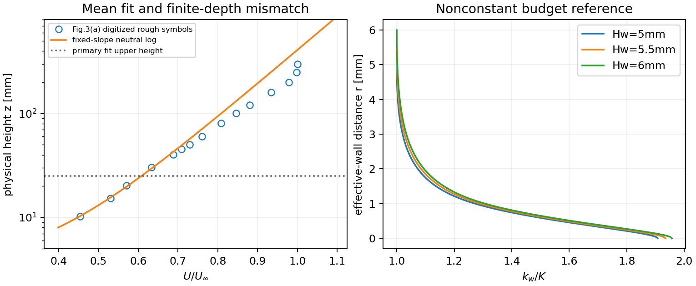
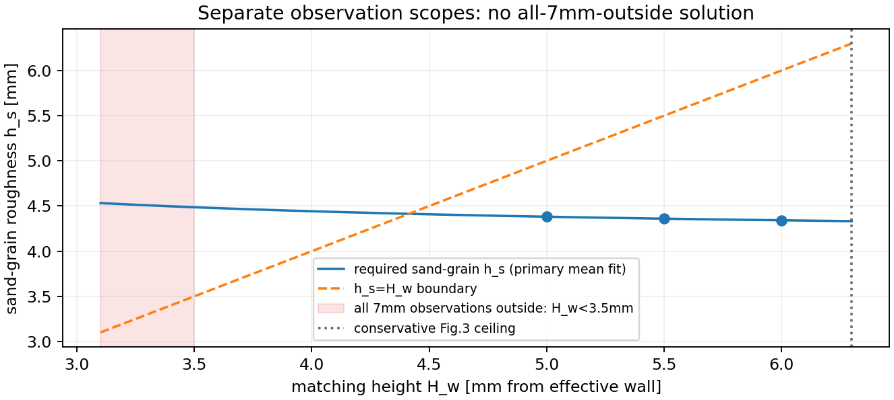
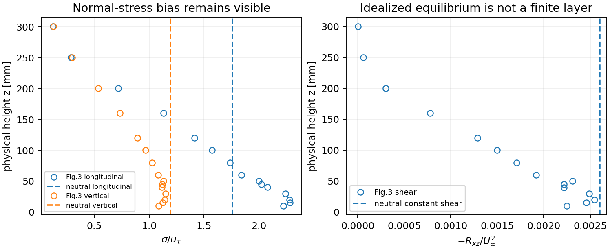

# WJ-H5: neutral inlet, mean intercept and matching-height feasibility

The new **WJNeutralBudgetReferenceV1** family and its calibration/reference
checks are implemented. All three continuum references pass. Three fresh
zero-step native initializations were executed; the 5 mm state passes, while
5.5/6mm are **OBSTRUCTED at startup by principal-negative projected states**.
No governing timestep, continuation, extra CP0, capacity change or model
amendment was executed. No final physical hill matching height is selected.

| H_w mm | physical z_H mm | fitted h_s mm | r_c mm | continuum | native startup / final passive |
|---:|---:|---:|---:|---|---|
|5|8.5|4.3814671786|1.0479269123|PASS|PASS / PASS|
|5.5|9|4.3597589674|1.0527466066|PASS|OBSTRUCTED / OBSTRUCTED|
|6|9.5|4.3418014170|1.0567959324|PASS|OBSTRUCTED / OBSTRUCTED|

5.5mm remains the organizational center, not an accepted physical default.
The 5 mm startup result is not a reason to discard the other cases or select a
whole-experiment height. [Component gates](wj-h5-linux/component-gates.json),
[calibration](wj-h5-linux/calibration.json), [candidate CSV](wj-h5-linux/candidates.csv)
and [native results](wj-h5-linux/initializations.json) retain the separate scopes.
H2-H4 results, failed states, ledgers and denials are unchanged and paused.

## Mean fit and observation envelope

The located original PDF is `docs/literature/Experimental study on roughness effects on turbulent boundary layer flow over a two-dimensional steep hill.pdf`,
497768bytes, SHA256
`adffb5c1d740be791211d82ce35778a37a3315a6dc72c56c80b70cc6642a43df`.
Pages6-7 and13-15 were read and rendered. The frozen sixty-symbol CSV and
digitization calibration are reused without redigitization. Panel3(a) uses
physical z(mm),3(b) z/delta,3(c,d) (z-d0)/delta. The panel(b) lower border is
not its zero. Fig.12 on p.15 retains physical z=7mm; p.13 identifies it as
7mm above the floor,2mm above5mm cubes. No Fig.12 rms values were invented.

With fixed u_tau=.051,d0=3.5mm,kappa=.381917863546733, the primary equal-weight
fit of log(z0_e)=mean(log(z-d0)-kappa*U/u_tau), using consistent lengths, is:

| frozen mean window | points | z0_e mm | RMS / U_infinity |
|---|---:|---:|---:|
|physical z<=25mm|3|.227050812848672|.00269823112168|
|same window, omit lowest|2|.227634333852433|.00325088391071|
|physical z<=50mm|6|.222011138387510|.00582957454892|

The50.2788mm center is excluded from the last window. The primary residuals
at 10.243007,15.314562,20.236270mm are respectively
-.000685498,-.002908135,+.003593633. Every H uses the same primary intercept.
Height-reading effects alone give z0_e in[.2193113,.2347519]mm; value-reading
effects give[.2248613,.2292617]mm; joint bounded reading effects give
[.2171964,.2370378]mm. Membership stays fixed. These are reading bounds, not
experimental confidence intervals. Uncertainty in d0,delta and rounded u_tau
is not quantified. [All fit residuals](wj-h5-linux/fit-residuals.csv) are retained.

| Fig.3 quantity | lowest physical z mm | height reading resolution mm |
|---|---:|---:|
|mean|10.2430071555|.3484806245|
|shear|10.0889788525|.2902746385|
|longitudinal rms|10.1539229009|.3225362531|
|vertical rms|10.2222203003|.3243271293|

Thus the conservative Fig.3 stress ceiling is **H_w<6.298704214014mm**,
replacing the old approximate16mm minimum. The primary roughness inverse
requires **H_w>4.413515541720mm** for h_s<H_w. The Fig.3-only strict interval
is(4.41351554,6.29870421)mm. The reported-z0=.2mm comparison branch has
threshold3.809089306439mm and h_s=3.749573292,3.732527282,3.718409663mm at
the three candidates. It is not substituted for the fitted branch.

Fig.12 requires **H_w<3.5mm** if every 7 mm stress target must be outside the
AWF. Both calibration branches have an **EMPTY** intersection with that
requirement. At H_w=3.5mm the primary required h_s is4.486214436879mm.
The [183-row region table](wj-h5-linux/observations.csv) keeps all Fig.3
samples outside the three AWFs and the 7 mm target inside each one, with the
appropriate inner-stress prediction role. No observation is excluded to
manufacture a whole-experiment interval.

## Exact outer and finite-nu wall reference

Definitions are Ne=81/20,qe=81/(2sqrt(143)),Cd=572/6561 and
kappa=sqrt(1.30*(1.82-1.44)*sqrt(Cd)). K=qe*u_tau^2=.008809015145515192;
A=u_tau^3/kappa. The physical viscosity remains
nu=.051*.005/3.97=6.423173803526447e-5, from the **reported** .2mm/3.97,
not the fitted intercept. Outer U=(u_tau/kappa)log(r/z0_e),k=K,epsilon=A/r
and nu_eff=nu_d=kappa*u_tau*r. No measured-rms k or Blackadar tail is used.

The full3D covariance has diagonal/u_tau^2
(3.094095437,2.257853427,1.421611417), Rxz/u_tau^2=-1. Its rms ratios
approximately1.759/1.192 retain their discrepancy from reported2.15/1.13 and
the individual digitized symbols. [Stress discrepancy](wj-h5-linux/neutral-stress-discrepancy.csv)
also shows that constant neutral shear/K do not reproduce finite-layer decay.
The literal log predicts U/U_infinity=.933413 at physical 250 mm and1.090033
at 800 mm. This is an **idealized full-height equilibrium control**, not an
experimentally calibrated finite-depth inlet.

The inverse uses d_nu=a*H*z0_e/(H-z0_e),zv=(nu-d_nu)/a with a=kappa*u_tau,
then the unchanged sand-grain relation. Independent split quadrature/root
integration checks J0,J2,U_H,production budget,r_c,Q and nonconstant k_w.
The compiled WJ/Budget kernel factory is compared with those independent
values. Maximum cutoff discrepancy is2.43e-17 in H_h units, k-profile
discrepancy3.47e-17, six inner weak-moment defects3.14e-19 and admissible outer
epsilon weak-moment defects3.18e-22. J2's absolute roundoff difference up to
1.17e-10 is relative machine precision on that dimensional integral.

| H_w mm | Lambda | d_nu/nu | k_w(0)/K | min inner eigenvalue/u_tau^2 | H_w+ | nu/(kappa*u_tau*H_w) |
|---:|---:|---:|---:|---:|---:|---:|
|5|2.5626240691|1.803170268|1.907080936|1.283036940|99.25|2.638150%|
|5.5|2.6533455276|1.795405898|1.933718675|1.280846537|109.175|2.398318%|
|6|2.7365178440|1.788986486|1.956862238|1.279006075|119.1|2.198458%|

The appendix's d_nu>=2nu sufficient proposition does **not** apply. The
verified extension uses unimodal P_ref, P_ref(0)>A/r_c, a peak before r_c,
positive tail defect and zero total budget. There is one defect sign change,
Q<0 inside and hence k_w>K; all profile samples and independent integrals agree.
Since k_w decreases and the turbulent shear fraction increases, the inner
minimum covariance eigenvalue occurs at H. These are stationary-reference
properties. The3% outer-molecular-ratio engineering screen gives lower
height4.396916943mm;2% requires6.595375415mm, above the Fig.3 ceiling.
Neither screen proves log-layer or roughness-sublayer validity. The physical
planes are only1.7,1.8,1.9 cube heights; normal displacement/homogenization
remains assumed.

Continuum matching checks common U/K,total D_A*U'_w=u_tau^2,zero k flux,
epsilon_H=E_c(H)=A/H and pi_w-pi_o=-K/Ne. The gradient ratio is
1-z0_e/H=.954590,.958718,.962158. Molecular traction is retained; turbulent
shear alone does not match. Mechanical inner pressure pi_w-2k_w/3 varies.
Complete outlet traction is(+K/Ne,0,u_tau^2) inner and(-K/Ne,0,u_tau^2)
outer. The top prescribes shear u_tau^2 and outward epsilon flux
u_tau^4/[1.3*(top-d0)]; its normal traction is the impermeability reaction.
No independent H epsilon flux, pressure Dirichlet or extra gauge is imposed.





## Native CP0 representation and passive correction

All three production Functions/CompositeTunnelV1 inputs use q12/normal16,
Q3 differential fields/Q1 regional pressures,one horizontal cell[0,8] and
**1174 states**. Low-H inner knots are filtered strictly below H and contain
the cutoff/roughness breakpoints; outer physical heights use the composite
inverse. No mesh search is performed. Fresh initialization calls Project/Lift
once; the strict5mm reader calls neither and reports zero governing solves.
Completed-stage data are inapplicable at CP0. All three have zero callbacks
and no PIMPLE attempts, mass-bound calls or correction activity.

| H_w mm | native minimum m/nu_eff | witness physical x,z mm | projected Gxz | exact Gxz at same point |
|---:|---:|---|---:|---:|
|5|+.000124559340|320,15.314561844|.457389112|.452108399|
|5.5|-.000605338612|320,10.243007155|.803105597|.792148446|
|6|-.003697911858|320,10.243007155|.810856525|.792148446|

G uses U_infinity/H_h. The exact reference in-plane value at all these points
is+.004137527847. Independent coefficient/owner reconstruction, common-action
compiled replay and the local angular calculation agree with the native
witnesses to a few1e-15. Both normal owners and inward neighborhoods are
retained in heavy physical-row tables. Covariance,scalar,cutoff,root and raw-work
conditions pass in both rejected candidates; their sole native failed condition
is principal_in_plane. They have **no accepted checkpoint**. A strict native
checkpoint weak readback is therefore NOT_RUN for them, rather than fabricated.

All three represented outer q12 loads pass the unchanged24/32 check; the
largest component/order difference is7.11e-15. The 5 mm full weak packet initially
showed an exterior discrepancy1.44292e-8: the old passive oracle used an
unprojected analytic interface hat. H/2 is not a low-H mesh face. Reconstructing
the exported native Q3 test traces per face/field fixes that comparison:
exterior error1.65e-14 and regional error1.46e-13, under the original
2e-9+2e-8*abs(component),4e-9+2e-8*abs(regional sum) limits.
The original unresolved result is retained and a separately hashed weak-v2
bridge supplies the corrected classification. No native byte or operator changed.

At the 5 mm interface x=0,4,8,shared U/k agree exactly and epsilon_H agrees
with the **actual endpoint K** target within9e-19. K varies from
.008809015146 to.008808993748 after projection/lifting; the cutoff responds
accordingly. Maximum sampled traction-component jump is2.92e-6 and k-flux
jump1.43e-7. Constant reduced-pressure jump remains-.002175065468028443.
These are measured projection defects, not strong interface corrections.
The 5 mm spatial mass-dual packet (u,v,k,entire outer epsilon,inner/outer
continuity,absent gauge,constraints) is
(7.73711e-4,1.79069e-5,5.10041e-3,5.12203e-4,2.03146e-6,4.59175e-7,0,0).
No nonpolynomial finite-space residual is required or forced to vanish.
Generic solver-console errors against its default zero ExactSolution are not
used as reference-error measurements.

## Reproduction, identities and cost

Fetched baseline `e2fd85f0ef5d7587db7985ffc6670ae80df9992e`. Generator/reference
source `ebc63a6a` (full identity in manifest); passive source `5e19336`, corrected
weak/test source `6499527`, publisher `3c4537f`. **No governing C++ changed**:
340 compilation inputs and133 qualified ELF identities were verified. Governing
producer is `c344dc2209f030e426e2ee5501d5e5b72a6d2c46`; native observer producer
`e62b5f4d265f068dd5af3f090bfb0e385c3ae53e`. Actual process mappings confirm
source-built SpatialDomains hash
`0c23e0de180a233bd88f70b265ae9865aeac456e6482f8ff0fa1b4be84d69dab`.
Solver SHA256 is `9ae37a1aba62755b10ad99c9484c498cef9d927a75fb950f00344f4ffc5d06fe`.
[Runtime identities](wj-h5-linux/runtime.json) bind the observer/kernel ELFs too.

Volume UUID5AB8A669B8A642FD was verified at `/media/jay/新加卷1`.
Heavy root R=`/media/jay/新加卷1/nektar-v2026-runs/wj-h5-equilibrium-inlet-20261112`.
Governing ELF S=`$R/../wj-h2-20261111/runtime-v4/IncNavierStokesSolver`;
native observer O=`$R/../wj-h2-20261111/observer-v6/RANSWallResolutionProbe`.
Use the qualified env.sh and source-built `wj-h1-20261111/build-v1/geometry-lib`
first in LD_LIBRARY_PATH. One serial rank,OMP/OpenBLAS/MKL/BLIS/NumExpr/VECLIB
threads1; current worker checks remained below72. Reused GNU11.4/C++17 Release
policy is -O3 -DNDEBUG -ffp-contract=off -fno-fast-math,RANS_BUILD_SOLVER=ON.

```bash
cmake -S "$R/observer-6499527/solvers/IncNavierStokesSolver/Tests/RANS" \
  -B "$R/focused-config-final" -DRANS_BUILD_SOLVER=ON -DCMAKE_BUILD_TYPE=Release \
  '-DCMAKE_CXX_FLAGS=-ffp-contract=off -fno-fast-math' \
  '-DNektar++_DIR=/home/jay/.local/opt/nektar-v2026-mpi/lib64/nektar++/cmake'
ctest --test-dir "$R/focused-config-final" -N -R '^WJH5NeutralInlet$'
ctest --test-dir "$R/focused-config-final" -R '^WJH5NeutralInlet$' --output-on-failure -j 1
# Actual solver invocations, all NumSteps=0:
"$S" "$R/cases/H5mm/case.xml"
"$S" "$R/cases/H5.5mm/case.xml"
"$S" "$R/cases/H6mm/case.xml"
```

One selected and registered CTest executed and passed in 2.60 s; it contains 9 focused
methods, including the manufactured projected-boundary trace fixture. The first
degree12 expression fixture failed5.51e-11>2e-11, then degree16 for the new family
passed; old degree12 defaults are retained. Two CMake discovery failures before
using the known Nektar++_DIR are also kept. They consumed no CP0s. Native CP0
launches total19.0202s; the 5 mm native/passive view23.7464s; no native rebuild.
The final journal has87.0827s measured operations,40s setup allowance and the
full180s closure reserve conservatively charged: **307.0827/1200s**. Peak RSS
756412416bytes; root 1,140,833,806bytes including source copies and transport,
within both8GiB limits. All failures remain charged. [Closure](wj-h5-linux/closure/receipt.json)
and [commands/exits/times](wj-h5-linux/command-receipts.json) provide exact argv.

Original/worktree main and appendix SHA256 both match:
`1959e96ea0b61f9deb9ff9ad1f5b26488a932a8451c2de6d3b6f7b7c9dbd9124`,
`0ab52e0d813b8fb344973f75ca6d8da97ff389ef9f93476500ca9d1df1fbc47c`.
The literal quad versus \quad erratum and correct(d+a*h)/a^2 coefficient are
retained; no specification bytes changed.

The compact357962byte transport hash is
`45547ae7391530850a39e0134b89df0e8af7aa9448e8346f888e72e9e49c6216`.
Its44 decoded publication files were independently verified on Mac;20 heavy
identities were verified remotely and are explicitly not claimed as locally read.
[Manifest](wj-h5-linux/manifest.json),[seal](wj-h5-linux/seal.json) and
[local verification](wj-h5-linux/local-verification.json) retain those roles.

## Next decision

Decide the measurement scope explicitly: the 7 mm target cannot be outside this
AWF under either intercept branch. Using the existing inner auxiliary stress
there, or changing that stress model/origin, is a later named modeling choice.
Then declare a finite-depth completion of the neutral lower branch and assess
its stress/principal behavior separately. New-reference projection/initialization
needs qualification before governing validation, since two exact-continuum
candidates already leave the principal domain after projection. No longer run,
old-H4 capacity investigation,EP or physical hill run is authorized or performed
by this package. The evidence does not establish global stability/realizability,
stationarity or a validated rough-hill inlet.
