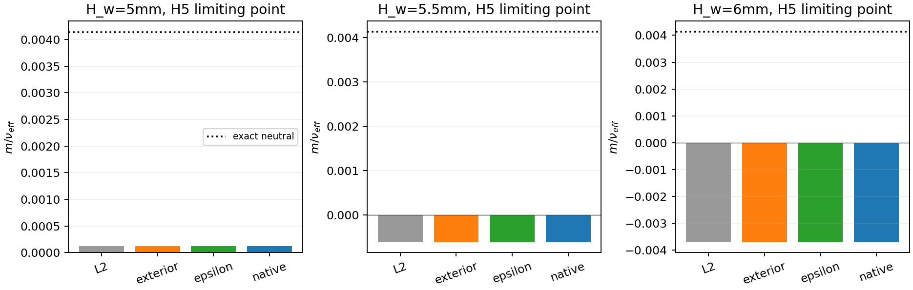
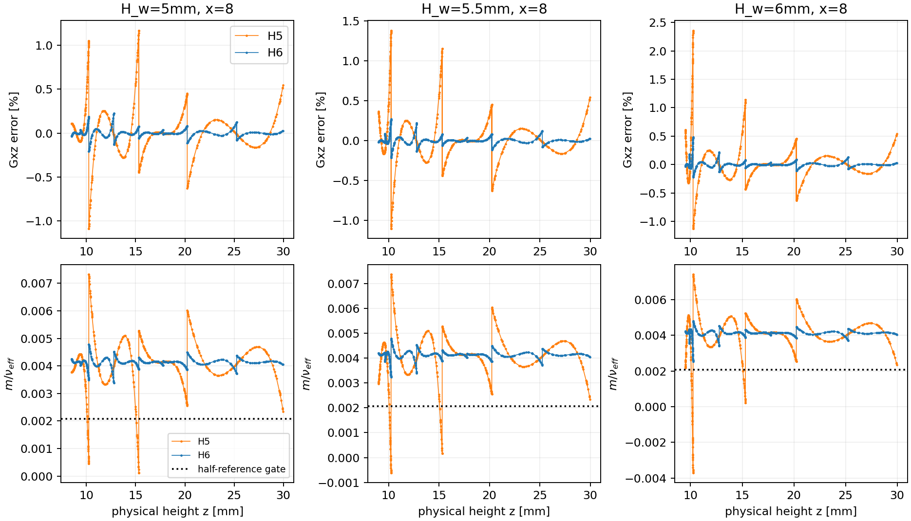

# WJ-H6: neutral-reference projection recovery

H6 is **PASS for the prescribed startup study**. Exactly three fresh native
zero-step initializations were executed. All three unchanged reference heights
pass the original native physical audit, the separate half-reference principal
margin requirement, error reduction, and passive weak/interface checks after
one bisection of every normal cell. There were no governing timesteps, solves,
implicit callbacks, completed-stage packets, bound calls, corrections or retries.
This establishes representation recovery on the declared finite inventory. It
does not establish exact discrete equilibrium, a convergence order, temporal
stability, global ellipticity/realizability, or experimental validation.

The fetched starting commit was the reviewed
`34937bb2ed8730bd836ff63f13e278d3e3facada`; origin agreed and there were no
intervening commits. The contract was committed before numerical execution in
`cf49b64`. Final scientific generator/reconstruction/observer orchestration is
`14bf43745b2051be8f4128a12f30ea1afabe1e39`. Publisher source is
`22654e3d0b81c484d49d460795077eb8415e785b`; the size-only compact-publication
bridge is `10881595031eecda3ec7723c2ca51f9ccf6ee7a8`. The subsequent evidence
commit changes no scientific input or native code. All commits are normal
descendants on `codex/wj-earsm-awf`, pushed without rewriting history.

The isolated Linux root is
`/media/jay/新加卷1/nektar-v2026-runs/wj-h6-neutral-projection-20261112`.
UUID `5AB8A669B8A642FD` was verified at that mount. Original H5 inputs,
reports, accepted checkpoint and two rejected candidates were imported read-only;
their bytes remain unchanged. In particular, the rejected H5 states were read
from their genuine report/event coefficients, never passed to the strict
checkpoint reader or treated as accepted checkpoints. H2–H4, old Blackadar/20mm,
capacity/backend, EP, long continuations and physical hill work remain paused.

The original Mac and worktree specification bytes agree. The main note is
138078 bytes, SHA-256
`1959e96ea0b61f9deb9ff9ad1f5b26488a932a8451c2de6d3b6f7b7c9dbd9124`;
the appendix is 53271 bytes, SHA-256
`0ab52e0d813b8fb344973f75ca6d8da97ff389ef9f93476500ca9d1df1fbc47c`.
The literal `quad` versus `\quad` typography erratum in `eq:integrals-linear`
and the intended `(d+a*h)/a^2` coefficient are retained without altering either
specification.

`WJNeutralBudgetReferenceV1` and every H5 physical Function are unchanged,
including their binary64 calibration values. The definitions remain
`Ne=81/20`, `qe=81/(2*sqrt(143))`, `Cd=572/6561`, and
`kappa=sqrt(1.30*(1.82-1.44)*sqrt(Cd))`. With `u_tau=.051`,
`nu=.051*.005/3.97`, `d0=.0875`, `delta=6.25`, `top=20`, and `H_h=40mm`,
`K=.008809015145515192`. The fitted intercept is .227050812848672mm,
dimensionless .0056762703212168. Full 3D WJ stress, DevStrainRawWorkV1,
raw stress work and independent Cd scalar diffusion are preserved. Positive
molecular viscosity remains in the finite-nu wall; outer molecular diffusion
remains zero. The wall has transported nonconstant reference k, current-K
counterfactual cutoff, dependent `A(K)/H` epsilon, and compatible complete
regional outlet/top tractions and scalar flux. No physical guard was weakened.

| H_w (mm) | Physical z_H (mm) | h_s (mm) | H5 cells/state size | H6 cells/state size |
|---:|---:|---:|---:|---:|
| 5 | 8.5 | 4.381467178582103 | 8 inner + 17 outer / 1174 | 16 + 34 / 2328 |
| 5.5 | 9 | 4.359758967365407 | 8 + 17 / 1174 | 16 + 34 / 2328 |
| 6 | 9.5 | 4.341801417014184 | 8 + 17 / 1174 | 16 + 34 / 2328 |

Counts were checked before launch and confirmed in each native report, using
`N=38*Ni+50*No+20`. All old endpoints, the unique H interface, cutoff/roughness
breakpoints and observation faces remain. Regional chart and physical midpoints
agree. Nx=1 on [0,8], Q3 differential fields/Q1 regional pressures, q12/normal16,
Functions/Physical, CompositeTunnelV1, OpenTunnelV1, ReferenceTractionV1,
IMEX1 single sweep, eta=0, PimpleVerify=Off and StopOnBound are unchanged.
The default H5 generator still reproduces its old mesh and Function bytes.

The independent reconstruction assembles the physical order16 mass/load
equations from the exported element maps, ids/signs and actual degree16 XML
Functions. It then reconstructs exterior OpenConstraints lifting with the
8-point GLL endpoint-constrained boundary transforms, followed by the dependent
epsilon lift using the **represented interface K**. Native PhysicalProject
starts from an order8 canonical projection and corrects toward these physical
mass equations; the replay solves the final equations rather than claiming to
export native iterative guesses. Two offline integral-defect refinements reduce
hierarchical-basis cancellation without changing quadrature or equations.
These are reconstructed stages, not native-exported intermediate states.

Attribution was allowed only after the final replay reproduced native
coefficients, owned fields, physical G and principal margins within scaled
2e-11. Coefficient absolute floors are 1e-15; field scales are U=1, k=K,
epsilon=A/H, pressure=u_tau^2; physical G has a 2e-11 absolute floor.
Across H5, maximum scaled coefficient/field errors were 3.24e-15/1.51e-14,
and physical-G error 6.04e-14. Across H6 they were 6.15e-14/1.65e-13 and
1.45e-12. Maximum linear backward residual was 3.39e-16. XML-versus-continuum
errors were at most 8.70e-14 in U, 8.36e-15 in k and 8.68e-19 in epsilon,
well below the unchanged 2e-11 expression requirement. No near-zero component
was used as a relative-error denominator.

The H5 negative principal margins are already present in the unconstrained
physical L2 projection. At each original limiting witness, exterior lifting
changes the margin by about 4–6e-12, and dependent epsilon lifting leaves that
witness margin unchanged at the reported precision:

| H_w (mm) | Reconstructed L2 m/nu_eff | After exterior lift | After epsilon lift | Original native final |
|---:|---:|---:|---:|---:|
| 5 | .000124559335191 | .000124559339529 | .000124559339529 | .000124559339530 |
| 5.5 | -.000605338617479 | -.000605338612299 | -.000605338612299 | -.000605338612303 |
| 6 | -.003697911864283 | -.003697911858171 | -.003697911858171 | -.003697911858178 |

The 5mm witness is at x=8, physical z=15.314561844mm; the other two are at
x=8, z=10.243007155mm. Both normal-face owners and nearby interior points
are retained in the stage rows and common comparison inventory. At these
witnesses Gxz is respectively 1.168019%, 1.383219%, 2.361688% high; epsilon
is .091305%, .107080%, .115535% low. The small lifted Gxx agrees with
`(U_projected-U_exact)/8` to approximately 1.4e-17. Outer k variation is
consistent with a shared continuous projection joining nonconstant inner k_w
to constant outer K. It is retained in the actual-K epsilon trace.

Passive hybrid closure evaluations isolate the dominant gradient sensitivity:
exact G with represented scalars gives margins .00384440, .00379366,
.00376644, whereas represented G with exact scalars gives .00041672,
-.00026280, -.00332927. Both exact inputs recover .004137527846908.
The full G, root/derivative, covariance spectrum, work, in-plane/transverse
margins and minimizing directions are in `principal-witnesses.json` and the
heavy stage rows. Hybrid states are diagnostic evaluations only and were not
saved as initialized solutions. The independent angular minimization was
cross-checked against the reused compiled shared WJ action at the witnesses.



The common outer inventory contains 4802/4872 owned rows for H5/H6 at 5mm,
4780/4840 at 5.5mm and 4804/4873 at 6mm. It uses the union of both meshes'
faces, Gauss12/LGL8 locations at x=0,4,8, original and new native witnesses,
all retained Fig.3/Fig.12 heights, boundary/interface rows and declared 1e-6
physical offsets. Every legitimate owner is evaluated; H's epsilon/WJ role is
outer-only and the inner owner uses the AWF stress/local k. These point scans
are separate from quadrature and each run's complete native hard inventory.

The exact neutral normalized in-plane margin is .004137527846908; the
case-specific half-margin quality gate is .002068763923454. All three refined
representations pass it, as well as the unchanged native physical audit:

| H_w (mm) | Native H6 min m/nu_eff | Fraction of exact margin | E_G H5 → H6 (%) | E_epsilon H5 → H6 (%) |
|---:|---:|---:|---:|---:|
| 5 | .003382062176 | 81.7411% | 1.168019 → .224822 | .124188 → .0125612 |
| 5.5 | .003232298785 | 78.1215% | 1.383219 → .270692 | .124188 → .0125612 |
| 6 | .002544936551 | 61.5086% | 2.361688 → .484910 | .124188 → .0128350 |

E_G and E_epsilon are maxima of the prescribed relative errors over the SAME
common physical/owner inventory for each height. The common-point minima
agree with the native minima within a few 1e-15. Max U error falls from
4.33–4.93e-5 to 4.22–4.91e-6; full-G absolute error falls from
.00860–.01871 to .00165–.00384. Max k relative error falls from
2.43e-6–1.26e-5 to 6.02e-9–3.37e-7. Maximum covariance-component error/K
falls from .00147–.00287 to .000277–.000584. These are value, gradient and
scalar errors separately, not an inferred convergence order.

Refined transverse principal minima are .943464285, .943462448,
.943460118; minimum outer covariance eigenvalues are .00248018416,
.00247980765, .00247808000. All native scalar, inner/outer covariance, root,
raw-work, scalar/stress viscosity, profile/cutoff and principal predicates
pass. Minimum outer epsilon is 1.74423926451e-5; scaled root residuals are
below 1.85e-16. A finite positive scan is not a global proof.



Strict passive readers were run only for accepted refined CP0s, without
Project, Lift, governing solves or state mutation. Independent weak evaluation
uses the actual projected native exterior test traces, not an analytic-hat
substitute. All components and regional sums pass the original limits
`2e-9+2e-8*abs(component)` and `4e-9+2e-8*abs(regional sum)`.

| H_w (mm) | Independent weak max regional error | q12–q32 max regional error | q24–q32 max regional error | Max traction component defect | Max k-flux defect |
|---:|---:|---:|---:|---:|---:|
| 5 | 1.69e-14 | 7.11e-15 | 5.56e-17 | 9.36e-7 | 1.00e-9 |
| 5.5 | 2.38e-14 | 1.07e-14 | 7.03e-17 | 3.60e-7 | 5.49e-9 |
| 6 | 1.33e-14 | 8.59e-17 | 3.56e-15 | 5.62e-7 | 1.82e-8 |

Shared U/k values agree exactly at H. Actual-K dependent epsilon defects are
at most 8.68e-19. The reduced-pressure offset remains -.002175065468028443;
total traction includes wall molecular stress. No strong interface traction
condition was added. Max sampled raw divergence is 5.51e-7, 5.66e-7, 6.14e-7.

Uncancelled physical consistent-mass dual spatial norms are nonzero:

| H_w (mm) | u | v | k | Entire outer epsilon | Inner continuity | Outer continuity |
|---:|---:|---:|---:|---:|---:|---:|
| 5 | 2.11404e-4 | 5.02237e-6 | 1.33528e-3 | 1.67454e-4 | 1.88329e-7 | 3.35235e-8 |
| 5.5 | 2.12195e-4 | 7.81115e-6 | 1.32648e-3 | 3.03451e-4 | 1.80511e-7 | 3.35451e-8 |
| 6 | 2.13172e-4 | 1.62054e-5 | 1.32085e-3 | 7.09006e-4 | 1.73615e-7 | 3.35711e-8 |

Constraints are zero and the outlet-fixed pressure has no global gauge block.
The accepted H5 5mm reader gives comparable u/v/k/epsilon norms
7.73711e-4/1.79069e-5/5.10041e-3/5.12203e-4. Equivalent mass-dual norms
for the two rejected H5 candidates are **unavailable**: their startup norm
packets have another normalization. They are not presented as like-for-like
baseline residuals. There is no actual completed-stage residual at CP0.

The Linux configuration registered and selected exactly two focused CTests:
`WJH5NeutralInlet` (nine methods) and `WJH6NeutralProjection` (six methods).
Final execution passed **2/2 CTests, 15 methods**, in 5.81s of CTest time.
Coverage includes midpoint/count/Function preservation; independent constant
and representable polynomial mass equations with ids/signs; exterior and
dependent lifts using actual K; rejected-state lineage; distinct reading
intervals; projected exterior traces; and honest weak-status classification.
The initial polynomial fixture exposed roundoff cancellation and prompted the
offline integral-defect refinement. An initial NumPy-bool JSON serialization
failure was fixed with explicit booleans and a regression. Both failed attempts
and successful reruns are retained and charged; neither consumed a native CP0
nor relaxed a scientific tolerance. The final startup/weak checks have no
remaining FAIL, UNRESOLVED or NOT_RUN component.

Exact argv, working directories, input identities, allocations, exits, elapsed
times and log hashes are in `commands.json`. Representative executed commands
were the following, under the recorded resource helper (not a continuation
authorization):

```bash
source /home/jay/.local/opt/nektar-v2026-mpi/env.sh
export OMP_NUM_THREADS=1 OPENBLAS_NUM_THREADS=1 MKL_NUM_THREADS=1
export BLIS_NUM_THREADS=1 NUMEXPR_NUM_THREADS=1 VECLIB_MAXIMUM_THREADS=1
export LD_LIBRARY_PATH=/media/jay/新加卷1/nektar-v2026-runs/wj-h1-20261111/build-v1/geometry-lib:$LD_LIBRARY_PATH
R=/media/jay/新加卷1/nektar-v2026-runs/wj-h6-neutral-projection-20261112
S=$R/source-14bf437/solvers/IncNavierStokesSolver/Tests/RANS
cmake -S "$S" -B "$R/focused-config-v3" -DRANS_BUILD_SOLVER=ON \
  -DCMAKE_BUILD_TYPE=Release '-DCMAKE_CXX_FLAGS=-ffp-contract=off -fno-fast-math' \
  '-DNektar++_DIR=/home/jay/.local/opt/nektar-v2026-mpi/lib64/nektar++/cmake'
ctest --test-dir "$R/focused-config" -N -R '^WJH[56]Neutral(Inlet|Projection)$'
ctest --test-dir "$R/focused-config-v3" -R '^WJH[56]Neutral(Inlet|Projection)$' \
  --output-on-failure -j 1
python3 "$S/study_wj_h6.py" --root "$R" --mode generate
python3 "$S/study_wj_h6.py" --root "$R" --mode replay --height-mm 5 --coarse
/media/jay/新加卷1/nektar-v2026-runs/wj-h2-20261111/runtime-v4/IncNavierStokesSolver \
  "$R/cases/H5mm/case.xml"
python3 "$S/study_wj_h6.py" --root "$R" --mode replay --height-mm 5
python3 "$S/study_wj_h6.py" --root "$R" --mode observe --height-mm 5 \
  --observer /media/jay/新加卷1/nektar-v2026-runs/wj-h2-20261111/observer-v6/RANSWallResolutionProbe
python3 "$S/study_wj_h6.py" --root "$R" --mode compare --height-mm 5
```

The recorded equivalent replay/CP0/observe/compare operations also ran for
5.5 and 6mm. Exactly three native reports confirm N=2328, time=0, steps=0,
callbacks=0 and PIMPLE attempts=0. CP0 elapsed times were 9.5851, 9.5904,
9.6204s; passive combined views were 37.95–38.06s. No native C++ rebuild
was required. Runtime equivalence verified 340 unchanged compilation inputs
and 133 ELF identities, with actual loaded mappings checked for all six native
startup/observer operations. Governing producer is
`c344dc2209f030e426e2ee5501d5e5b72a6d2c46`, observer producer
`e62b5f4d265f068dd5af3f090bfb0e385c3ae53e`. Solver SHA-256 is
`9ae37a1aba62755b10ad99c9484c498cef9d927a75fb950f00344f4ffc5d06fe`;
observer SHA-256 is
`6f35b837f0dd13eb155e0fe34f0dc670c609ee6cbe739609a5de288dd49ed06d`.
Loaded source-built SpatialDomains SHA-256 is
`0c23e0de180a233bd88f70b265ae9865aeac456e6482f8ff0fa1b4be84d69dab`.
The reused GNU11.4/C++17 Release runtime retains `-O3 -DNDEBUG`,
`-ffp-contract=off -fno-fast-math` and `RANS_BUILD_SOLVER=ON`. Execution used
one serial MPI rank and all six numerical thread controls at one. Current
server allocation was inspected before operations and remained below 72.

The closed allocation charges 393.339691s for operations, including a failed
41s source-fetch timeout, failed tests/replay and both publication passes;
40s setup and the full 180s closure reserve are additionally charged.
Total **613.339691/1200s**, peak RSS **2599739392 bytes**, final root volume
**2016339357 bytes**, both below 8GiB. A GitHub fetch timeout was resolved by
transporting exact Git bundles into isolated source worktrees using verified
local parent objects; no shared checkout/install was overwritten. No resource
reservation remains unknown and the ledger is closed.

The first sealed publication retained a 270857374-byte scalar inventory. It
remains immutable on Linux; the compact view removes that bulk copy only,
preserving every scalar decision and scientific result. `compact-bridge.json`
binds original/compact seals and heavy packet identities. The 456172-byte
transport archive SHA-256 is
`8aba1f56e5ccf017a5c04438cda869d403ff674be1a2cb3dd877d79f654e4c96`.
All 48 compact seal-listed files were decoded and independently hashed on
Mac. The 42 heavy identities and original large publication were verified
remotely, not transported/read locally; `local-verification.json` states that
distinction. Failed and superseded lineages remain in the root and receipts.

Every original observation-region entry is reused unchanged from
`docs/plans/wj-h5-linux/observations.csv` (183 rows, SHA-256
`fef5b3851802f6b1fd66e3c2bb3f7d0c16489a8257c1f81d72a81328538e5748`).
The common point inventory includes those Fig.3/7mm heights. The Fig.3 ceiling
H<6.298704214mm and roughness feasibility H>4.413515542mm still admit these
three candidates. Fig.12's physical 7mm plane has r=3.5mm and lies **inside
the AWF for all three**. Requiring it outside has an empty interval; no
observation was removed and no final physical H was selected. The bounded
refitted-mean estimator interval [.2171963971,.2370377766]mm and the
intersection of individual point-compatible intervals [.2261849783,.2309394239]mm
remain different deterministic reading constructions, neither a confidence
interval. The full-height logarithm still predicts approximately .9334 at
250mm and 1.0900 at 800mm, with constant outer K. Finite-depth completion and
roughness-sublayer validity remain unresolved modeling decisions.

The next proposed package is a separately budgeted short-time **neutral
control**, retaining this mesh/reference and all current hard guards. A small
predeclared same-time timestep pair, fresh compatible CP0/history per timestep,
and unchanged local owner inventory should assess whether the recovered margin
survives actual transport while reporting uncancelled residuals and correction
activity. Cost admission and physical horizon must be frozen before launch;
no timestep or existing checkpoint signature is to be edited. H6 executes none
of this. Choosing a finite-depth inlet and explicitly deciding how the 7mm
inner-region observations are modeled must precede a physical tunnel/hill claim.
