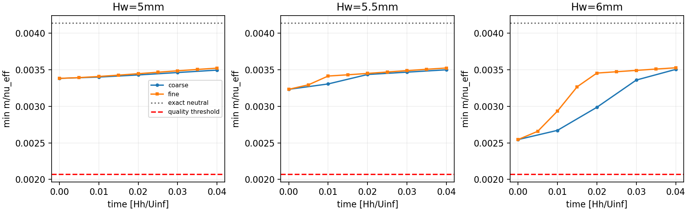
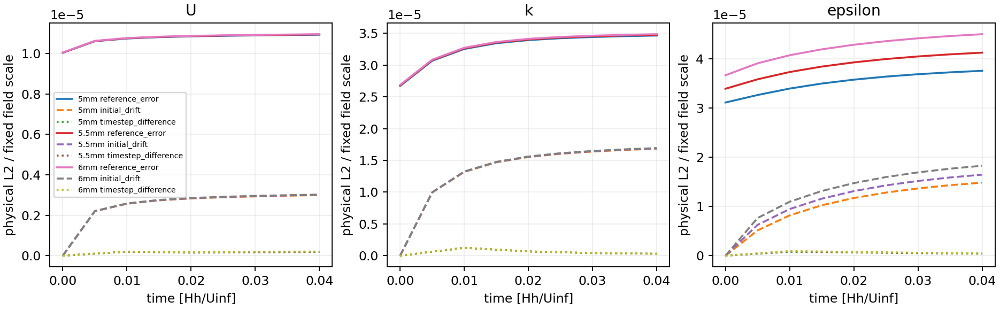
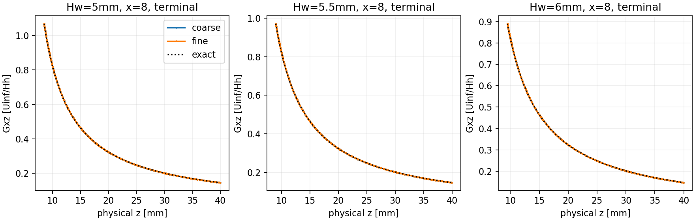

# WJ-H7: bounded neutral-reference transport to T=.04

The **six-trajectory numerical study passes**. Every branch reached its fixed
T=.04 endpoint: 36 attempts, 36 accepted steps, no rejection, zero bound
activations or material corrections. All assessed accepted states retain the
separate half-reference principal margin. All six strict endpoint/independent
weak/quadrature checks pass. This is initial transport on a finite inventory,
not exact discrete equilibrium, a temporal order, long-time stability, a
developed precursor or experimental validation.

**Storage closure is OBSTRUCTED separately.** After the scientific matrix had
finished, an H7 observer-checkout operation entered an uninterruptible NTFS
metadata wait. Its witness and resource charge are retained below. Compact
publication succeeded in explicit Linux temporary staging and was independently
transported/verified on Mac. No heavy native data were relocated or rerun. No
mount, installation or unrelated campaign was changed.

Fetched origin and the clean WJ worktree started at the reviewed
`a2642861740cdf1c9bf4f8adce44d15dd4b4a70d`; no intervening commit needed
reconciliation. The contract was committed/pushed as `26c22d0` before numerical
execution. Numerical orchestration/reconstruction is
`73ca56e88ea7ec640d10cd8ab94d82742c65ed7d`. Native governing source remains
`c344dc2209f030e426e2ee5501d5e5b72a6d2c46`, and the reused native observer is
`e62b5f4d265f068dd5af3f090bfb0e385c3ae53e`. No C++ rebuild occurred.
Initial publication source is `7a43a9e13179bc8c3d5ee2614515644557c17eff`;
the versioned reference-owner correction is
`2785c442299f26f0ee4eaf2596d5733810a9f4fc`. Subsequent metadata-only
compaction and executable-check additions do not change the native inputs.
All source/evidence commits are normal pushed descendants, with no reset or
published history rewrite. Other worktrees and prior H2–H6 evidence are preserved.

The primary root is
`/media/jay/新加卷1/nektar-v2026-runs/wj-h7-neutral-transport-20261113`,
on verified UUID `5AB8A669B8A642FD`. Six scientific blocks ran in the frozen
order 5.5mm pair, 6mm pair, 5mm pair. Each uses the unchanged H6 16-inner/
34-outer-cell mesh, Nx1 [0,8], Q3/Q1, 2328 states, q12/normal16, native
points and the 3000-state guard. H_w=5/5.5/6mm and
h_s=4.381467178582103/4.359758967365407/4.341801417014184mm remain fixed.
No height is a selected physical default.

The full3D Original WJ tensor/cubic root, DevStrainRawWorkV1, physical epsilon,
raw stress work, independent Cd diffusion and original constants remain:
Ne=81/20,qe=81/(2sqrt143),Cd=572/6561,
kappa=sqrt(1.30*(1.82-1.44)*sqrt(Cd)),u_tau=.051,
nu=.051*.005/3.97,d0=.0875,top=20,K=.008809015145515192 and the exact
H6 fitted-intercept bytes (display .0056762703212168 code lengths).
Molecular viscosity remains positive in AWF and zero only in the declared
outer high-Re diffusion. Nonconstant inner k is transported; current represented
endpoint K sets the counterfactual cutoff and dependent A(K)/H epsilon.
Functions/Physical, CompositeTunnelV1/OpenTunnelV1, complete prescribed regional
outlet/reference-top traction and scalar flux, IMEX1/PimpleSingleSweep, eta0,
ExactStepV1, PimpleVerifyOff, StopOnBound and IO_CheckSteps1 are unchanged.
There is no extra H pressure equation, inner epsilon PDE, physical cap, clipping,
reference reset, stabilization, governing diagnostic solve or model retuning.

Original Mac/worktree literature bytes retain the H6 SHA-256 identities:
main `1959e96ea0b61f9deb9ff9ad1f5b26488a932a8451c2de6d3b6f7b7c9dbd9124`;
appendix `0ab52e0d813b8fb344973f75ca6d8da97ff389ef9f93476500ca9d1df1fbc47c`.
The literal quad/\quad typography erratum and intended `(d+a*h)/a^2`
coefficient are preserved.

The three H6 .01 CP0s were reused read-only. Coarse XML changes only restart/
output locations and NumSteps=4; .01 is retained. Exactly three fresh .005,
NumSteps=0 CP0s were created. Their coupled and fixed-reference coefficient
arrays match the respective H6 arrays bitwise, including signed binary64
values. Corresponding physical native-history arrays also match; dt-dependent
labels/signatures are correctly distinct. Evolution restarts report Project/
Lift work [0,0]. No checkpoint was relabeled, edited, reset or reprojected.

| H_w mm | dt | Attempted/accepted | End time | Bound calls/activations | Native block seconds |
|---:|---:|---:|---:|---:|---:|
| 5.5 | .01 | 4/4 | .04 | 4/0 | 25.7731 |
| 5.5 | .005 | 8/8 | .04 | 8/0 | 42.6128 |
| 6 | .01 | 4/4 | .04 | 4/0 | 25.8095 |
| 6 | .005 | 8/8 | .04 | 8/0 | 42.7151 |
| 5 | .01 | 4/4 | .04 | 4/0 | 25.4537 |
| 5 | .005 | 8/8 | .04 | 8/0 | 42.5511 |

There are exactly 36 U-predictor, 36 pressure, 36 k and 36 epsilon solves,
36 logical bound calls, and zero bound activations. Every retained raw k
snapshot equals its corrected snapshot bitwise. No failure's partial counts
were overwritten: there were no failed scientific attempts. A one-block
trajectory was used for each branch, without a segmented driver or retry.
Native governing-block time totals 204.9154s. Fine CP0s cost 9.63–9.65s each.

Every accepted fine odd step was scanned. Common intended times 0,.01,.02,
.03,.04 are matched by integer step ratios with the frozen roundoff allowance,
retaining recorded timestamps. Every state is bound to its actual producer,
native audit, callback history and time/alpha. The final per-height inventory
retains all H6 points/owners, normal faces, H/exterior rows, x0/4/8, measurement
heights and old/new native limiting points with 1e-6 physical neighborhoods.
Earlier states are replayed on that final union. Full native and expanded
inventories remain distinct. At H, epsilon/WJ are outer-only, with a separate
inner AWF covariance. Immutable sparse basis/geometry rows are cached; fields,
full G, root, stress, principal action and current K/cutoff are freshly evaluated.
The independent batched action agrees with the established angular calculation
and shared compiled action at retained/decisive witnesses within 2e-11 absolute.

The half-reference quality threshold is .002068763923454, from exact neutral
m/nu_eff approximately .004137527846908. No accepted-state quality loss or
expanded missed negative/sign discrepancy was found:

| H_w mm | Minimum across assessed accepted states | Terminal coarse minimum | Terminal fine minimum |
|---:|---:|---:|---:|
| 5 | .003382062176 | .003495091782 | .003522032740 |
| 5.5 | .003232298785 | .003499440698 | .003523902447 |
| 6 | .002544936551 | .003505047586 | .003526746225 |

The minimum over each entire accepted history occurs at startup. Native scalar,
covariance, root/denominator, viscosity, cutoff and raw-work checks pass unchanged;
transverse and covariance margins are reported separately from the in-plane
quantity. No universal simple-shear threshold replaces the full-gradient action.



Reference error, initial-state drift and timestep difference are separate. The
physical L2 rule is shared elementwise Gauss8 with actual physical Jacobians
and physical breakpoints. Duplicate face observations have zero integration
weight. Epsilon uses the entire outer domain; inner fields use their own
finite-nu reference. Pressure has its outlet-fixed physical level and is not
independently regauged. `norms-and-differences.csv` includes physical L2/maxima
and fixed-scale versions using 1,K,A/H,u_tau^2, with absolute errors for zero
components. Different inner profiles across heights are not mesh-error estimates.

Terminal physical L2 values (fine reference/drift and coarse–fine same-time
difference) are:

| H_w mm | Field | Error versus exact | Drift versus CP0 | dt difference |
|---:|---|---:|---:|---:|
| 5 | U | 1.09315e-5 | 2.99608e-6 | 1.79189e-7 |
| 5.5 | U | 1.09450e-5 | 3.00945e-6 | 1.88932e-7 |
| 6 | U | 1.09568e-5 | 3.02225e-6 | 2.04701e-7 |
| 5 | k | 3.05194e-7 | 1.48292e-7 | 2.62684e-9 |
| 5.5 | k | 3.06170e-7 | 1.48761e-7 | 2.68234e-9 |
| 6 | k | 3.07059e-7 | 1.49188e-7 | 2.80249e-9 |
| 5 | outer epsilon | 1.04282e-7 | 4.12072e-8 | 1.06366e-9 |
| 5.5 | outer epsilon | 1.04103e-7 | 4.15253e-8 | 1.07289e-9 |
| 6 | outer epsilon | 1.04105e-7 | 4.22634e-8 | 1.03596e-9 |
| 5 | reduced pressure | 1.33300e-6 | 1.33300e-6 | 6.53689e-8 |
| 5.5 | reduced pressure | 1.33433e-6 | 1.33433e-6 | 7.09467e-8 |
| 6 | reduced pressure | 1.33621e-6 | 1.33621e-6 | 8.70112e-8 |

Terminal fine E_G is .192831%, .193520%, .194800% for 5/5.5/6mm;
E_epsilon is .0125612% for each, E_U approximately 4.17073e-6 and E_k
1.62e-6/1.58e-6/1.54e-6. These measured quantities have no imported 2%/5%
preservation threshold. The small bulk dt differences do not bound all local
gradient/principal errors. At the same x=8, physical z=10.2430071555mm outer
face owner, maximum terminal same-point principal changes are .000174789,
.000274387 and .000518652. For 6mm the paired values there are .0036981653
and .0042168172, distinct from the two minima elsewhere in the inventory.
Both owners and nearby points remain; no difference of minima at different
positions is substituted for this comparison. The largest change is about
12.5% of the exact neutral margin, although the half-reference gate is retained.




Final review corrected a measurement defect before sealing the final view:
`z-d0` subtraction at the 5mm H plane can round just below H. The first
reference evaluator used that comparison to select an inner derivative and
covariance even for a declared outer owner. This falsely inflated the sampled
5mm Gxz error to about 4.7%; it did not change native fields, principal actions,
admission or temporal differences. The corrected evaluator selects the reference
by region/owner. A fixture with two H owners and a rounded-below-H coordinate
fails the old selection and passes the new one. The versioned observer applies
the correction to the unchanged saved arrays; **all physical L2 reference
norms are asserted bitwise unchanged**, since affected face rows have zero
weight. Drift, dt differences, principal margins and native decisions are
unchanged. Original source/view/seals are retained in
`superseded-reference-seal.json`, `reference-repair-bridge.json` and the remote
temporary output. No governing or kernel run was repeated for this repair.

Current-K coupling is exercised, rather than frozen. At T=.04 the fine sampled
K ranges are [.0088090139745,.0088090152993],
[.0088090150075,.0088090153508], [.0088090140935,.0088090168304].
Their recomputed cutoff ranges are [.0261981726751,.0261981738213],
[.0263186649843,.0263186652854], [.0264198968155,.0264198992428] code
lengths. Shared U and k defects are zero; maximum dependent epsilon defect
over the recorded histories is 1.13e-17. Terminal fine total traction component
defects are 2.30e-7/1.77e-7/4.17e-7, with k-flux defects
2.18e-9/4.64e-9/1.11e-8. The evolving pressure jump is measured, not reset
to the initial offset. Wall shear and inner covariance/positivity are retained.

The fine integrated actual inner turbulent production exceeds cutoff destruction
by approximately 3.25e-8/3.19e-8/3.19e-8 over the physical inner region.
Counterfactual production and destruction instead agree to about 4e-17,
by construction of the current-K budget. Raw stress work is also reported
separately. No stationary source cancellation was imposed on the evolved state.
Signed storage, transport, production/destruction, diffusion and prescribed
exterior contributions are retained in the independent weak packets and boundary
loads; separately normed residual pieces are not added as signed loads.

All six strict readers use the terminal accepted checkpoint and its genuine
producing callback/history, with zero Project/Lift and governing solves.
The failed-producer predecessor route is implemented/tested but was not needed
by this matrix. Frozen linear residual maxima are below 4.48e-19 for flow/
pressure and 1.12e-21 for scalars. They are not the nonlinear recombined
consistency defect. Terminal fine physical consistent-mass dual norms are:

| H_w mm | Spatial u/v/k/entire-outer-epsilon | Genuine completed-stage u/v/k/epsilon |
|---:|---|---|
| 5 | 1.866e-6 / 7.733e-7 / 6.921e-6 / 1.026e-5 | 5.804e-7 / 4.680e-7 / 1.856e-8 / 7.284e-8 |
| 5.5 | 1.922e-6 / 9.754e-7 / 6.962e-6 / 1.104e-5 | 6.876e-7 / 7.094e-7 / 1.828e-8 / 8.054e-8 |
| 6 | 2.026e-6 / 1.723e-6 / 7.014e-6 / 1.218e-5 | 9.270e-7 / 1.487e-6 / 1.877e-8 / 8.514e-8 |

Spatial residuals have alpha=0; completed-stage residuals use the actual saved
history/time and alpha=100/200. None is a synthetic callback constructed from
endpoints. Weak continuity is near roundoff, while terminal maximum raw strong
divergence is .000252/.000368/.000681 coarse and
.000101/.000105/.000122 fine. Net exterior mass flux on fine branches is
approximately -2.00e-14/4.19e-15/-1.77e-14. Strong divergence and weak pressure
tests remain separate. No stability conclusion or new pressure space follows.

Independent q12–32 and q24–32 comparisons on the same fixed states pass all
original component `2e-9+2e-8*abs(value)` and regional
`4e-9+2e-8*abs(sum)` limits, with maximum regional discrepancy below
1.64e-13. Independent complete weak checks have regional errors below
1.17e-13. Actual projected native exterior test traces are used. No analytic-hat
substitution, quadrature retuning, pressure verification solve or extra flux was
introduced. Default console errors against zero ExactSolution are not used.

Linux registered/selected/executed exactly three focused CTests, all passing:
WJH5NeutralInlet (nine methods), WJH6NeutralProjection (six),
WJH7NeutralTransport (initial eight). The later H7 owner fixture increases
that focused module to nine, all passing. There were 23 distinct methods in the
initial CTest run and 24 after the owner regression; publication-source and
owner-module reruns are recorded separately, not counted as additional distinct
tests. No historical broad campaign was rerun. Tests cover fixed matrix ceilings,
cross-dt/signature/state rejection, integer-aligned and odd steps, genuine
accepted/rejected callback binding, batched full action, zero-safe metrics,
bound calls versus activations, statuses and H owner selection.

Every original command/exit/time/input/log identity is in `commands.json` and
closure/repair receipts. Representative commands, all subject to H7 admission:

```bash
source /home/jay/.local/opt/nektar-v2026-mpi/env.sh
export OMP_NUM_THREADS=1 OPENBLAS_NUM_THREADS=1 MKL_NUM_THREADS=1
export BLIS_NUM_THREADS=1 NUMEXPR_NUM_THREADS=1 VECLIB_MAXIMUM_THREADS=1
R=/media/jay/新加卷1/nektar-v2026-runs/wj-h7-neutral-transport-20261113
S=$R/source-73ca56e/solvers/IncNavierStokesSolver/Tests/RANS
ctest --test-dir "$R/focused-config" -N -R '^WJH[567]Neutral(Inlet|Projection|Transport)$'
ctest --test-dir "$R/focused-config" -R '^WJH[567]Neutral(Inlet|Projection|Transport)$' --output-on-failure -j 1
python3 "$S/study_wj_h7.py" --root "$R" --mode prepare --height 5.5
"$R/runtime/IncNavierStokesSolver" "$R/cases/H5.5mm/coarse/case.xml"
"$R/runtime/IncNavierStokesSolver" "$R/cases/H5.5mm/fine-cp0/case.xml"
python3 "$S/study_wj_h7.py" --root "$R" --mode initial-pair --height 5.5
"$R/runtime/IncNavierStokesSolver" "$R/cases/H5.5mm/fine/case.xml"
python3 "$S/study_wj_h7.py" --root "$R" --mode scan --height 5.5 --version pair
python3 "$S/study_wj_h7.py" --root "$R" --mode observe --height 5.5 --branch fine
```

The same fixed operations ran for 6 and 5mm, with startup and post-coarse scans
before unlaunched blocks, and two strict endpoint views per height. Reproduction
must preserve input intents and should not rerun into these immutable roots.
The runtime wrappers invoke the exact old ELF through its exact old loader.

Initial verification correctly stopped before native launch because host glibc
had changed from Ubuntu `2.35-0ubuntu3.15` to `.18`. The configured repository
still supplied `.15`; it was downloaded/extracted privately, with all six changed
loader/libc/libm/libdl/libresolv/librt files required to match their sealed H6
SHA-256 values exactly. The host installation was not downgraded or modified.
340 native compilation inputs and 133 ELF identities pass. Actual monitored
maps verify the private libraries in all nine native startup/evolution operations;
observer/kernel maps and executable bytes are explicitly verified separately
in `closure/executable-map-qualification.json`. Shell/Python orchestration maps
are distinguished from the private native closure. The three executable hashes
remain solver `9ae37a1aba62755b10ad99c9484c498cef9d927a75fb950f00344f4ffc5d06fe`,
observer `6f35b837f0dd13eb155e0fe34f0dc670c609ee6cbe739609a5de288dd49ed06d`,
kernel `3d4edf79a2718a281175be1a575776a33dd5f988c48d5a1b594a9b5f2dd7844c`.
GNU11.4 C++17 Release `-O3 -DNDEBUG -ffp-contract=off -fno-fast-math`,
RANS_BUILD_SOLVER=ON, one serial rank and six thread controls=1 are retained.
Current allocations were inspected before operations. A controller initially
imported NumPy before setting its parent thread controls; the conservative
worker reservation refused before any native launch. All later parents set
controls before import. This zero-launch setup failure is preserved/charged.

Center-pair measured full scientific cost was 212.7252s. Remaining-work admission
with 25% headroom and closure projected 1361.3507s, then 1341.0778s and
1281.5203s before successive phases. The matrix was never changed. Afterward,
the new sparse observer checkout stalled in kernel state D,
`ntfs_look_free_mft`, not in a native solve. SIGTERM then SIGKILL were sent
only to that H7-owned Git operation; at the closure witness it remained blocked
after 625s. No remount or unrelated process termination was attempted. All
governing and strict native processes had already exited successfully.

Compact staging used `/tmp/wj-h7-compact-20261113`; corrected staging used
`/tmp/wj-h7-owner-repair`. Primary heavy fields/checkpoints/history stayed in
the NTFS run root. The closure reserve covers verification, measurement repair
(1.51s fixtures + 44.62s corrected publication), transport and serialization.
The final ledger conservatively charges **1800/1800s**: 1692.1432s known,
including full setup/closure allowances and the retained storage wait, plus
107.8568s charged as an unknown storage reservation. This is not a budget
reset or an uncharged retry. Peak process-tree RSS was 1360465920 bytes.
Last exact primary-root footprint was 2376627549 bytes; a conservative bound
including the entire possible unfinished checkout, Git allowance, both compact
staging versions and transport archives is below 2.90GB, below 8GiB. The NTFS
operation's quiescence is not claimed; the storage witness remains unresolved.

The original 68-file publication and corrected 69-file view were decoded and
independently hashed on Mac. 105 heavy identities were verified remotely only;
those full native bytes were not transported/read on Mac. Corrected transport
SHA-256 is `aa6672b6cfee0e20b7c81d86c9a12065109b898e65a741628382975f688144f0`.
The compact Git view omits repeated bulk boundary/station arrays from six
endpoint JSON copies, retaining numerical decisions, signed weak loads,
interfaces and source identities. `compact_wj_h7.py`, the original seals and
`compact-bridge.json` make that metadata-only transformation reproducible.
The full arrays remain in native packets. H6 input/report/checkpoint hashes
are reverified unchanged. Historical H6/H2–H4 ledgers and denials are untouched.

The next supported scientific step is targeted verification of the initial
pressure/interface adjustment at the retained x=8 outer face, where local
principal timestep variation is much larger than bulk field variation. Any
further timestep/horizon/refinement must be separately scoped and cost-admitted;
none is executed or authorized here. Operationally, the NTFS metadata blockage
needs diagnosis before another write-heavy campaign. Finite-depth inlet completion,
roughness-sublayer validity and the 7mm measurement/model-region decision remain
unresolved: all three candidates put that plane inside AWF, and the all-stresses-
outside interval remains empty. No physical H is selected. Old Blackadar/20mm,
H4 backend/capacity, EP, physical hill and longer continuation work remain paused.
T=.04 is only .005 strip flow-throughs and about 1.05–1.26% of K/epsilon_H.
The full-height logarithm is still an idealized control, not a developed tunnel
inlet or a physical hill result.
