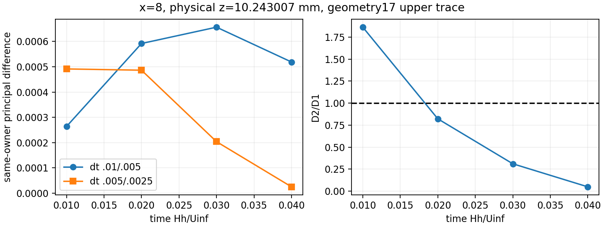
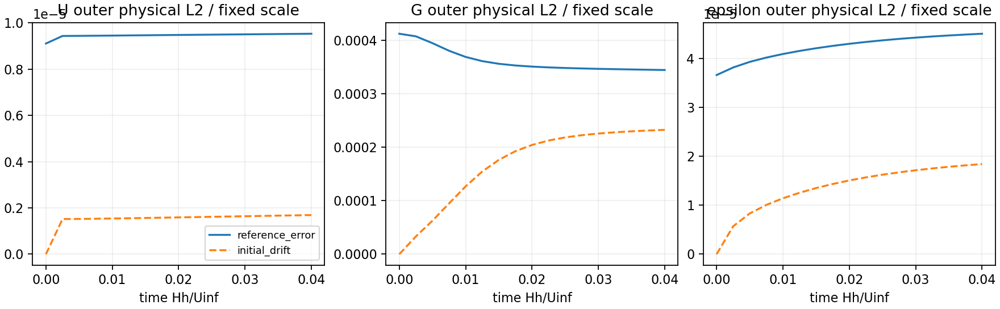

# WJ-H8: local transient and one additional timestep

**Verification PASS; uniform local timestep contraction UNRESOLVED.** The new
6 mm, dt=.0025 trajectory accepted 16/16 steps to T=.04. Native and expanded
admissibility, half-reference quality, all seven strict views and independent
weak/quadrature checks pass. The decisive same-owner difference grows at t=.01
and contracts at later common times. A favorable endpoint does not close the
initial transient sensitivity question.

## Source and immutable runtime

Fetched starting Mac/origin HEAD was
`262d83464b0550faa20bb4b7e71d417f411f8c81`, with no newer upstream work or
existing H8 reservations/jobs in the inspected locations. The contract was
committed/pushed as `37bf4be` before execution. Implementation commits are
`2039149`, `4761f6c`, `c3b4d73`, `a21e8eb`, `c06419e`, `24b0945`, `71d41ab`
and closure verifier `48d90be`. Each was pushed normally. Full commit/file
identities and the versioned Python import paths are in
[observer-lineage.json](wj-h8-linux/closure/observer-lineage.json).

No C++ rebuild occurred. Governing producer remains
`c344dc2209f030e426e2ee5501d5e5b72a6d2c46`; passive observer remains
`e62b5f4d265f068dd5af3f090bfb0e385c3ae53e`. All 340 compiled inputs and 133
qualified ELF identities were checked. The governing/observer/kernel hashes are
respectively `9ae37a1aba62755b10ad99c9484c498cef9d927a75fb950f00344f4ffc5d06fe`,
`6f35b837f0dd13eb155e0fe34f0dc670c609ee6cbe739609a5de288dd49ed06d`,
`3d4edf79a2718a281175be1a575776a33dd5f988c48d5a1b594a9b5f2dd7844c`.
The copied original private glibc loader and six overrides were retained. Actual
native-PID maps from CP0, governing block and seven strict views match the
qualified closure, including libc. Host time/shell maps are identified separately.
See [actual-native-runtime.json](wj-h8-linux/actual-native-runtime.json).

The reused build policy is GNU11.4, C++17 Release, `-O3 -DNDEBUG
-ffp-contract=off -fno-fast-math`. The external test project was configured with
`RANS_BUILD_SOLVER=ON`; this configuration did not rebuild an old ABI.

Original Mac, worktree and synchronized literature bytes agree:

- Main, 138078 bytes: `1959e96ea0b61f9deb9ff9ad1f5b26488a932a8451c2de6d3b6f7b7c9dbd9124`.
- Appendix, 53271 bytes: `0ab52e0d813b8fb344973f75ca6d8da97ff389ef9f93476500ca9d1df1fbc47c`.

The literal `quad`/`\quad` typography erratum and correct `(d+a*h)/a^2`
coefficient remain documented and unchanged.

## Repair and execution

H7 completion now locks/reloads its journal and merges only its own operation.
Child reservations/charges and monotone halts survive. The first detected
witness is immutable; earliest affected physical time is tracked separately per
trajectory. Later successes cannot clear the halt. CP0/governing admission
refuses it. Accepted coverage and reference quality are separate; an
OBSTRUCTED/UNRESOLVED history cannot become PASS through absence of QUALITY_LOST.
Rejected candidates remain outside accepted/strict checkpoint lineage.

A real child-process fixture exercises the original stale-parent failure. Other
focused tests cover first/earliest ordering, mixed statuses, rejected contexts,
fixed ceilings, cross-dt identities, common times, zero-safe ratios, genuine
intermediate callbacks, physical Q1 pressure projections and early noncontraction.
Linux executed 4/4 selected CTests successfully (34 methods in that frozen source
snapshot), then the final 12-method H8 module passed. Together these cover
**36 unique focused methods: 24 H5/H6/H7 and 12 H8**. Earlier duplicate direct
runs and the separate checkpoint-header regression remain in the command ledger;
registered tests are not counted as additional executed scientific trajectories.

Only selected manifest-bound H6/H7 reports, XML/checkpoints and packet identities
were imported. An initial import incorrectly interpreted `CP.1` as absolute step1;
its header is step2. The assertion stopped that import. Version2 selects by
verified native header, with a focused fixture; failed copies/receipt remain.
No checkpoint reader or signature was weakened.

New native work was exactly one fresh dt=.0025 CP0 and one normal 16-step restart
block. CP0 coupled state, fixed reference and physical histories match H6/H7
bitwise, including signed zero; its own timestep/signature/history labels are
retained. Restart Project/Lift is `[0,0]`. Each completed attempt has one U,
pressure, k, epsilon solve and bound call: **16 each, zero activations/material
corrections**, identical raw/corrected k. There are no rejected native attempts.
H7's six trajectories/36 accepted steps are reuse, not new H8 execution.

The fixed problem is H_w=6mm (.15 code), h_s=4.341801417014184mm, one horizontal
cell on [0,8],16 inner/34 outer cells,2328 Q3/Q1 states,q12/normal16. Physical
Functions, calibrated reference bytes, model coefficients, molecular wall nu,
outer high-Re diffusion, OpenTunnel/CompositeTunnel boundaries, pressure seed
and solver selectors are unchanged. Current endpoint K drives cutoff/epsilon;
there is no restoration, source cap, gradient substitution or added equation.

## Local response and three distinct errors

The decisive point is x=8,z=.25607517888672315 code (10.2430071555mm), geometry17
upper normal face; geometry18 is its other owner. It is .743007mm ABOVE the
9.5mm matching plane. Both traces, +/-1e-6 physical offsets, x=0,4,8/outlet
neighbors, matching traces and5x5 Lobatto samples of adjoining elements were
retained. All new native witnesses extend the final6mm union retrospectively.
There are59 distinct accepted branch-step assessments, including every fine/quarter
step. Re-evaluation on the final union gives73 actual scientific state scans.

For the normalized principal value at the fixed upper trace:

| t | D1: .01/.005 | D2: .005/.0025 | D2/D1 |
|---:|---:|---:|---:|
| .01 | 2.637283116e-4 | 4.912873872e-4 | **1.862854** |
| .02 | 5.918559135e-4 | 4.862509917e-4 | .821570 |
| .03 | 6.563930928e-4 | 2.037920137e-4 | .310473 |
| .04 | 5.186518686e-4 | 2.513953764e-5 | .048471 |

The common-support outer principal-difference envelope also fails contraction
at .01; at .04 its ratio is .183900, rather than the single-face .048471.
The largest D1 occurs at .03; largest D2 at .01. Their values are well above the
4e-11 normalized-principal comparison floor. Ratios with a denominator at the
declared fixed-scale reconstruction floor, including identical CP0, remain
UNRESOLVED. No order is inferred. Signed tensors/scalars/directions and both
owners are in [fixed-face-history.csv](wj-h8-linux/fixed-face-history.csv),
[fixed-face-three-level.csv](wj-h8-linux/fixed-face-three-level.csv) and the
manifest-bound full local packets on Linux. Minima at different positions are
reported separately from these comparisons.



At .01 the fixed-trace Gxz is .795733477/.795084455/.793869871 for the three
levels; Gzz is -6.53309e-4/-8.49346e-4/-7.14336e-4. The full G, k/epsilon,
root/direction and pressure histories are retained. This is a time-dependent
local gradient/closure response; pressure itself is not an input to m(k,epsilon,G).
Saved packets contain coupled post_flow states and k-block matrices, not separate
velocity-predictor/pressure-correction vectors. Their separate causal contributions
remain UNRESOLVED; none were fabricated or recomputed by an extra governing solve.

The quarter-step minimum starts at .002544936550658 and ends at
.003538831759650, always above .002068763923454. Transverse/covariance/scalar,
root/denominator, viscosity, cutoff and raw-work checks pass separately. There
is no expanded missed-negative or sign-uncertainty halt. This finite inventory
is not a global ellipticity/realizability certificate.

Terminal outer errors E_G/E_epsilon/E_U/E_k are respectively
`.001911900068 / .0001256119762 / 4.170734254e-6 / 1.925860562e-6`.
Full-domain velocity reference L2 error is1.096729961e-5; initial-state drift
is3.043743714e-6. These are distinct from the .005/.0025 temporal L2 difference
1.057812144e-7. At T=.04, resolved full physical L2 D2/D1 values are:
U .516759,G .346116,k .608835,outer epsilon .522672,R .394997,
pi .520119,mechanical pressure .520889. These endpoint bulk contractions do not
bound the earlier local principal response. Inner fields retain their own
finite-nu reference; full/inner/outer norms and errors are separate in
[norms-history.csv](wj-h8-linux/norms-history.csv).



## Continuity, interface and actual-stage checks

Strong-divergence maxima occur at .02/.01/.0075 for dt .01/.005/.0025,
with values8.914483476e-4/8.489015467e-4/8.126406685e-4. Quarter-step terminal
max is6.648031700e-5. The peak is not the endpoint. At the quarter-step peak,
outer divergence L2 is4.742119367e-5, continuous-Q1 projection8.8223e-17,
broken-Q1 projection3.462490613e-5 and broken complement3.240193643e-5.
The continuous-pressure complement is therefore NOT identified with purely
high-order element modes. Region/element modes, moments and squared-norm
identities are retained. There were3796 scientific diagnostic mass solves and208
factorizations; these changed no state/history and added zero governing solves.

H6 CP0 views and all six H7 terminal strict views are reused, with no new
native readback. [reused-strict-bindings.json](wj-h8-linux/reused-strict-bindings.json)
checks their reviewed/sealed compact bytes and producer/state/callback/checkpoint
bindings against the H8 imports; all terminal checkpoint bytes agree. It labels
prior heavy verification separately from fresh H8 reads.

Seven new strict reads used actual checkpoints/callbacks: coarse steps1,3 (alpha100),
fine2,6 (alpha200),quarter4,12,16 (alpha400). They perform zero Project/Lift and
zero governing solves; saved input bytes remain unchanged. All seven independent
actual-test-trace weak checks and q12/24/32 component/regional comparisons pass
unchanged2e-9+2e-8|component| /4e-9+2e-8|regional| tolerances.

At quarter-step T=.04, native consistent-mass dual norms are:

| residual definition | u | v | k | entire outer epsilon |
|---|---:|---:|---:|---:|
| uncancelled spatial,alpha0 |1.41157e-6|8.75603e-7|6.64026e-6|1.11283e-5|
| genuine completed callback,alpha400 |2.37584e-7|6.73624e-7|8.80912e-9|3.80763e-8|

Continuity norms are about6e-18, absent gauge/constraints0. Maximum frozen
linear residuals over16 solves are2.17e-19(U),3.78e-19(pressure),1.51e-21(k),
5.82e-22(epsilon). Neither a subsolve nor a completed-stage defect is the
uncancelled spatial residual or exact equilibrium.

Terminal current K spans roughly .00880901392 to .00880901640 on the reported H
samples; cutoff changes correspondingly. Shared U/k defects are0; dependent
epsilon matches current A(K)/H to roundoff. At x8, traction-jump components are
(3.44241e-7,0,2.17912e-7), k-flux defect-8.40508e-9 and reduced-pressure jump
-.002174777918. Mechanical pressure is pi-2k/3, not continuous by prescription.
Net exterior mass flux is8.80546e-15, boundary flux repair0, gauge unknowns0:
complete outlet traction fixes the pressure level. Actual inner turbulent
production integral .00760380004490 differs from counterfactual production
.00760376733573, which agrees with cutoff destruction. No stationary budget
was imposed on the evolved state. Signed storage/transport/stress/source/exterior
loads and actual interface rows are retained in
[strict-weak-stage-views.json](wj-h8-linux/strict-weak-stage-views.json).

## Commands, costs and closure

Linux root is `/home/jay/build/wj-h8-local-timestep-20261113`, healthy ext4 UUID
`4c5b928b-0ef9-464e-91cb-3b0b2202e3b0`; selected source/output passed bounded
write/fsync/readback. The obsolete H7 observer checkout was not traversed.
One serial MPI rank; OMP/OpenBLAS/MKL/BLIS/NumExpr/VECLIB threads1 before numerical
imports. Each operation admitted the current scientific-worker inventory plus10
reserved workers; largest other-worker snapshot17, with periodic72-worker guard.

Reproducible command equivalents (version/PYTHONPATH details and exact child argv in
[commands-final.json](wj-h8-linux/closure/commands-final.json)):

```sh
R=/home/jay/build/wj-h8-local-timestep-20261113
S=$R/source/solvers/IncNavierStokesSolver/Tests/RANS
export PYTHONPATH="$R/observer-v4:$R/observer-v3:$R/observer-v2:$S"
export WJ_H8_SOURCE="$R/source"
export OMP_NUM_THREADS=1 OPENBLAS_NUM_THREADS=1 MKL_NUM_THREADS=1
export BLIS_NUM_THREADS=1 NUMEXPR_NUM_THREADS=1 VECLIB_MAXIMUM_THREADS=1
cmake -S "$S" -B "$R/focused-config" -DRANS_BUILD_SOLVER=ON \
  -DCMAKE_BUILD_TYPE=Release '-DCMAKE_CXX_FLAGS=-ffp-contract=off -fno-fast-math' \
  '-DNektar++_DIR=/home/jay/.local/opt/nektar-v2026-mpi/lib64/nektar++/cmake'
ctest --test-dir "$R/focused-config" -N \
  -R '^WJH(5NeutralInlet|6NeutralProjection|7NeutralTransport|8LocalTimestep)$'
ctest --test-dir "$R/focused-config" --output-on-failure -j 1 \
  -R '^WJH(5NeutralInlet|6NeutralProjection|7NeutralTransport|8LocalTimestep)$'
python3 -B "$R/observer-v3/control_wj_h8.py" --root "$R" --mode native
# Above coordinator invokes exactly:
"$R/runtime/IncNavierStokesSolver" "$R/case/cp0/case.xml"
"$R/runtime/IncNavierStokesSolver" "$R/case/run/case.xml"
```

The actual SSH submission imported `control_wj_h8.native(root)`; the CLI shown
is equivalent. The source/observer import order is explicit in the source lineage
and operation receipts; the coordinator imports the a21e8eb study module. These
commands describe the closed experiment, not authorization to rerun its root.
Runtime wrappers
execute the private original loader/library closure, not the host libc.
Native CP0/block measured9.626/75.722s; final union44.815s. Initial full remaining
projection, including25% headroom and180s closure, was923.145/1200s and passed.
Final charge is **784.559820486s**:60s setup,544.559820486s consuming operations,
180s closure charged in full. Maximum tree RSS1,235,054,592 bytes (1.15GiB);
largest recorded root1,702,521,061 bytes (1.59GiB), plus the compact closure archive,
well below8GiB. No build time or new capacity was used.

All failures remain charged: the header-index import, a publication final-print
variable shadow (outputs preserved in publication-v1), and a copied-fixture child
PYTHONPATH error. Each received a changed-code fix/version; no native reservation
was retried. The final publisher keeps counts and ELF identities distinct and
marks early noncontraction UNRESOLVED. H7's closed1800s allocation and
107.85679090699705s unknown charge were neither reopened nor reclaimed.

The958709-byte transport SHA256 is
`3ff7dc1fc40eee4bd0d4b7e3157f69c0fe0dbf11e46cf69608a236ad3665423e`.
Mac independently checked transport, both seals and43 decoded compact identities;
[compact-bridge.json](wj-h8-linux/compact-bridge.json) aliases the45 transferred
files, including the seals, without editing their JSON/native paths. Selected
heavy identities were freshly verified on Linux by closure, not downloaded or
independently read on Mac. Failed/superseded outputs remain at their original
Linux paths. Final accounting is in
[accounting-final.json](wj-h8-linux/closure/accounting-final.json).

## Decision

The first limiting scientific gate is same-owner principal noncontraction at
T=.01. Late local and terminal bulk differences contract, but uniform initial
transient resolution is not established. Recommend one separately scoped passive
initial flow/scalar-splitting and boundary-load audit using these genuine callback
histories, before choosing a finite-depth completion. Limit that proposal to retained 6 mm t<=.01 committed/post_flow/pre_k states,
the three existing weak modes and common closure actions, in one passive batch
with zero timesteps. Separate predictor versus pressure-correction causality
remains unresolved. No fourth timestep, new mesh,
pressure space, stabilization or longer evolution is authorized/executed here.

This is an idealized full-height log/constant-outer-K control through .005 nominal
strip flow-throughs. It selects no physical H_w and proves no order, exact discrete
equilibrium, stationarity, nonlinear stability or global realizability. The7mm
observation remains inside every AWF candidate; the all-stresses-outside interval
is empty. Finite-depth completion and roughness-sublayer validity remain open.
Old measured-rms/20mm,EP,H4 backend/capacity,physical hill and long campaigns stay
paused. All authorized H8 native work is complete; no later extension was run.
