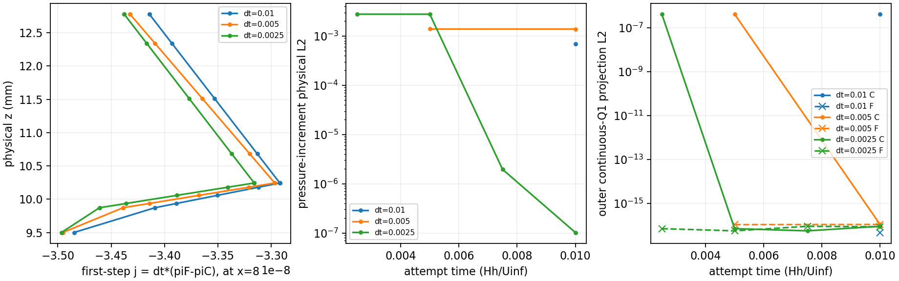
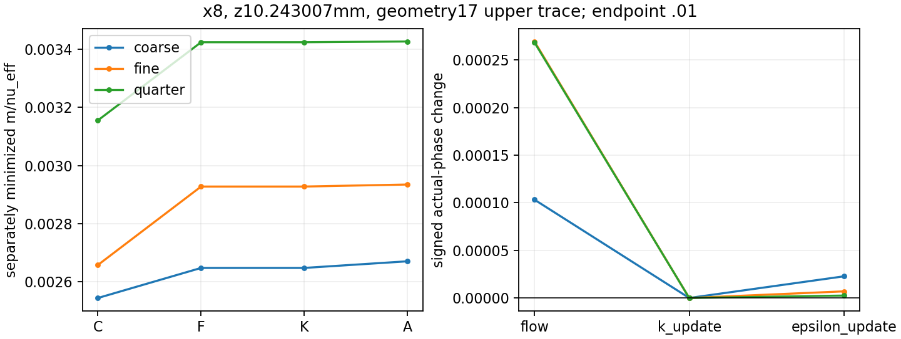

# WJ-H9: discrete startup compatibility and saved-stage audit

The bounded audit is **PASS**. The represented initial velocity does not satisfy
all regional continuous-Q1 continuity tests. The first saved flow update removes
that defect, and its signed pressure impulse approaches a common field as dt is
reduced. No governing sign, source, trace or boundary-load defect is demonstrated
by this audit. The separate predictor/correction vectors were not saved, so their
numerical causal split remains **UNRESOLVED**. H8's early local contraction result
also remains UNRESOLVED; no historical classification or ledger was changed.

**New work: zero governing attempts, zero CP0s, zero strict native readbacks,
zero builds.** Only seven original H7/H8 attempts at H_w=6mm were audited:
coarse(.01)1; fine(.005)1–2; quarter(.0025)1–4, ending at t<=.01. The original
full-height neutral reference, 2328-state H6 mesh, physical boundary data, original
WJ/Budget equations and current-K coupling are unchanged. Intermediate phases
are diagnostics, with neither accepted-state admission nor strict-reader status.

## Identities, scope and commands

Mac/origin starting HEAD was `9011d621ef76b0667eeb5b5c1b3367abe56daf1c`, matching
the reviewed HEAD; the WJ worktree was clean. Source and versioned Linux observer
blobs through `eea840e` are independently matched to Git in
[source-identities.json](wj-h9-linux/source-identities.json). Governing C++/headers
and native build inputs are unchanged; the CMake change registers one Python test.
The original governing producer is `c344dc2209f030e426e2ee5501d5e5b72a6d2c46`,
passive observer producer `e62b5f4d265f068dd5af3f090bfb0e385c3ae53e`. Neither
PDE/strict-observer executable was invoked in H9.

The only native executable used was H8's persistent WJKernelProbe, ELF SHA-256
`3d4edf79a2718a281175be1a575776a33dd5f988c48d5a1b594a9b5f2dd7844c`.
Its actual process maps match H8's qualified ELF identities, including the private
original glibc loader/libraries: [runtime](wj-h9-linux/publication-v3/runtime.json).
The inherited source-built policy remains Release GNU11.4, `-ffp-contract=off
-fno-fast-math`. This is reuse, not a new native compilation/validation claim.
The literature hashes and documented quad/\quad and `(d+a*h)/a^2` errata remain
unchanged.

The new healthy ext4 root is
`/home/jay/build/wj-h9-startup-compatibility-20261113` (UUID
`4c5b928b-0ef9-464e-91cb-3b0b2202e3b0`), reached via `ssh jay@100.105.247.110`.
A bounded1MiB write/fsync/readback passed, with about86GiB initially available.
Only manifest-selected H8 reports/XML/checkpoints, seven original k packets and
matrices, local records and three existing t=.01 strict anchors were read.
H7 packet paths still on NTFS were selectively verified; no old-root traversal,
obsolete observer checkout access, mount change or H7/H8 regeneration occurred.
[Imports/aliases](wj-h9-linux/publication-v3/imports.json) and the
[closure verification](wj-h9-linux/closure/verification.json) bind the exact
reports, states, callback histories, alpha, accepted checkpoints and fixed reference.

All Linux commands set OMP/OpenBLAS/MKL/BLIS/NumExpr/VECLIB threads=1 before imports,
one serial scientific worker. The largest pre-launch scientific allocation
snapshot was23 workers; H9 reserved6, below72. Exact argv, source hashes, timing,
exits and logs are retained under [operations](wj-h9-linux/operations/). The main
commands, with `R` denoting the new root and versioned `PYTHONPATH` from the receipts,
were:

```sh
python3 -B -m unittest -v test_wj_h5_neutral test_wj_h6_projection \
  test_wj_h7_transport test_wj_h8_local_timestep test_wj_h9_startup_audit
python3 -B "$R/observer-v3/study_wj_h9.py" --root "$R" --mode stage \
  --expected "$R/wj-h9-expected.json"
python3 -B "$R/observer-v4/study_wj_h9.py" --root "$R" --mode science --resume
python3 -B -m unittest -v test_wj_h9_startup_audit
python3 -B "$R/observer-v5/assess_wj_h9.py" --root "$R"
python3 "$R/observer-v8/publish_wj_h9.py" --root "$R" --output "$R/publication-v3"
python3 "$R/observer-v9/close_wj_h9.py" --root "$R" --publication "$R/publication-v3"
```

There are **51 unique executed passing methods**: H5=9,H6=6,H7=9,H8=12,H9=15.
The passed full invocation executed50; the final H9 invocation executed15,
including the additional anchor-category fixture. This is not65 unique tests.
CTest registration was added; no CMake configure/build or CTest invocation occurred.

## Saved roles and discrete continuity

For every attempt P(predecessor) and C(committed after ExternalLift) are bitwise
identical: all lift contributions are zero. F(post_flow)=pre_k bitwise; raw K=
corrected K bitwise; F and A share velocity/reduced-pressure coefficients bitwise.
C->F changes only u,w,pi_inner,pi_outer; F->K only k; K->A only outer epsilon.
The original attempts each had one U/pressure/k/epsilon solve and one bound call,
zero activations/material corrections. These are **reused historical counts**.

All34 inner and70 outer pressure-test moments were evaluated, not merely the
three weak modes. Signed vectors verify
`r_p(F)-r_p(C)=D*(U_F-U_C)` and `D*(U_F-U_C)=-r_p(C)` within2e-15 absolute
(the actual signed identity discrepancies are near1e-17). Accepted A moments
are reused for F only after bitwise velocity equality is established.

| First branch step | Initial inner Q1 projection L2 | Initial outer L2 | Post-flow inner L2 | Post-flow outer L2 |
|---|---:|---:|---:|---:|
| .01 step1 | 1.90185896e-7 | 4.22115975e-7 | 4.15315e-16 | 4.61913e-17 |
| .005 step1 | 1.90185896e-7 | 4.22115975e-7 | 4.43867e-16 | 1.05056e-16 |
| .0025 step1 | 1.90185896e-7 | 4.22115975e-7 | 4.78365e-16 | 6.88831e-17 |

The common initial C hash is
`6bbe9d451566a9f519ccee1bf6bf95ffb3cf9a6410531f709a4675b63b532395`.
All first-step incoming differential storage is exactly zero and the boundary
Functions are static. Full signed vectors are in
[all-Q1-moments](wj-h9-linux/publication-v3/all-Q1-moments.json).
Small weak continuity does not imply small pointwise divergence, nor establish
pressure-pair instability.

## Pressure impulse and its limits

Keep the outlet-fixed pressure level; no branch or region was regauged. These
are **first steps at different physical times**, not a common-time comparison.

| dt and first time | ||delta pi|| physical L2 | ||j=dt delta pi|| L2 | full signed mean(j) | ||delta U|| L2 |
|---|---:|---:|---:|---:|
| .01 | 6.92707604e-4 | 6.92707604e-6 | -4.72798997e-7 | 2.43728854e-6 |
| .005 | 1.38879638e-3 | 6.94398192e-6 | -4.73918516e-7 | 2.20908144e-6 |
| .0025 | 2.78095342e-3 | 6.95238354e-6 | -4.74472194e-7 | 1.97982108e-6 |

The signed full-field j differences are1.75621696e-8(coarse/fine) and
8.90981241e-9(fine/quarter), relative0.253529% and0.128310%. Coefficient vectors,
regional means, signed owner profiles and subsequent increments are retained in
[signed impulses](wj-h9-linux/publication-v3/signed-impulses.json),
[comparisons](wj-h9-linux/publication-v3/impulse-comparisons.json) and
[increment history](wj-h9-linux/publication-v3/flow-pressure-increments.csv).
This supports approach to a common impulse field, not a temporal-order proof.

The actual PIMPLE source uses `A_u=alpha*M+L`,
`delta_u_star=-A_u^-1*r_u`, `B=dt*M_free^-1`,
`S=D*B*G_p-C_pp`, `delta_pi=S^-1*(D*delta_u_star+r_p)` and
`delta_u=delta_u_star-B*G_p*delta_pi`.
OpenTunnel sets gauge size0(Patch.cpp531); Picard's pressure rows contain only
continuity, without pressure storage/penalty; its gauge block is guarded by
HasGauge. Thus C_pp=0 here. G_p includes pressure stress, matching tangential
pressure-gradient roughness forcing and non-outlet exterior reactions; it is
not simply -D^T. No new momentum/Schur operator was assembled, inverted or solved.

For common first-step state/static constraints and an invertible S0,
`S=dt*S0`, hence `S0*j=r_p+D*delta_u_star`. **Conditionally**, if the bounded
frozen momentum system gives `delta_u_star=O(dt)`, j approaches `S0^-1*r_p`,
pressure correction isO(1/dt), and the constraint velocity repair has a finite
limit. The verified signed moments and observed impulse scaling support that
mechanism. They do not recover the unsaved predictor/correction vectors. The
frozen k matrix cannot supply them. A pressure-offset-only seed change cannot
remove `r_p(C0)=D*U(C0)`, which has no pressure argument.



## Actual local flow/k/epsilon changes

The fixed point is x8,z=.25607517888672315(code), physical10.2430071555mm,
geometry17 upper trace, **.743007mm above** the9.5mm matching plane. The geometry18
lower trace, existing inward neighborhoods and matching-H owners remain distinct.
Only H8's declared local set was used, with no new adaptive search or three-height
scan. Full G,R,k,epsilon,pi/mechanical pressure, root residual/derivative,
viscosity, raw work, B_t, covariance and directions are in the compact
[local phases](wj-h9-linux/publication-v3/local-phases.csv), with complete local
phase tensors retained remotely by the manifest.

Use fixed unit xi=(1,0,-7)/sqrt50,a=(7,0,1)/sqrt50 and H=a tensor xi. For the
three attempts ending t=.01 the common normalized fixed action changes are:

| attempt | C action | flow F-C | k K-F | epsilon A-K | A action |
|---|---:|---:|---:|---:|---:|
| coarse1 | .00254493860 | +1.03933570e-4 | +2.34881e-8 | +2.27896013e-5 | .00267168526 |
| fine2 | .00265894213 | +2.70373152e-4 | -7.24994e-9 | +6.97132119e-6 | .00293627936 |
| quarter4 | .00315689345 | +2.68507094e-4 | +1.64746e-8 | +2.54395410e-6 | .00342796098 |

These attempts start at different times; compare their actual stages, not identical
starting intervals. Separately minimized accepted actions are.00267097320,
.00293470151,.00342598890 with their own angles. Dimensional fixed actions and
nu_eff are retained separately. All functional telescopes include the zero P->C
lift and use the same owner/history/alpha/time within an attempt. The compiled
spot replay's largest dimensional action error is2.765e-18; implicit-root derivative
error1.777e-15. The cubic root is differentiated, not frozen.

For both actual stages and common-time pairs the exact tensor identity
`delta B=mean(tau)*delta devG+delta(tau)*mean(devG)` is verified. At t=.01 the
geometry17 timescale-term/gradient-term norm ratios reproduce
**.007842610696** and **.002204122656**. The nonorthogonal tensor terms are not
percentages of a nonlinear principal-action change. Full signed terms, fixed and
minimized actions and telescopes are retained in
[delta-B](wj-h9-linux/publication-v3/delta-B-selected.json) and
[telescopes](wj-h9-linux/publication-v3/local-telescopes.csv).

K's temporary dependent-epsilon discrepancy reaches1.16486838e-9; A restores the
current-K dependent trace to1.735e-18. This is the saved sequential scalar update,
not an accepted-state trace defect, and no phase was repaired. Local observations
without ground samples explicitly report wall_shear=null/not_evaluated; independent
weak ground reactions are evaluated from the actual phase fields.



## Signed weak, boundary and matrix checks

Only coarse1/fine2/quarter4 receive full C/F/K/A weak budgets; the three first
steps receive pressure-only impulse loads. These are the actual projected
1,x/5,interface_hat tests. Recovery errors are5.329e-15(values),
4.232e-11(physical gradients),5.552e-15(exterior traces), within the declared
2e-11/2e-10/2e-11 reconstruction tolerances. No analytic exterior hat was substituted.

Every phase recomputes current K/cutoff, raw full-R production, diffusion,
roughness force and state-dependent inlet/ground/top-normal reactions. Prescribed
outlet traction/top tangent/scalar flux remain fixed. The momentum stress is
`D_A*(G+G^T)-pi I` inside and `-R+(2k/3-pi)I` outside; the outer isotropic2k/3
cancels the corresponding R part in reduced-pressure momentum, while full R,
including its isotropic work, remains in raw production. Pressure/nonpressure
stress and roughness-pressure splits are retained without dropping the inner
full-strain trace contribution. Exterior loads are reported by role and region.

The three accepted anchors' largest physical component difference is8.671e-14;
largest regional difference7.726e-14. Aggregate unmasked stage/spatial sums also
pass. All12 phase q24/q32 comparisons pass; largest component difference2.343e-13.
First-step pressure-load comparisons pass. Original limits remain
`2e-9+2e-8*abs(component)` and `4e-9+2e-8*abs(regional sum)`.
[Signed loads](wj-h9-linux/publication-v3/signed-weak-loads.csv),
[exterior roles](wj-h9-linux/publication-v3/signed-exterior-loads.csv),
[anchor checks](wj-h9-linux/publication-v3/assessment-native-anchor-checks.json)
and [quadrature](wj-h9-linux/publication-v3/quadrature-checks.json) preserve all terms.

Pressure-only loads retain volume `-pi div(test)`, roughness
`-test_t grad_t(pi_H)` and non-outlet `+pi test.n`, including top normal reaction.
They are unrestricted three-mode physical weak functionals, with nonzero
Dirichlet test traces; they are **not** the constrained free-row Schur G_p vector.
Intermediate nonlinear weak defects need not vanish and are not frozen Picard
subsolve residuals. Storage, uncancelled spatial loads and genuine completed-stage
sums remain separate; no endpoint-derived stage history was fabricated.

All seven453x453 k matrices pass hash/matvec checks: largest recorded-residual
replay error7.412e-22, state/increment discrepancy1.646e-18, state-derived linear
residual2.706e-15. No saved governing system was factored or solved.

## Failures, accounting and closure

Initial focused tests exposed a missing copied XML fixture, scalar/batched
Delta-B handling and a subprocess attempting to raise its enclosing4GiB hard
limit. Fixes preserve defaults and all resource caps. The initial science prefix
failed when a local-only inventory requested nonexistent ground extrema. It
completed no attempt output; its projected tests were retained/reused after a
scope-aware null diagnostic fix. All partial work is charged. One logical audit
recovery completed the seven original attempts; it introduced no new native work.

The original derived summary was UNRESOLVED because its comparator incorrectly
counted native diagnostic/aggregate buckets as additional physical loads. A
versioned scalar-only reassessment separates additive components, explicitly
checks stage/spatial aggregates and retains the diagnostic buckets. The original
summary and failed receipts remain immutable. Actual loads/tolerances did not
change. Final verification directly rereads/hash-checks all three original native
anchor packets and proves their component arrays, state/history/time/alpha and
producer/checkpoint bindings equal the compact anchors.

A decoded-list plotting error and a test-log parser which missed headings when
tests printed between the name and “ok” were also fixed; failed publication and
verification receipts remain. Final figure QA sorts physical-height samples and
preserves its superseded figure. None is a governing-model correction.

The completed batch used21 k matvecs,52 diagnostic pressure-mass factorizations,
28 diagnostic mass solves,24 kernel queries and24 phase weak evaluations. The
failed prefix adds3 k matvecs,52 mass factors,4 mass solves and134 projected-test
fits(inferred from its preserved exception location). Two kernel processes were
started: the failed prefix issued zero queries, the recovery issued24. Equal
states are deduplicated while all phase roles remain recorded.

The initial measured pilot/remainder projection and its conservative bookkeeping
correction are both retained. The corrected forecast was227.919s with25% remaining
headroom and90s closure; no actual charge was changed. Final charge is
**207.329978799/600s**, including full30s setup and90s parent/closure reserves;
logical science33.911624818/360s. Peak tree RSS **974012416 bytes** (<4GiB),
new root output **86272353 bytes** (<2GiB) at compact transport. No unknown charge
was reclaimed. Final scalar figure QA/packaging are included in the full90s
closure charge. H8's closed784.559820486s and H7's closed ledger/unknown charge
are unchanged.

[Final accounting](wj-h9-linux/closure/accounting-final.json),
[verification/seals](wj-h9-linux/closure/seal.json),
[component gates](wj-h9-linux/publication-v3/component-gates.json) and
[local transport verification](wj-h9-linux/transport-local-verification.json)
bind the compact archive(786683bytes,SHA-256
`9948bb512140ab93f4ded7658a9a52f41ca9b5c627f7c6d06eacf7cf42c8317c`),
82 decoded files and remote-heavy identities. Compact bytes and366 source-version
blobs were independently checked on Mac; heavy fields/checkpoints were verified
on Linux, not copied/read locally. Root-level source/transport supplements have
an additional local compact manifest.

## Decision

Initialization incompatibility and its removal are verified, signed impulses
approach a common field, and actual flow/k/epsilon contributions are measured.
No governing defect is demonstrated within these seven attempts/three weak modes.
A separately bounded initialization package should construct a velocity satisfying
**actual discrete continuity and physical exterior constraints**, then qualify
its WJ principal/scalar/covariance and current-K epsilon/cutoff properties. Changing
only pressure cannot accomplish that; a naive projection which alters boundary
data or loses admissibility is not justified. No such correction was implemented.

This is a startup audit, not time convergence, long-time stability, developed
precursor calibration or hill validation. The idealized full-height log/constant-K
control still needs a declared finite-depth completion. No physical H_w is selected;
the7mm observation remains inside these AWFs and the all-stresses-outside interval
stays empty. Roughness-sublayer validity and measurement-region choice remain open.
The old measured-rms/Blackadar/H_w20mm, EP, H4 capacity work, long continuations
and physical hill runs remain paused. No further run is authorized by this audit.
