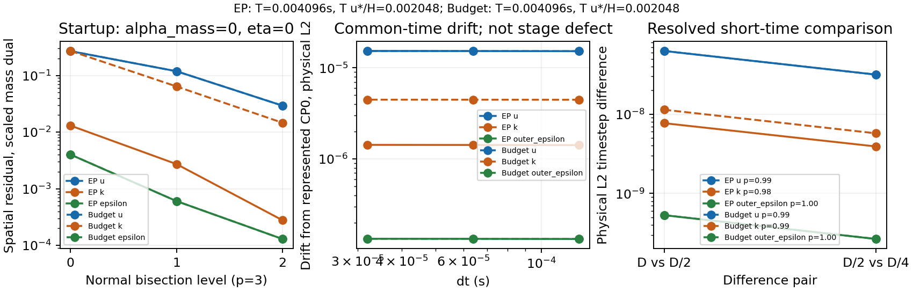
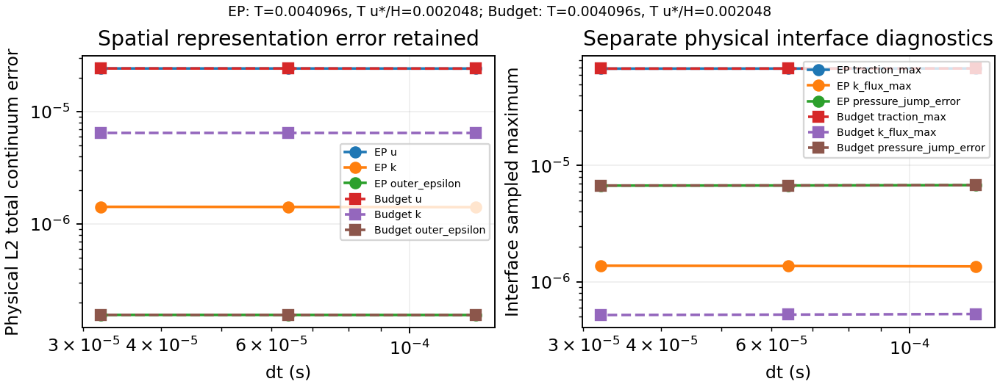
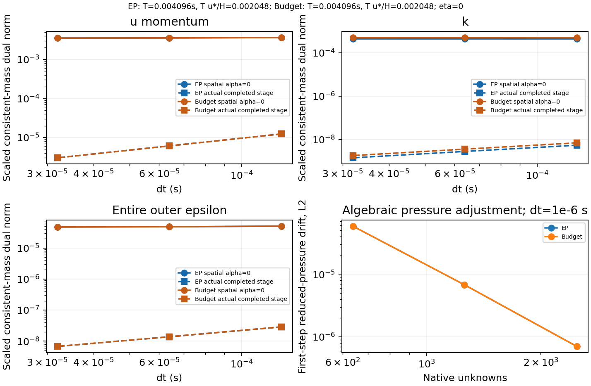

# WJ-3 native spatial, temporal and drift qualification

The implementation and measurement contract is [wj3-contract.md](wj3-contract.md).
Detailed numerical tables, runtime identities, immutable Linux paths and hashes
are indexed in [wj3-linux/receipt.json](wj3-linux/receipt.json) and
[wj3-linux/manifest.json](wj3-linux/manifest.json). Heavy fields/checkpoints/logs
remain under `/media/jay/新加卷/nektar-v2026-runs/wj3-20261110`.

## Source, configuration and arithmetic

The reviewed parent is `1d397855465be1daeefd160fc52c89c806ca0681`; its last
compiled WJ-2 source was `c8f3481b03a5e172f7875aedaa7d18faae3574d4`, tree
`e46ef5fcb086c18fc67e30ab917a02ac895fa5a0`. The existing Mac worktree/branch
was preserved. No unrelated merge/rebase/reset was performed. Every WJ-3
commit was pushed to `origin/codex/wj-earsm-awf` immediately after creation.

The final audited source/publication revision is
`ea51ceaf80696b698c356a7725151b7e7c62356f`, tree
`84f60ad6f6c747db25beb7cd2ba19054f4939b3d`, source-content manifest SHA-256
`98017f62b8969c577c8da7b57c5a4d5e3dec6fe0978501bf98eabbfadffb1029`.
C++ inputs are byte-identical to the last native production build at 7e4e10e;
later commits repaired measurement/publication Python only, as the equivalence
receipt records. Spatial/scout and main/resumed driver revisions are retained
per summary. The subsequent evidence commit adds these results and figures.

Executable SHA-256 identities:

```text
8dac6ba9d98639fca5de8952f8eb3a317d3dc5adabefc0fd0bd6108a3d5fee1e  IncNavierStokesSolver
39c5474e4fefdcf409e3338a90c0d4063fc55b965bb7a7c4be2a9d2608bdb2a3  RANSWallResolutionProbe
```

Actual SHA-256 values match the reviewed specifications:

- Main: `1959e96ea0b61f9deb9ff9ad1f5b26488a932a8451c2de6d3b6f7b7c9dbd9124`.
- Appendix: `0ab52e0d813b8fb344973f75ca6d8da97ff389ef9f93476500ca9d1df1fbc47c`.

Both complete specifications were read. Original Mac files were unchanged.
The main eq:integrals-linear literal `quad` remains the documented `\quad`
typographic erratum; its intended d+a*h logarithmic coefficient is retained.

No constitutive equation or native sweep was replaced. WJHighRe uses complete
3D covariance with the prescribed cubic N surrogate, DevStrainRawWorkV1,
Original stress, physical epsilon, Praw=-R:Graw, separate Cd*k²/epsilon scalar
diffusion, and the exact WJ-1 defaults. The inner stress is full-strain Linear;
wall molecular nu remains positive. EP has uniform chi=1, endpoint K and zm=.5;
budget has zK=zm=H=1, no physical chi, and nonconstant transported inner k.
IMEX1 executes flow/pressure, k, epsilon once; eta=0, no body/scalar force or
gravity, reuse/verification Off, no condensation/search/cap/stress clipping.
Native pressure remains pi=p/rho+2k/3 with one gauge and separate pressure
traces. No inner epsilon PDE or additional epsilon flux was introduced.

Linux used a new isolated source/build/run area, compatible installed
dependencies read-only, RANS_BUILD_SOLVER=ON, Release GNU C++17,
`-ffp-contract=off -fno-fast-math`. Effective target flags and resolved linked
library hashes are in the manifest. The initial build used one worker; after
capacity inspection subsequent builds used four. Each native trajectory used
one MPI rank and numerical threads=1. Two independent serial policy drivers
later ran concurrently; CTest stayed -j1. Snapshots accounted for 32 threads
before main allocation and36 before the resumed fine-mesh runs, with ten
additional threads reserved, below 72. Live CLS/A93/A95 work was preserved.

## Repairs and read-only evidence

WJ now rejects PimpleVerify=On before integration, avoiding its legacy extra
flow verification solves. k-only ScalarDomain packets emit a null dependent
trace minimum with explicit not_evaluated scope. Negative tests check precise
reasons for cutoff failure, invalid nu, unsupported controls, valid changed
nu/policy/mesh and changed-dt checkpoint signature rejection. Smooth budget
initialization retains its distinct reference_nonpositive witness.

WJFiniteAuditV2 gives separate condition flags/margins/categories and complete
in-plane/transverse principal witnesses. Native geometry/element/side, point,
state/history/context hashes, phase, raw G, k/epsilon/K, root, covariance spectrum,
nu_eff/nu_d, xi/a, action and contraction are retained. Limiting witnesses are
independently replayed by complex differentiation and local angular minimization.
Their finite spatial/x-z angular scope is explicit. The exact reference
nu_eff/250 certificate remains a reference-only result.

The strict checkpoint reader still requires entry alpha_mass=0 and exact saved
time. WJ accepted-stage packets now retain the actual implicit-callback history;
SHA-bound report lineage supplies completed-stage time/alpha/history for retained
checkpoints, including common half-time checkpoints. The reader never advances
a callback, calls Lift, projects/reset fields or changes checkpoint bytes.
Synthetic WJNativeChecks history=state, alpha=1e6 remains an assembly test only.

Passive arithmetic records copy already completed systems and never apply an
additional governing factor. SVD conditioning, long-double backward errors,
physical mass metrics, pressure correction maps, frozen history propagation
and alternative field evaluation sensitivity estimate comparison floors. Safety
factor 100 was declared before main runs. Spatial residuals and nonlinear stage
defects are excluded from that floor. It is a finite diagnostic estimate, not
a rigorous nonlinear perturbation bound.

Fixable development failures were retained: the initial observer timing selector
accidentally entered physical parameter identity, arithmetic k filenames collided
with existing k-bound snapshots, cross-dt GLM labels were incorrectly compared,
and JSON integer mesh controls needed conversion after lossless numeric reading.
The fixes changed diagnostic controls/file namespaces and harness handling;
no saved signature, physical equation or frozen target was edited. Fresh IMEX1
labels [0,dt] remain native; initial primary/gauge and both physical history
vectors are bit-identical across dt.

## Spatial startup and quadrature

All three independently projected tensor-cubic meshes have 639,1257,2493 unknowns.
The 3000-unknown safeguard remains. H, h, sampling and zm were fixed. The continuum
rough-reference conditions hold independently: zv=-.0053932758668542,
d=.00104489419829356>=2nu, Lambda=5.19932226714955>=1. Budget Q0 endpoints vanish
and k_ref(0)=1.88870840800865 is positive. The pressure offset is
-K/Ne=-.209060502501773. Both H sides and every element were checked.

Scaled consistent-mass dual spatial residuals at alpha_mass=eta=0:

| Policy | Unknowns | u | k | Entire outer epsilon |
|---|---:|---:|---:|---:|
| EP |639|.268457088879|.013013171987|.004010426499|
| EP |1257|.118646107517|.002727140552|.000605967544|
| EP |2493|.029341095700|.000279144339|.000130009462|
| Budget |639|.268457088879|.270481784118|.004010426499|
| Budget |1257|.118646107517|.063982673543|.000605967544|
| Budget |2493|.029341095700|.014629482891|.000130009462|

All meaningful blocks decrease. The two u slopes are about1.18 and2.02;
epsilon2.73 and2.22; EP k2.25 and3.29; budget k2.08 and2.13. No fourth-order
residual claim is inferred from p=3. Roundoff-level constant EP k representation
errors receive no order. Gauge/constraint/continuity scales are reported separately.

At the refined mesh, source quadrature16->32 changes the largest norm by
2.12e-12 (budget k); EP's largest change is2.87e-14. Independent observation
order6->10 changes L2 errors by at most6.39e-13. Both are negligible relative
to spatial differences and below the declared1e-10 absolute floor. Independent
source/diffusion quadrature splits element and physical breakpoints. Basis
points remain8x8; independent source/outer rules are32/24. Initial H derivatives
partly impose traction/flux agreement through RadialProject, and are labelled
as such rather than independent evolved equilibrium evidence.

The first-step reduced-pressure L2 adjustment at dt=1e-6 is approximately
5.862e-5,6.824e-6,7.043e-7 on the three meshes. Its mesh dependence is measured;
its entire size is not required to scale with dt.

## Frozen temporal design and measured drift

Both policies passed all five four-step scouts at dt=1e-6,4e-6,1.6e-5,6.4e-5,
1.28e-4. D=1.28e-4 and T=32D=.004096s were frozen before main runs;
T*u*/H=.002048. The 1257-unknown triplet uses32/64/128 steps at D,D/2,D/4.
Estimated remaining costs were47.0/58.8 minutes for EP/budget, within the declared
60-minute per-policy budget. Measured fine-mesh process costs allowed the
preferred 2493-unknown same-T run. Different-end-time scouts are not a stability
boundary proof. The optional micro-triplet was unnecessary for these resolved
main differences and was not used to claim an order.

Observed common-time L2 orders, all above their safety-multiplied arithmetic floors:

| Field | EP | Budget |
|---|---:|---:|
| Vector velocity |.9907|.9907|
| k |.9752|.9888|
| Outer epsilon |.9981|.9978|
| Reduced pressure |1.0947|1.0946|
| Mechanical pressure |1.0896|1.0855|

A/B, sampled Linf, floors and common half-time comparisons are in the tables.
Physical L2 integrates physical 2D area (field units times m); sampled Linf
retains field units. Residuals use the fixed scales in the contract.
The main finest-dt velocity A/B are6.2811e-8/3.1608e-8 for EP, comfortably
above a floor of order1e-11. Actual saved-history stage residuals and uncancelled
spatial residuals remain distinct. At T on 1257 unknowns, EP's u spatial/stage
norms are.00351962/3.01524e-6; k.000443266/1.42644e-9;
outer epsilon4.75901e-5/6.76140e-9. Small stage defects are not stationarity.

At the same mesh/time and finest dt, vector-velocity drift is1.53092e-5 for
both policies; total velocity continuum error is2.42416e-5, versus initial
representation error1.88240e-5. EP k drift is1.42631e-6. Budget k drift is
4.46967e-6 and total k error6.47432e-6, versus initial4.69892e-6. Pressure
adjustment and the nonconstant budget reference are retained. These are measured
nonzero errors; no reference resetting or anchoring suppresses them.

At that state, traction-jump maxima are6.82e-5, k-flux jumps1.38e-6/5.19e-7,
mechanical-jump error6.73e-6, shared-k defect0, and epsilon-trace defect<=1.67e-16.
K changes by order1e-8 and cutoff by order1e-11. Global sampled strong divergence
is4.82e-4s^-1; the outer WJ inventory's maximum raw divergence is1.14e-5.
Weak continuity/gauge constraints are at roundoff. Those scopes are separate.

## Gates, limitations and next bounded package

At the same T and dt=D/4,2493 unknowns reduce vector velocity drift to
1.33623e-6. EP/budget k drifts are9.60618e-8/3.57533e-7, and outer epsilon
about8.35e-9. Fine-mesh spatial u,k,epsilon norms are
9.32536e-5,1.45425e-5,7.17029e-7 for EP and
9.32536e-5,1.63144e-5,7.18495e-7 for budget. These are distinct from stage
defects. Traction-jump maxima fall to7.11e-6, mechanical-jump error to5.01e-7,
and k-flux jumps to1.02e-7/6.52e-8; shared-k defect is0 and epsilon-trace defect
<=2.22e-16. Common physical observations retain each mesh's initial errors.

Both policies passed exact32 versus16+16 primary/gauge/history/time comparison,
accepted audit/physical sample equality, later frozen readback and deliberate
end-of-step rollback. Saved checkpoint bytes were unchanged; failed candidates
were retained separately. Every fully executed baseline/rejected attempt had
one vector-U, pressure/gauge, k, epsilon solve and logical bound operation.
All qualified trajectories had zero bound activations and bit-identical raw/
corrected primary candidates: the correction reserve is exactly zero. A separate
zero-production, near-reference numerical-floor fixture activates projection
and proves the StopOnBound guard rejects before advancing history or starting
the next requested step. It is an expected numerical-policy intervention,
excluded from neutral baseline qualification.

Each final study used 408 scheduled attempts:20 scouts,3 spatial first steps,
224 main,128 cross-mesh,32 restart and1 deliberate rejection. Package-wide counts are 433 EP and 429 budget, including development and
registered-test attempts. They are bound in the receipt and remain below 500
per policy. No completed solve was replayed for
the mesh-control harness repair. Actual main command time was about 22.1 minutes
for EP and 35.5 minutes for budget, including resumed comparison work, below
the declared 60-minute budgets.

The finite outer audit at the main finest-dt state has covariance minimum
.238558, minimum N4.049638, scaled root residual below1.18e-19, F_N>30.6,
raw-work defect<=1.12e-16, in-plane principal minimum/nu_eff about.00409149,
and transverse minimum about.94355. nu_eff and nu_d are separately recorded.
Those sampled minima do not extend the reference certificate to all states.

All 29 distinct final selected CTests passed:24 kernel/legacy controls,
WJNativeEP, WJNativeBudget, the shared legacy transaction, and the two WJ-3
read-only-stage tests. Inventory has 53 registrations. There were no missing
required dependencies, zero-test selections or skipped required fixtures.
Precise commands/exits/times and log hashes are in the command receipts.

Both adverse constitutive witnesses remain reproduced: q=3.5 gives
N=4.130462147295279, principal/nu_eff=-.006333781035394115 with positive covariance
minimum.278778911953837 and P/epsilon=1.03576095435346. The commuting 3D state gives
N=3, R/k=diag(-2/15,-2/15,34/15), P/epsilon=48/5. Neither is clipped or hidden.
The smooth-budget witness still passes its cutoff gate but rejects initialization
with reference_nonpositive k_ref(0)=-.33012750295117. Cutoff/scalar/configuration
and valid signature mismatches retain separate intended reasons.

This is finite spatial consistency and resolved short-time native verification.
It is not exact finite-space equilibrium, long-time preservation, global scalar
positivity/realizability, coupled nonlinear stability, native3D/MPI or terrain
validation. Positive sampled principal minima and implicit viscosity are not
substitutes for those results.


## Reproduction and bounded follow-up

Activate the installed environment and the retained run-env.sh; use one
numerical thread per library. The executable paths, complete CTest regular
expressions and all modes/arguments are in command-receipts.json. The principal
commands were:

```sh
cmake -S "$root/source/solvers/IncNavierStokesSolver/Tests/RANS" -B "$root/build" \
  -DRANS_BUILD_SOLVER=ON -DCMAKE_BUILD_TYPE=Release \
  -DNektar++_DIR=/home/jay/.local/opt/nektar-v2026-mpi/lib64/nektar++/cmake \
  -DCMAKE_CXX_FLAGS="-ffp-contract=off -fno-fast-math"
cmake --build "$root/build" --parallel 4 --target IncNavierStokesSolver RANSWallResolutionProbe
ctest --test-dir "$root/build" --show-only=json-v1
ctest --test-dir "$root/build" -j 1 --output-on-failure -R '^WJReadOnlyStage(EP|Budget)$'
python3 -B "$scripts/run_wj3_native.py" --solver "$root/build/IncNavierStokesSolver" \
  --probe "$root/build/RANSWallResolutionProbe" --policy EP --mode spatial --output "$root/study-final"
# Repeat spatial for Budget, then scout for both. Only after frozen_design is
# written, run --mode main for each; completed command receipts are immutable.
python3 -B "$scripts/plot_wj3.py" "$root/study-final/EP/summary.json" \
  "$root/study-final/Budget/summary.json" --output "$root/figures"
```







The evidence supports a bounded longer **serial-flat rough neutral** pilot,
with dt<=3.2e-5, the2493-unknown mesh and the same separate hard audits. A bounded
WJ-4 should first add horizontal refinement, repeat common-time pressure/traction
and source-load comparisons, then extend duration by one declared factor while
retaining inactive projection and exact restart/rejection gates. Set explicit
drift/residual budgets before that run. It should stop at the first physical or
material-correction exit and retain its witness. Uniform time convergence over
further meshes, longer preservation, native3D/MPI and terrain remain separate
qualification work; none follows from this short pilot.
