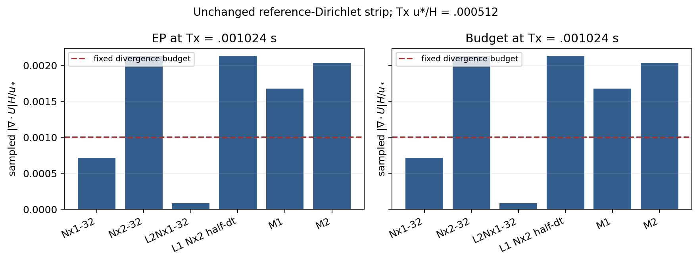
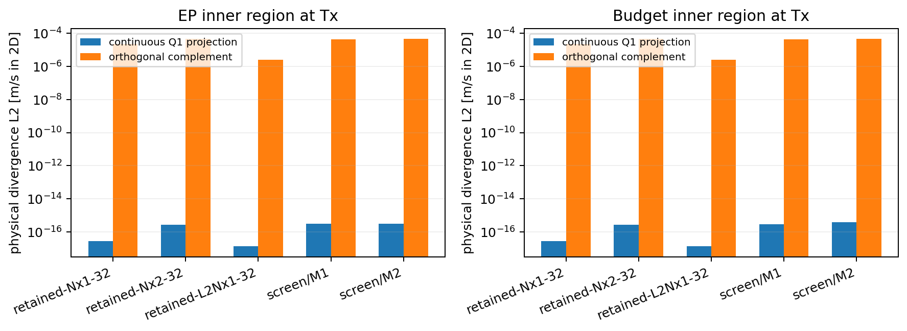

# WJ-5 native divergence diagnosis and bounded local normal refinement

The bounded remedy is **OBSTRUCTED for both wall policies**. Neither M1 nor
M2 satisfies the unchanged sampled strong-divergence budget at
Tx=.001024 s. No selected T3 trajectory or selected-mesh transaction was
launched. The frozen T3=.004096 s target remains unreached. Native hard
predicates pass and numerical k correction remains inactive on the executed
control and screen attempts. This is an accuracy obstruction, not a hard
constitutive rejection or a projection intervention.

The experiment is `/media/jay/新加卷/nektar-v2026-runs/wj5-20261111`.
The [contract](wj5-contract.md) fixes the selected equations, boundary problem,
meshes, budgets, source semantics and stopping rules. WJ-4 remains immutable;
its original horizontal OBSTRUCTED and boundary-uncertainty UNRESOLVED results
are not overwritten. Its stationarity conclusion remains NOT_REACHED.

## Sources, specifications and native build

Work started at reviewed `6eb53fbde2437ee22e9597f4ef64ee8f6683a834` in the
existing Mac worktree/branch. Other worktrees, dirty main checkouts, installed
libraries and live CLS/A93 jobs were preserved. Every WJ-5 commit was pushed.
The USB SSH route timed out; authoritative Linux work used the documented
`ssh jay@100.105.247.110` fallback.

Original and worktree specification copies have the exact SHA-256 identities:

```
1959e96ea0b61f9deb9ff9ad1f5b26488a932a8451c2de6d3b6f7b7c9dbd9124  main
0ab52e0d813b8fb344973f75ca6d8da97ff389ef9f93476500ca9d1df1fbc47c  appendix
```

Main eq:integrals-linear retains the literal `quad` typography erratum for
`\quad`; the logarithmic coefficient is `(d+a*h)/a^2`. No specification or
model algebra was changed.

The successful native build source is
`da9518ac40d8e65349790adb1c53dbe0380fa5ad`. The frozen regression source is
`8769ae178583bd376d3276e0652749d47d9a933e`; all native C++/header/CMake inputs
are identical. The producing study engine is frozen separately at
`aa799f54a9465c041843947fbd756fd08659b940`. Higher-order observations use a
separate orchestrator at `480bdccff058ec252e83dc4a374d278465f6e3c4`.
Publication uses separately versioned Python sources and output directories;
its manifest binds the exact revision/tree and native-input equivalence.
WJ-4 producer/observer identities remain distinct from this rebuilt runtime.
The publication source is `711e9a5718df0f48de401519fd0c339e2b043422`,
tree `d1b37577f739196de2f3fa9d4b744f01fc1e4c60`. The tested regression tree is
`5087a71b96dae6d846d7e0db8003408387e4f2cc`. Final passive control/figure
processing uses committed `dec8d23`; the successful final seal/export uses
`5534d2bee394bf04dad38280571c30c6aaec1857`. Later documentation does not change
the native inputs. All 1800 C++/header/CMake inputs agree with the built source,
with canonical content digest
`d2dc3475b5261254118716e3bd5e4274437872e90d84721943de1c8a9ba81513`.

Linux compilation used the external RANS project, RANS_BUILD_SOLVER=ON,
Release GNU C++17, `-ffp-contract=off -fno-fast-math`, and compatible installed
dependencies read-only. The build began with one worker and resumed with four
only after a current capacity check. All affected native consumers were built.
The first four-worker build caught `-Werror=misleading-indentation` in the new
diagnostic JSON writer; the corrected build completed with exit0 in167.150 s.
Earlier interrupted/failed build receipts are retained, not rewritten.
The compiler is Ubuntu GNU 11.4.0; effective flags include `-O3 -DNDEBUG
-std=gnu++17 -ffp-contract=off -fno-fast-math`. MPI-capable libraries are linked,
but every WJ case is serial. The solver SHA-256 is
`753ac06d42be9dd5716417fa4a444487eb22366c80597073377c11191e6c338f`;
the native observer is
`e5762aa3a1e1e5c685f630fc630769412b3d65aab2313a48ff3ba76853c47ab2`.
The manifest and regression seal bind all 13 distinct tested executable or
interpreter closures and their resolved libraries, plus Python 3.10.12,
NumPy 1.21.5, SciPy 1.8.0, SymPy 1.9 and the dependency environment hash.

## Fixed equations, spaces and boundary conditions

The model remains full 3D WJ with the prescribed cubic-N surrogate, Original
stress, DevStrainRawWorkV1, physical epsilon, Praw=-R:Graw and independent
nu_d=Cd*k^2/epsilon. Constants remain c1=1.8,c2=5/9,Ce1=1.44,Ce2=1.82,
sigma_k=1,sigma_epsilon=1.3,Cd=572/6561,qe=81/(2 sqrt(143)),
kappa=.381917863546733. Molecular diffusion is omitted only in the outer
high-Re model. Positive wall nu remains in stress, diffusion and budgets.

Inner stress is full-strain Linear, with uncapped EP source P_A-p_A,0
(chi=1, endpoint K, zm=H/2), or budget source P_A-E_c (endpoint K,zK=zm=H,
no physical chi). The budget reference/evolved inner k is nonconstant.
Canonical nu=1.5e-5,u*=.5,H=1,top=2,h=.1,K0=.8466950351321795.

The finite strip is **[0,1]x[0,2]**. Both laterals and top prescribe reference
differential-field traces; ground has no slip and zero modeled k flux.
Q3 velocity/scalars, regional continuous Q1 pressure, one gauge,
pi=p/rho+2k/3, shared U/k, distinct pressure/gradient traces and one dependent
outer epsilon value trace are unchanged. No inner epsilon PDE or extra flux
is introduced. IMEX1/PimpleSingleSweep, one U/pressure/k/epsilon solve and one
logical bound operation, eta=0, zero prescribed forces/gravity, reuse/verify
Off, WJNativeV1 MassProjection and StopOnBound=On remain selected.

No pressure-space change, grad-div term, stress/source cap or regularization,
roughness smoothing, reference reset, extra iteration or projection correction,
boundary change, scalable backend, native3D/MPI or terrain route was added.
The3000-unknown evolution guard is retained.

## Native runs and obstruction witnesses

Production changes are passive: RANSWallEvolutionPatch.h defines explicit
normal/x observation ownership and diagnostic exports;
RANSWallEvolutionDiagnostics.cpp evaluates those rows, actual pressure-test
moments, forcing and signed loads; RANSWallResolutionProbe.cpp transports the
extended observation contract. No governing residual or time-sweep equation
changes. The case generator adds validated zknots, the measurement/qualification
helpers propagate actual mesh unions and constraint-aware uncertainty, and the
new run/repair/publication drivers retain separate immutable code/output
lineages. Three focused tests are registered in the external RANS CMake project.

All L1 knots were retained. M1 adds .085,.095,.125,.175. M2 additionally adds
.0825,.0875,.0925,.0975,.1125,.1375,.1625,.1875. Actual x/z vectors, XML bytes,
semantic settings, dt, role, checkpoint and target are in immutable intents.
A changed knot vector or comparison role cannot reuse a cached execution.

| Mesh | Nx1 unknowns | Nx2 unknowns | WJ-5 evolution |
|---|---:|---:|---|
| L1 | 1257 | 2183 | one fresh half-dt adverse control per policy |
| M1 | 1409 | 2447 | 32-step screen per policy |
| M2 | 1713 | 2975 | one authorized32-step escalation per policy |
| uniform L2 | 2493 | 4331 | retained Nx1 passive context only; Nx2 not evolved |

The original and half-timestep L1/Nx2 states have common target
Tx=.001024 s (Tx*u*/H=.000512). Each half-dt control owns a fresh compatible
CP0, dt=1.6e-5 and exactly64 scheduled steps. The retained original uses
dt=3.2e-5 and32 steps. The adverse block was explicitly diagnostic, with
hard/material-correction checks at each attempt; no further adverse continuation
was performed. M1/M2 use fresh mesh-specific CP0, dt=3.2e-5 and32 steps.

| State at Tx | EP normalized max divergence | Budget normalized max divergence | Limit |
|---|---:|---:|---:|
| retained L1/Nx2 | .002128831240 | .002128831764 | .001 |
| L1/Nx2 half dt | .002133663883 | .002133664417 | .001 |
| M1/Nx2 | .001675179608 | .001675179567 | .001 |
| M2/Nx2 | .002032907320 | .002032907281 | .001 |

Halving dt changes the retained maximum by only about0.23%; it does not remove
the obstruction. EP's normalized full-domain velocity L2 difference is
4.30780e-8. This two-dt diagnostic is not a timestep stability boundary or an
order measurement.

M1 moves the maximum from x=1,z=h+ to **x=1,z=.2-**, rather than eliminating
it. M2 increases that maximum again. For EP M1, Gxx=.0008375898038122644 s^-1
and Gzz=-5.80e-21 s^-1; independent element-owned native evaluation gives
Gxx=.0008375898038927683 s^-1. All normal/x faces and intersection owners remain
in the observation inventory. Higher observation order does not remove these
zero-weight maximum samples.
M1's central-strip maxima are .000830854667 EP and .000830854561 budget.
M2's are .001007623899 and .001007623868, so the latter also exceeds the
unchanged divergence budget away from the constrained lateral values.

Every field error/drift gate passes in full, central and constrained-boundary
scopes. For example, EP M1 normalized velocity E2/D2 are
2.60520e-5/1.19908e-5; budget M1 k E2/D2 are 4.66021e-6/3.07874e-6.
The complete field tables preserve physical L2, sampled maxima and each scope's
own measure, including the entire outer epsilon domain. Interface maxima over
both screens are:

| Policy | Traction jump / u*² | k-flux jump / (K0 u*) | Reference pressure-offset departure / u*² |
|---|---:|---:|---:|
| EP | 2.09836e-4 | 3.55200e-7 | 3.43320e-5 |
| Budget | 2.09856e-4 | 3.30606e-6 | 3.43463e-5 |
| Fixed limit | 1e-3 | 1e-4 | 1e-4 |

k value-trace mismatch is zero; outer epsilon target mismatch is at most
1.66534e-16. Sampled K/cutoff ranges and full traction are retained. The
pressure-offset error is a reference diagnostic, not a replacement coupling law.

A passive uniform L2/Nx1 readback at the same Tx gives normalized divergence
8.037404e-5 EP and8.037407e-5 budget, versus about7.14437e-4 on L1/Nx1.
This supports sensitivity to broader normal resolution. The comparison with
Nx2 local meshes jointly changes x/z resolution and does not close a pure
horizontal gate. The corresponding uniform L2/Nx2 needs4331 unknowns and was
not evolved.

## Weak/strong continuity and evolved loads

The native diagnostic exports actual B*U, lambda*m_p, continuity rows, pressure
mass/mean rows and integrated outward flux. Offline L2 projection uses the
actual regional continuous Q1 pressure test space and never corrects U.
For retained EP L1/Nx2 at Tx, inner divergence L2 is4.7593845e-5, its global
Q1 projection is2.65723e-16, and its complement retains essentially the whole
L2 norm. Actual inner continuity rows have maximum1.20433e-17; their native
mass-dual norms remain near roundoff. Both regions and all elementwise tensor
Legendre coefficients are retained.

Q3 divergence has modes outside continuous Q1 tests. The complement also can
contain piecewise low-degree contributions cancelling against global tests;
it is not just a collection of elementwise high degrees. At fixed lateral
w=0, wz=0 is imposed along that trace, while ux is a free normal derivative.
These facts explain weak/strong coexistence without establishing an unstable
pressure pair or a unique cause.

Retained actual arithmetic packets replay incoming velocity, predictor increment,
pressure correction and accepted velocity without a governing solve. At the
retained EP Nx2 terminal stage, their divergence L2 magnitudes are respectively
4.69752e-5,8.39057e-7,4.68260e-9 and4.76651e-5 on the independent integration
rule. These separately normed components are not linearly additive.

Exact-reference F_x is zero and viscosity is smooth near h. Evolved EP Nx2
F_x at H ranges approximately[-3.15511e-4,3.32956e-4] m/s². Its mechanical
pressure-gradient and conservative-convection components are exported separately.
The source still acts only at z<=h. Signed near-h storage/advection/viscous/
pressure/roughness loads use a continuous test supported on [.08,.2]. Independent
split assembly reproduces retained EP Nx2 loads to3.87e-15 absolute. Full
source/diffusion and shared-interface weak-load checks use actual represented
fields and actual accepted callback history, not reference substitutions.

The evidence supports an unresolved spatial consistency/approximation-space
issue extending beyond the originally dominant h face. Temporal sensitivity is
small at Tx; local refinement alone is not monotonically sufficient. Refinement
changes velocity, pressure tests and trace projection together, so it does not
isolate one of them as the sole cause. No nonzero reference forcing or viscosity
jump is asserted.

## Constraint-aware uncertainty and quadrature repair

The original WJ-4 boundary L2 velocity comparison remains UNRESOLVED under its
old global estimate (about1.59e-5 against1e-5). The new estimator uses actual
observation rows and q=q_D+P*q_F, including the endpoint-K dependent epsilon
trace. k and epsilon estimates propagate through their own rows. Prescribed
inputs, lift/basis/geometry evaluation and accumulation uncertainty retain the
100x reserve and the two-trajectory factor. Pressure is unconstrained: its own
row is composed with the one full-domain gauge row, with no regional regauging
or velocity-boundary exemption. Every required startup/cadence row is used.
The measured divergence gate remains unchanged.
For the retained horizontal comparison at Tx, the old normalized boundary
velocity L2 uncertainty is 1.58997e-5 EP / 1.58994e-5 budget. The constraint-aware
values are 6.89168e-10 / 6.88469e-10, below the same 1e-5 sensitivity limit;
the measured differences remain about 2.54e-23. The resulting comparison is
PASS under the new estimator; the original estimator/publication is retained.

Both half-dt controls have exactly equal initial primary coefficients/gauge
and corresponding physical history values to their retained coarse-dt CP0;
the native dt histories, signatures and time labels remain distinct. All 42
field/scope/norm sensitivity leaves per policy pass. The worst fraction of the
10%-budget allowance is .240240 EP / .240235 budget, for full-domain sampled
velocity, including the declared uncertainty. These are adverse diagnostic
comparisons, not selected-mesh qualification or a temporal order measurement.

The first order6/8 observation check found a1.57804e-9 difference in the
constrained-boundary velocity reference-error L2 norm, above the declared1e-10
absolute floor. Polynomial drift integration differed only at about2.5e-17.
That failed measurement was retained. A separately bound observation lineage
uses order8 versus10, with independent horizontal order4 versus6. All four
screen comparisons have maximum norm changes at most1.60e-13, passing the same
1e-10 floor. No governing attempt was repeated for this repair.

Metadata fixes preserve integer types in canonical intent fingerprints and
validate exactly integral serialized quadrature orders. The physical-state
reader still preserves signed binary64 zero. A synthetic fixture missing its
geometry field was corrected. Failed receipts and the corresponding code bytes
remain indexed. These implementation fixes changed no model, state or budget.
The passive control exporter initially treated a checkpoint directory as a
file; it now verifies State.bin. The first strict final inventory check also
identified the publisher's closing wrapper log. Its completed receipt is now
validated and copied separately. Both failures remain in the command receipts.
Neither required another governing attempt or a numerical-state change.

## Tests, allocation and reproducible commands

The native build registers59 tests. All32 required WJ-4 selections passed:
24 kernel/standard/CLS/AWF controls,3 native/legacy transaction tests,
2 read-only-stage tests,1 qualification metadata test and2 composite-observation
tests. The3 new focused selections also pass. They cover all four native custom
mesh sizes, actual intersection owners, native pressure-test moments, constrained
free-DOF and prescribed-data actions, nonzero free rows, unconstrained pressure,
dependent epsilon maps and stale knot/role rejection. Supplemental metadata
fixtures cover mixed k/epsilon uncertainty, complete row coverage, stale hashes,
integer fingerprints and serialized quadrature degrees.

| Selection | Actual selected | Exit | CTest command seconds |
|---|---:|---:|---:|
| wj5-regression-controls | 24 | 0 | 106.41855 |
| wj5-capacity-retry-native | 3 | 0 | 474.43555 |
| wj5-capacity-retry-readonly | 2 | 0 | 91.90064 |
| wj5-capacity-retry-metadata | 1 | 0 | 1.87337 |
| wj5-capacity-retry-composite | 2 | 0 | 116.98884 |
| wj5-focused-final | 3 | 0 | 133.94154 |

This is 35 unique passing tests out of 59 registrations, including every
required WJ-4 selection and the legacy transaction. Supplemental final metadata
selection passes all 11 focused fixtures in 1.68551 s. Inventories, exact CTest
regexes, fixture relationships, logs and log hashes are retained; zero selected
tests is rejected.

Both adverse WJ-1 witnesses remain reproduced by the compiled independent
oracle: q=3.5 has N=4.130462147295278 and principal form/nu_eff
-.00633378103539413 with positive covariance; the commuting3D case has N=3,
R/k=diag(-2/15,-2/15,34/15),P/epsilon=48/5. The smooth-budget
reference_nonpositive and reason-specific cutoff/scalar/configuration/signature
failures remain in the native selections. No clipping conceals them.

Numerical-library threads are explicitly1, serial ranks1, CTest -j1.
Capacity was checked currently, including other campaigns and MPI helper threads.
A66-existing+10-reserved allocation was denied before launching the next test
group; a55+20 allocation was also denied. Retained failures were retried under
new labels only when capacity permitted. Screens then ran serially by policy;
allowed allocations reached67 including reservations, below72. Denied totals
are hypothetical reservations, not employed workers. Other campaigns were not
stopped or altered.

The exact expanded argv, exits, elapsed times and log hashes are in the receipt
bridge. Principal commands use these paths:

```bash
r='/media/jay/新加卷/nektar-v2026-runs/wj5-20261111'
source /home/jay/.local/opt/nektar-v2026-mpi/env.sh
export OMP_NUM_THREADS=1 OPENBLAS_NUM_THREADS=1 MKL_NUM_THREADS=1
export BLIS_NUM_THREADS=1 NUMEXPR_NUM_THREADS=1 VECLIB_MAXIMUM_THREADS=1
export WJ_PACKAGE_ATTEMPT_CAP=800 WJ4_PACKAGE_ROOT="$r" TMPDIR="$r/tmp"
export LD_LIBRARY_PATH="$r/build/geometry-lib:${LD_LIBRARY_PATH:-}"
cmake -S "$r/source/solvers/IncNavierStokesSolver/Tests/RANS" -B "$r/build" \
  -DRANS_BUILD_SOLVER=ON -DCMAKE_BUILD_TYPE=Release \
  -DNektar++_DIR=/home/jay/.local/opt/nektar-v2026-mpi/lib64/nektar++/cmake \
  '-DCMAKE_CXX_FLAGS=-ffp-contract=off -fno-fast-math'
cmake --build "$r/build" --parallel 4
# Each wrapper inventories its exact selection before ctest -j1.
python3 -B "$r/source/solvers/IncNavierStokesSolver/Tests/RANS/wj4_validate.py" \
  --root "$r" --suite native --label wj5-capacity-retry
# Other completed suites: controls/label=wj5-regression, then
# readonly, metadata, composite/label=wj5-capacity-retry.
ctest --test-dir "$r/build" -j 1 --output-on-failure \
  -R '^WJLocalNormal(Metadata|ObservationEP|ObservationBudget)$'
# Policy EP is replaced with Budget for the other serial policy.
s="$r/qualification-source/solvers/IncNavierStokesSolver/Tests/RANS"
python3 -B "$s/run_wj5_native.py" --solver "$r/build/IncNavierStokesSolver" \
  --probe "$r/build/RANSWallResolutionProbe" --output "$r/study-v2" \
  --retained /media/jay/新加卷/nektar-v2026-runs/wj4-20261110 --policy EP --mode control
s="$r/measurement-source/solvers/IncNavierStokesSolver/Tests/RANS"
python3 -B "$s/repair_wj5_measurements.py" --frozen-source "$r/qualification-source" \
  --solver "$r/build/IncNavierStokesSolver" --probe "$r/build/RANSWallResolutionProbe" \
  --output "$r/study-v2" --retained /media/jay/新加卷/nektar-v2026-runs/wj4-20261110 \
  --policy EP --mode screen --mesh M2
```

Heavy checkpoints, matrices, fields and logs remain outside Git. The compact
manifest binds source/tree/spec hashes, exact knots, XML/CP0/report/stage/history
lineage, runtime and resolved-library identities, compiler flags, observation
identities, signed loads, all field/scope gates, solve counts and correction
budgets. Publication and final accounting use separate immutable seals to avoid
a receipt/hash cycle. Original WJ-4 retained artifacts are checked against their
sealed index, including options/fields, not just reports/checkpoints.

## Closed work accounting and immutable delivery

| Policy | New study attempts | All scheduled/conservative units | Numerical-study seconds | Limits |
|---|---:|---:|---:|---|
| EP | 128 | 156 | 2658.24677 | 800 units / 10800 s |
| Budget | 128 | 156 | 3158.09372 | 800 units / 10800 s |

The 128 study attempts are 64 adverse-control + 32 M1 + 32 M2. The other 28
units comprise 14 ordinary-control step/invocation units and 14 native/shared
regression units; ordinary controls are not described as WJ one-sweep attempts.
All reservations/sessions are reconciled. Full outer process time includes
observations, SVD/projection algebra and report/checkpoint I/O, with shared work
conservatively charged to each policy and a further 120-second passive/I/O
reserve. Native build commands are recorded separately: 900.12655 s including
the interrupted and failed builds. Timings are receipts under a shared server
load, not isolated performance comparisons.

Every executed study attempt retains one momentum predictor, pressure/gauge,
k and epsilon solve and one bound call: 128 each per policy. There are no
additional governing/restoration solves, partial study attempts, bound
activations, mass corrections or added k storage residuals. Raw/corrected k
hashes agree. The minimum declared arithmetic correction reserve is
7.70065e-13. See [run accounting](wj5-linux/run-accounting.csv).

The final seal exits zero in 15.37280 s. It verifies 838 original WJ-4 retained
artifacts plus the original closed accounting and inner receipt, and 3221
immutable WJ-5 artifacts from a 3226-entry, 4.51674 GB heavy index. The five
remaining inventory paths are explicitly mutable progress files (two ledgers,
command receipts and two closing publisher logs). Their final write-once
snapshots are bridged separately; no numerical case is exempted from checking.

| Component | Both policies |
|---|---|
| Retained diagnosis, independent loads and native hard audits | PASS |
| Adverse dt control execution / accuracy | PASS / OBSTRUCTED |
| Adverse dt sensitivity, 42 leaves each | PASS |
| Constraint-aware boundary comparison | PASS; original UNRESOLVED retained |
| M1/M2 local accuracy screen | OBSTRUCTED by divergence only |
| Common selected normal vector | None |
| Selected T3 horizontal comparison | OBSTRUCTED; not launched |
| Selected half-dt T3 comparison and transactions | NOT_RUN |
| Remaining full-campaign resource design | NOT_RUN; no common qualifying mesh |
| Actual work caps / numerical correction | PASS / inactive |

The exact receipt SHA-256 is
`325a26a37688abfbc62eb9319b0f63844306e01e92f7668c278be8c6961903d9`;
the final publication seal is
`91ba532eef9096fe0ec0240391634c466025b454b5f7cc049100dd0e7652a7cb`.
The outer seal-command bridge is
`832f990f8f8ec80a4b478a1e0ac560e4e1d8534a8287db2e77cd72f53552d772`.
The original compact receipt, final publication, outer command receipts and
export transport occupy separate hash layers, without a self-hash cycle.

The 67 transported files use about 5.95 MB. Large JSON/CSV observations are
gzip-compressed with mtime0; receipts and all other files retain exact original
bytes. Every compressed and decompressed hash was verified on the Mac after
transfer. [transport.json](wj5-linux/transport.json) maps every delivered file
to its immutable Linux path/hash and decoded identity. Empty coordination locks
are omitted. Decode *.gz into a fresh scratch directory for the plotting or
measurement readers; never overwrite the original receipts.

Useful entry points are the [bounded summary](wj5-linux/bounded-summary.json),
[manifest](wj5-linux/manifest.json), [publication](wj5-linux/publication.json),
[regression verification](wj5-linux/regression-verification.json),
[field table](wj5-linux/fields.csv),
[spatial/actual-stage residuals](wj5-linux/residuals.csv),
[pressure projection](wj5-linux/pressure-projection.csv),
[signed near-h loads](wj5-linux/near-h-loads.csv),
[independent loads](wj5-linux/independent-loads.csv),
[interface table](wj5-linux/interfaces.csv),
[all adverse-control sensitivity margins](wj5-linux/control-sensitivity.csv),
and [old/new horizontal-estimator margins](wj5-linux/diagnostic-sensitivity.csv).
Complete state/stage/history hashes, audit witnesses and both-side ownership
remain in the compressed policy/diagnosis packets and their heavy indexes.

Scientific PNG/PDF/SVG figures are supplied with their input/code lineage:





Further figures cover both normal-face traces, elementwise mode energy,
evolved pressure/convection forcing, signed roughness loads and error/drift.
All seven plots were visually inspected; colorbar and legend placement were
repaired under a new immutable figure version. None substitutes stage defects
for uncancelled spatial residuals or displays an unexecuted T3 trajectory.

## Bounded conclusion and next step

No supported predeclared local mesh qualifies at Tx. Consequently the selected
Nx1/Nx2 T3 comparison, half-dt T3 companion and late selected-mesh transactions
are NOT_RUN by the stopping contract. Existing WJ/legacy transaction regressions
pass; they do not substitute for those unexecuted selected-mesh tests.

The next supported step is a separately scoped broader normal-resolution and
constraint-mode study under the same boundary problem, or a scalable frozen
system backend permitting the matched uniform L2/Nx2 comparison above3000
unknowns. The present data do not support further duration as the next gate.
Separately qualified homogeneous boundaries remain a different problem.
This package does not establish exact finite-space equilibrium, global
positivity/realizability/stability, long-time preservation, native3D/MPI or
terrain qualification.
